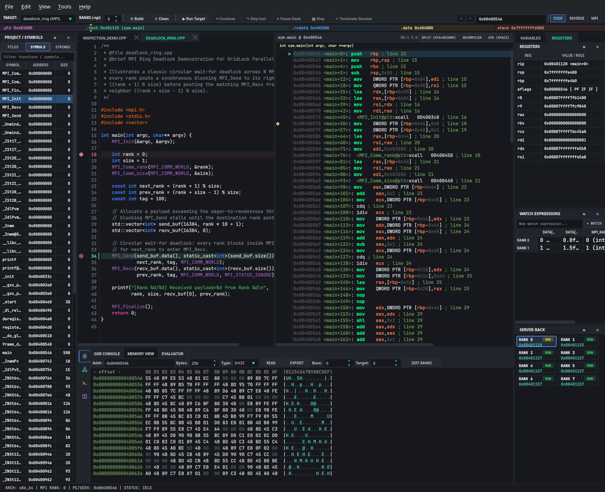
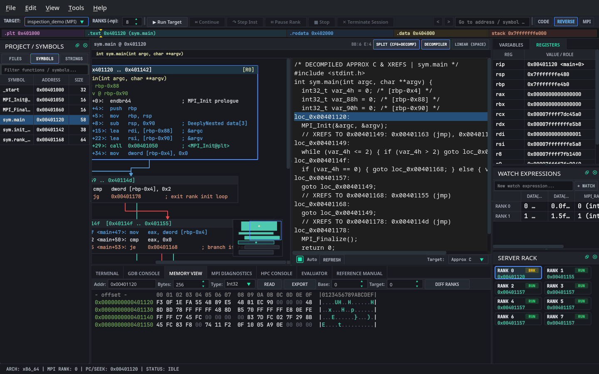
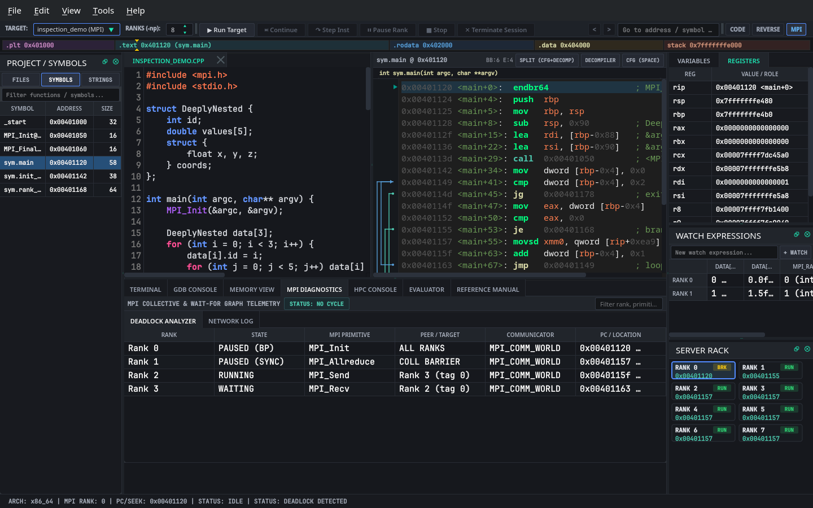
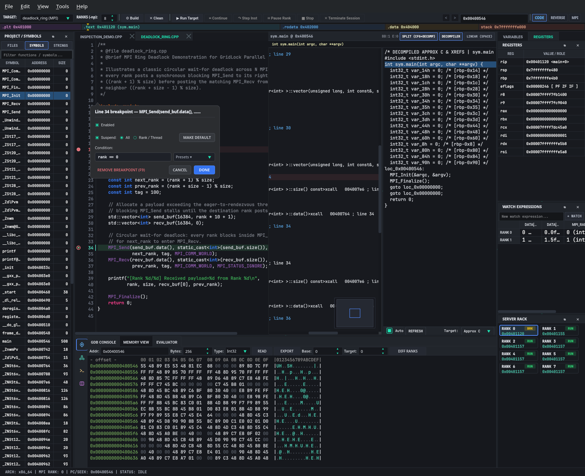
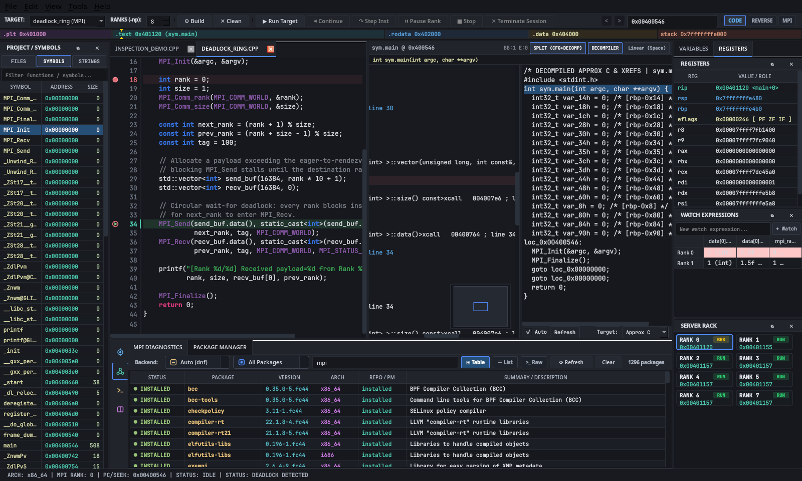
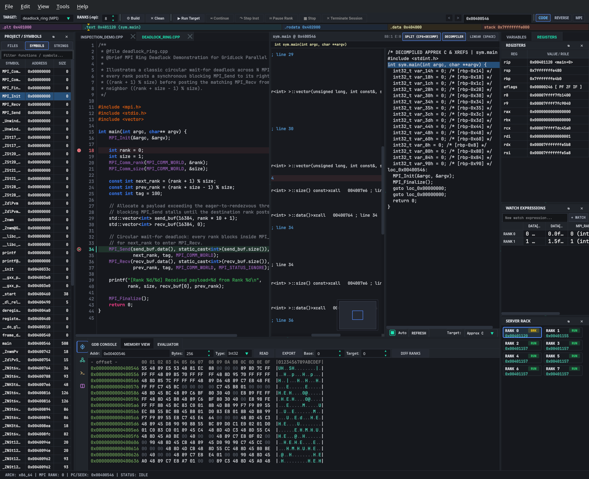
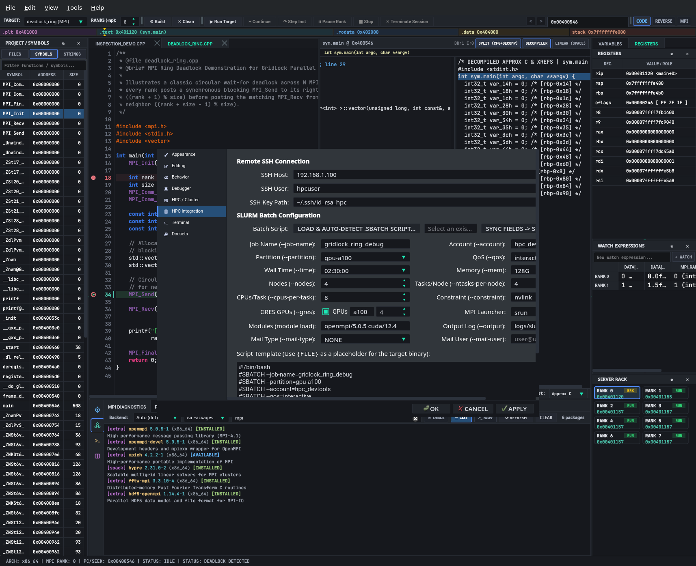

# GridLock v0.7.0 — High-Performance MPI Graphical Debugger & Binary Analysis Workstation


**GridLock (`v0.7.0`)** is a Wayland-native, Qt6/C++23 graphical MPI debugger and binary analysis workstation engineered for parallel high-performance computing (HPC) and systems reverse engineering. It unifies multi-rank MPI execution control, cross-rank variable and memory diffing, native ELF64 binary inspection, orthogonal Control Flow Graph (CFG) visualization, and multi-target decompilation inside a zero-gutter `#16181d` dark-slate workstation layout.

---

## Workstation Overview & Perspectives

### 1. Code + Disassembly Perspective (`Alt+1` / `CODE`)
Synchronized C/C++ source stepping (`SourceCodeView`), linear assembly with branch-flow arcs (`DisassemblyView`), live x86_64 register telemetry (`RegisterView`), cross-rank watch comparison (`DifferentialGrid`), 8-rank cluster status (`ServerRackView`), and zero-copy hexadecimal memory inspection (`MemView`).



### 2. Reverse Engineering Perspective (`Alt+2` / `REVERSE`)
One-click full-stage expansion combining the orthogonal basic-block Control Flow Graph (with per-block MPI rank occupancy badges `[R0]`, `[R1]`, `[R2-R7]` and interactive minimap overlay) alongside the synchronized multi-target (`Approx C`, `C++`, `Pseudocode`) decompiler and cross-reference (`XREF`) comments.



### 3. MPI Cluster & Deadlock Diagnostics Perspective (`Alt+3` / `MPI`)
Dedicated multi-rank wait-for cycle analysis (`DeadlockAnalyzer`), structured 6-column collective/point-to-point network telemetry (`MpiDiagnosticsWidget` / `MpiNetworkLogWidget`), and integrated offline Zeal `.docset` SQLite/HTML & system `man` documentation (`ReferenceManualWidget`).



---

## Core Workstation Capabilities

### Parallel MPI Rank Debugging
* **Inline Target & MPI Rank (`-np`) Toolbar Configuration:** Select MPI demonstration targets or load arbitrary ELF64 binaries directly from `#toolbarTargetSelector`, adjust cluster rank counts (`1..64`) via `#toolbarRankSpin`, and drive state-aware execution (`Run Target`, `Continue`, `Step Inst`, `Pause Rank`, `Stop`, `Terminate Session`).
* **Synchronized Multi-View Step Execution:** Stepping instructions (`Step Inst`) advances the program counter across `DisassemblyView` (Linear, CFG Graph, and Decompiler), `SourceCodeView` (emerald `▶` gutter indicator and full-width active line highlight), `RegisterView` (`rip`, `rsp`, `rbp`, `rax`, `eflags`), `ServerRackView`, and `MemView`.
* **Cross-Rank Watch Matrix (`DifferentialGrid`):** Compare arbitrary C/C++ expressions (e.g., `data[0].id`, `data[0].coords.x`, `mpi_rank`) across all active MPI ranks simultaneously, with one-click promotion from the `Variables` dock or `Evaluator` console.
* **Circular Wait-For Deadlock Detection (`DeadlockAnalyzer`):** Detects directed wait-for cycles across blocked MPI ranks (`MPI_Send` / `MPI_Recv` / `MPI_Barrier`), badging affected nodes in both `ServerRackView` and the 2D Control Flow Graph with crimson `DEADLOCK CYCLE` alerts.
* **Zero-Copy Cross-Rank Memory Differ (`MemoryDiffer`):** Extracts raw process memory via `process_vm_readv` and highlights byte-level discrepancies between any two MPI ranks in `MemView`.

### Binary Analysis & Reverse Engineering
* **Native ELF64 Binary Inspector (`ElfBinaryInspector`):** Parses 64-bit ELF headers, section tables (`.plt`, `.text`, `.rodata`, `.data`), `.symtab`/`.dynsym` symbol tables, and printable ASCII strings without external dependencies, mapped onto the interactive address-space navigation ribbon.
* **Orthogonal Control Flow Graph & Rank Divergence Badges:** Partitions assembly listings into basic blocks connected by Manhattan-routed true (green), false (red), and unconditional (blue) edges, annotated with live MPI rank occupancy badges and a draggable corner minimap.
* **Multi-Target Decompiler & Bidirectional Sync:** Reconstructs structured `Approx C`, `C++`, or `Pseudocode` with `XREFS TO` comments and function signatures. Clicking any C/C++ line in `SourceCodeView` or `Decompiler` automatically seeks `DisassemblyView`, `CFG`, and `MemView` to the corresponding virtual instruction address (and vice versa).
* **Interactive Xref & Call-Graph Navigator (`XrefInspectorDialog`):** Press `X` on any instruction to inspect incoming callers/branches (`XREFS TO`) and outgoing calls/jumps (`XREFS FROM`) with live preview and double-click navigation.
* **Live Instruction & Hex Byte Patching with ELF Export:** Assemble live instruction patches (`Ctrl+Shift+P` / `nop`, `ret`, `xor eax, eax`, `jmp`, `je`, `jne`) or edit raw hex bytes (`Ctrl+E` in `MemView`), and persist the modified image to disk as an executable ELF64 binary (`ElfBinaryInspector::savePatchedBinary`).

### Integrated Developer Environment & Cluster Tooling
* **Two-Lane Vector Gutter & Cursor-Anchored Breakpoint Popover (`SourceCodeView` + `ConditionalBreakpointDialog`):** Right-clicking any gutter line opens a frameless cursor-anchored popover displaying line context, rank suspension scope (`All MPI Ranks` vs. `Focused Rank Only`), and live `clangd` LSP virtual-buffer C++ expression completion (`ClangdLspClient`).
* **Left Vertical Tool-Window Icon Rail (`#bottomToolWindowRail`):** Organizes the bottom dock into four linked tool groups (`Debug`, `MPI`, `Terminal`, `Docs`), pairing a `36px` vertical icon rail with contextual sub-tabs and a flattened single-row `MPI Diagnostics` header.
* **Multi-Distro HPC & System Package Manager (`HpcConsoleWidget`):** Auto-detects `spack`, `pacman`, `dnf`, `apt`, `zypper`, `rpm`, `dpkg-query`, and `eb`, presenting `"mpi"` and system package queries across switchable `Table`, `List`, and `Raw` views.
* **16-Directive SLURM Batch Auto-Detector & Smart Build System:** Parses `#SBATCH` job scripts directly inside `PreferencesDialog` (`HPC / Cluster`) and auto-detects `Meson`, `CMake`, `Make`, or standalone `mpicxx` builds (`F7`).
* **Zero-Gutter Workstation Chrome & 8 Curated Themes:** Engineered around a two-tier panel architecture (`24px` header strips with `0px` outer viewport margins) across 5 dark themes and 3 high-contrast light themes (`Daylight Paper`, `Solarized Warm`, `Catppuccin Latte`).
* **Offline Zeal Docsets & System Man Viewer (`ReferenceManualWidget`):** Auto-discovers installed Zeal `.docset` SQLite/HTML bundles (`~/.local/share/Zeal/Zeal/docsets`) alongside system `man` pages (`F1`).
* **Isolated Fixed-Pitch PTY Terminal (`TerminalDockWidget`):** Embeds a real `QTermWidget` pseudo-terminal enforcing strict fixed-pitch font isolation (`DejaVu Sans Mono` / `Cascadia Code` / `Liberation Mono`).

| Cursor-Anchored Breakpoint Popover | Multi-Distro Package Manager (`"mpi"` Search) |
| :---: | :---: |
|  |  |

| Bottom Tool Rail (`Debug` Mode) | 16-Directive `#SBATCH` Auto-Detection |
| :---: | :---: |
|  |  |

---

## Keyboard Shortcuts & Perspectives Reference

| Shortcut | Action | Scope |
| :--- | :--- | :--- |
| **`Alt+1`** | Switch to **Code** Perspective (`SourceCodeView` + `DisassemblyView`) | Global |
| **`Alt+2`** | Switch to **Reverse** Perspective (Full-width Split `CFG` + `Decompiler`) | Global |
| **`Alt+3`** | Switch to **MPI** Perspective (`MPI Diagnostics` & Cluster Focus) | Global |
| **`Ctrl+M`** | Toggle Maximize / Restore Bottom Console Dock (`68%` height) | Global |
| **`Ctrl+G`** | Focus Global Address / Symbol Seek Bar (`#cutterSeekBar`) | Global |
| **`Alt+Left` / `Alt+Right`** | Navigate Backward / Forward in Address Seek History | Global |
| **`Space`** | Toggle `DisassemblyView` between Linear Assembly and 2D CFG Graph | Disassembly / CFG |
| **`X`** | Open Interactive Cross-Reference (`XrefInspectorDialog`) for Active Address | Disassembly / CFG |
| **`F1`** | Context-Sensitive Symbol Lookup in `Reference Manual` (Zeal / Man) | Disassembly / Global |
| **`Ctrl+Shift+P`** | Patch Active Instruction in `DisassemblyView` | Disassembly |
| **`Ctrl+E`** | Patch Raw Hex Bytes at Active Address in `MemView` | Memory View |
| **`Ctrl+Shift+F`** | Unified Multi-Domain Workspace Search (Symbols, Strings, Asm, Decompiler) | Global |
| **`;`** | Add / Edit Inline User Comment at Active Instruction Address | Disassembly |
| **`Ctrl+B`** | Toggle Address Bookmark on Active Instruction | Disassembly |

---

## Building, Testing & Headless Snapshots

### Prerequisites
* **C++23 Compiler:** GCC 13+ or Clang 16+
* **Build System:** Meson (`>= 1.1`) and Ninja
* **Qt 6 Modules:** `Qt6Core`, `Qt6Gui`, `Qt6Widgets`, `Qt6Network`, `Qt6Sql`, `Qt6Concurrent`, `Qt6Svg`, `Qt6OpenGLWidgets`, `Qt6Test`
* **Libraries:** `qtermwidget6`, `tomlplusplus`, and bundled `Qt-Advanced-Stylesheets`

### Build & Run
```bash
meson setup builddir
ninja -C builddir

# Launch interactive workstation
./builddir/gridlock
```

### Running the Full Test Suite (Headless)
GridLock includes 26 automated test suites (including 43 end-to-end UI cohesion, workflow, binary analysis, and repository-wide Google C++ Style / `< 950` LOC / `>= 20%` documentation audits):
```bash
find builddir -name "*.gcda" -delete && meson test -C builddir --print-errorlogs
```

### Headless Offscreen Snapshot Generation
Capture deterministic `1440x900` PNG snapshots without opening a visible Wayland/X11 window:
```bash
QT_QPA_PLATFORM=offscreen ./builddir/gridlock --headless --snapshot docs/screenshots/workspace_overview.png
```

### Configuration (`config.toml` & `.gridlock/workspace.toml`)
User preferences are stored in `~/.config/gridlock/config.toml` and per-project settings in `.gridlock/workspace.toml`:
```toml
[ui]
preferred_monitor = "2560x1440"
open_unfocused = false

[docsets]
paths = ["/home/user/.local/share/Zeal/Zeal/docsets"]
```

---

## Documentation Index

* [**Architecture & Modularity Guide (`docs/ARCHITECTURE.md`)**](docs/ARCHITECTURE.md) — 4-zone workstation layout, translation unit partitioning, signal choreography, and code quality invariants.
* [**User Workflow Guide (`docs/USER_GUIDE.md`)**](docs/USER_GUIDE.md) — Step-by-step guide to MPI rank debugging, CFG/Decompiler analysis, live binary patching, and Zeal docset integration.
* [**Workstation Color Themes & Typography Gallery (`docs/THEMES.md`)**](docs/THEMES.md) — Visual showcase and hex color matrices for all 6 curated workstation themes (`GridLock Slate`, `Obsidian Teal`, `Tokyo Night`, `Catppuccin Mocha`, `Gruvbox Industrial`, and `Daylight Paper`) and live font scaling.
* [**User Documentation Suite (`docs/user/README.md`)**](docs/user/README.md) — Detailed interface, advanced debugging, and HPC cluster guides.
* [**Developer Documentation Suite (`docs/developer/README.md`)**](docs/developer/README.md) — Core coordinators, security sanitizers, and UI internals.

---

## License

Licensed under the MIT License. See [LICENSE](LICENSE).
