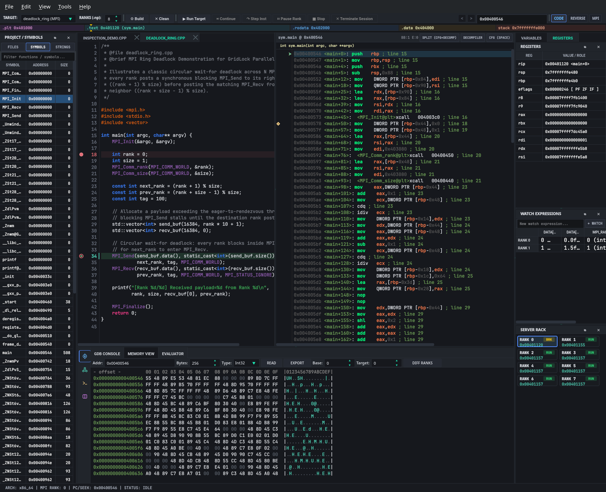
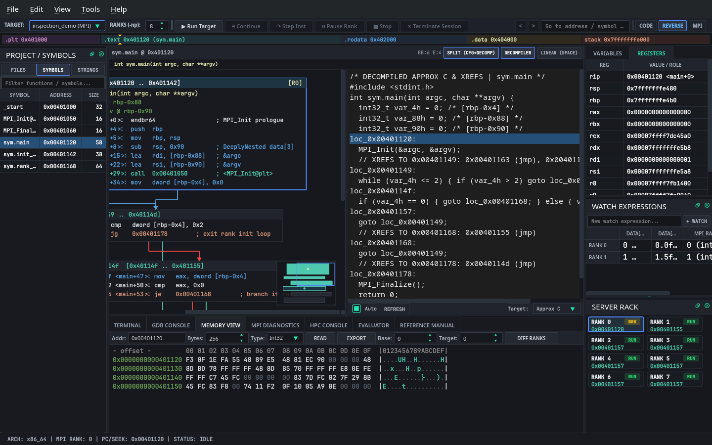
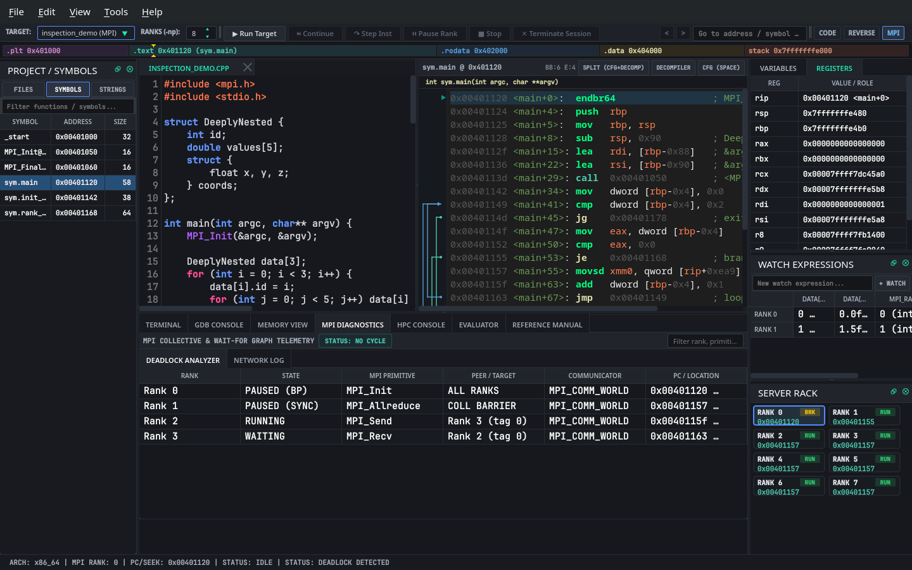
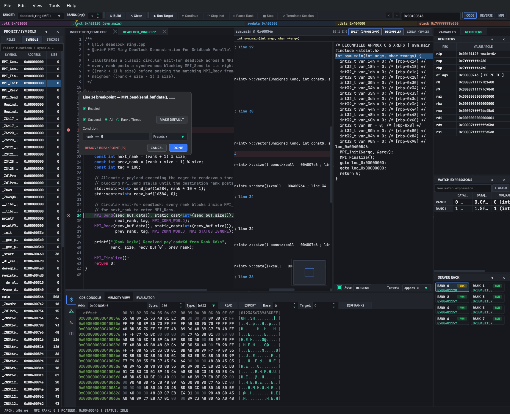
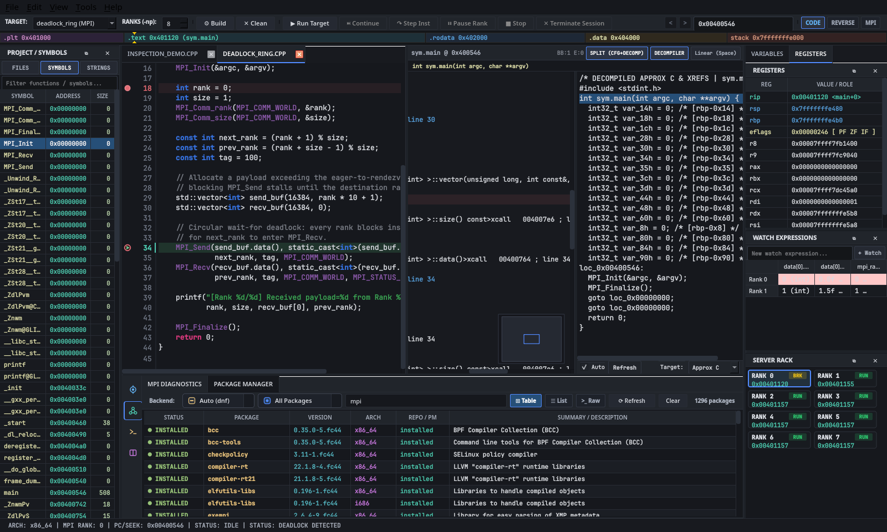
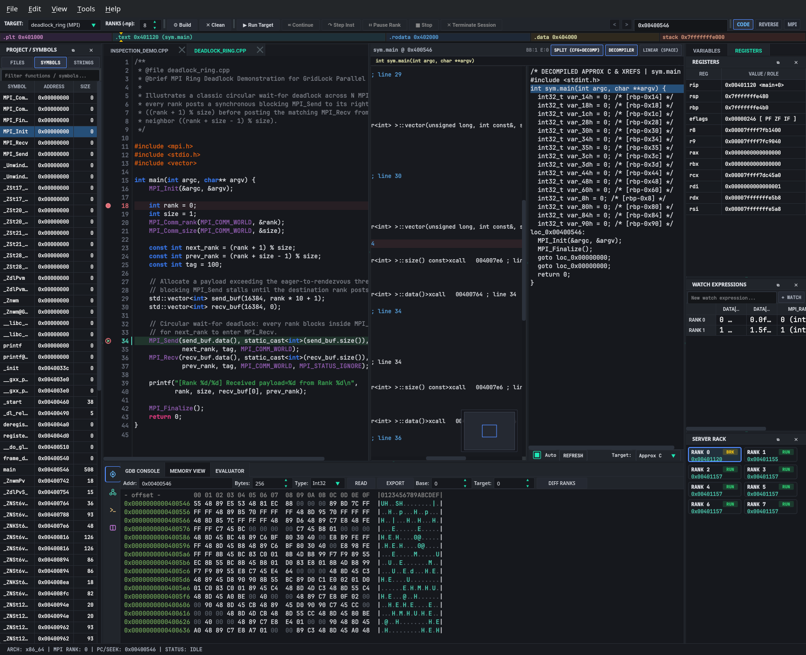
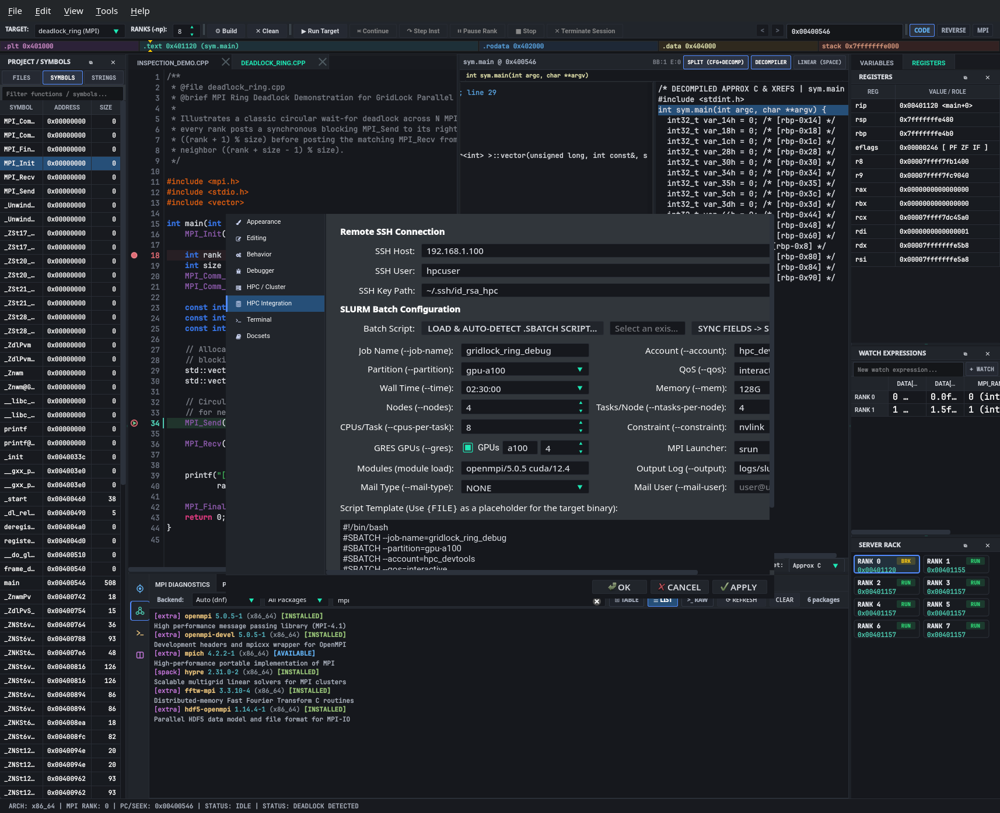

# GridLock — MPI Debugger & ELF Binary Inspector


[](https://github.com/bnorthern42/GridLock/actions/workflows/release.yml)


**GridLock** is a C++23 and Qt6 debugger for multi-rank MPI programs and ELF64 binaries on Linux. It lets you step individual MPI processes, compare variables and memory across ranks, inspect disassembly and control-flow graphs, edit source files with `clangd` language server support, and detect communication deadlocks.

---

## Workspace Perspectives

### 1. Code + Disassembly (`Alt+1` / `CODE`)
Side-by-side C/C++ source editor (`SourceCodeView` / `EditorTabManager`), linear assembly with branch arcs (`DisassemblyView`), CPU registers (`RegisterView`), cross-rank watch comparisons (`DifferentialGrid`), rank status cards (`ServerRackView`), and a hex memory viewer (`MemView`).



### 2. Reverse Engineering (`Alt+2` / `REVERSE`)
Full-width split view pairing the basic-block Control Flow Graph (with per-block MPI rank badges `[R0]`, `[R1]`, `[R2-R7]` and a corner minimap) with a synchronized decompiler (`Approx C`, `C++`, `Pseudocode`) and cross-reference (`XREF`) comments.



### 3. MPI Diagnostics (`Alt+3` / `MPI`)
Dedicated view for circular wait-for deadlock detection (`DeadlockAnalyzer`), MPI point-to-point and collective message logs (`MpiDiagnosticsWidget` / `MpiNetworkLogWidget`), and offline documentation via Zeal docsets and system `man` pages (`ReferenceManualWidget`).



---

## Features

### Multi-Rank MPI Debugging
* **Target & Rank Controls:** Pick an MPI target or load any ELF64 binary from the toolbar, set the process count (`-np 1..64`), and run, step, pause, or stop individual ranks.
* **Selectable Debugger Backends:** Choose between `GNU GDB (gdb)`, `LLVM LLDB-DAP (lldb-dap)`, `NVIDIA CUDA-GDB (cuda-gdb)`, and `AMD ROCm GDB (rocgdb)` in `Edit -> Preferences -> Debugger`.
* **Synchronized Source & Assembly Stepping:** Stepping an instruction updates the active address across the disassembly view, CFG, decompiler, source editor, register table, rank status panel, and hex memory view.
* **Cross-Rank Watch Table (`DifferentialGrid`):** Evaluate C/C++ expressions (such as `data[0].id`, `data[0].coords.x`, or `mpi_rank`) across all active ranks at once, or promote variables directly from the `Variables` and `Evaluator` panels.
* **Deadlock Cycle Detection (`DeadlockAnalyzer`):** Builds a wait-for graph across blocked `MPI_Send`, `MPI_Recv`, and `MPI_Barrier` calls and flags circular dependencies in both the rank rack and the control-flow graph.
* **Cross-Rank Memory Diffing (`MemoryDiffer`):** Reads process memory directly via `process_vm_readv` with bounds validation (`MemoryBoundsValidator`) and highlights byte differences between any two MPI ranks in `MemView`.

### Source Editor, Project Tree & `clangd` LSP
* **Project File Tree Operations (`ProjectExplorerWidget`):** Create `.cpp` and `.hpp` files, create folders, rename (`F2`), and delete entries from the right-click context menu on the `FILES` tree, with optional 1-click source registration in `meson.build` or `CMakeLists.txt`.
* **Split Editors & Dirty Buffer Tracking (`EditorTabManager`):** Open files side-by-side (`Split Right`) or stacked (`Split Down`), track unsaved buffers with `●` tab markers and close prompts, save all open buffers (`Ctrl+Shift+S`), and toggle between `.hpp` and `.cpp` files (`F10`).
* **Scope Breadcrumbs & Git Diff Gutter (`SourceCodeView`):** Displays a scope bar (`File > Class/Struct > Function`) at the top of the editor and marks added, modified, and deleted lines from `git diff` in the editor gutter.
* **`clangd` Diagnostics, Hover & Navigation (`ClangdLspClient`):** Underlines compiler errors and warnings inline, shows symbol/Doxygen hover tooltips, and supports Go-to-Definition (`F12`), Find References (`Shift+F12`), and AST symbol renaming (`Shift+F6`).
* **Gutter Breakpoint Popover:** Right-clicking a line in the source gutter opens a popover next to the cursor to filter breakpoints by rank (`All MPI Ranks` or `Focused Rank Only`) and write conditional expressions with `clangd` autocomplete.

### Binary Inspection & Reverse Engineering
* **ELF64 Parser (`ElfBinaryInspector`):** Reads ELF headers, sections (`.plt`, `.text`, `.rodata`, `.data`), symbol tables (`.symtab`, `.dynsym`), and printable strings from disk, displaying section layout in an address-space navigation bar.
* **Control Flow Graph & Rank Badges:** Breaks assembly routines into basic blocks with true, false, and unconditional branch edges, showing which MPI ranks are stopped inside each block.
* **Decompiler & Bidirectional Navigation:** Generates `Approx C`, `C++`, or `Pseudocode` alongside assembly. Clicking a line in the source editor or decompiler jumps the disassembly, CFG, and memory views to the matching instruction address, and vice versa.
* **Cross-Reference Inspector (`XrefInspectorDialog`):** Press `X` on any instruction to list callers and incoming branches (`XREFS TO`) as well as outgoing calls and jumps (`XREFS FROM`).
* **Instruction & Byte Patching:** Patch assembly instructions (`Ctrl+Shift+P`) or raw hex bytes (`Ctrl+E` in `MemView`) and write the modified ELF64 binary back to disk (`ElfBinaryInspector::savePatchedBinary`).

### Cluster Tools & Environment
* **Bottom Tool Rail:** Groups the bottom dock panels into four categories (`Debug`, `MPI`, `Terminal`, `Docs`) on a vertical icon rail so only relevant tabs are shown at a time.
* **System & HPC Package Search (`HpcConsoleWidget`):** Queries `spack`, `pacman`, `dnf`, `apt`, `zypper`, `rpm`, `dpkg-query`, and `eb` from a single search tab with `Table`, `List`, and `Raw` output modes.
* **SLURM Script Parser & Build Runner:** Imports `#SBATCH` directives and `module load` lines from batch scripts in `PreferencesDialog` (`HPC / Cluster`), and builds projects with `Meson`, `CMake`, `Make`, or `mpicxx` (`F7`).
* **12 Dark & Light Themes (`ThemeManager`):** Includes 8 dark themes (`GridLock Slate`, `Obsidian Teal`, `Tokyo Night`, `Catppuccin Mocha`, `Gruvbox Industrial`, `Nord`, `One Dark Pro`, `Dracula`) and 4 light themes (`Daylight Paper`, `Solarized Warm`, `Catppuccin Latte`, `One Light`) with independent UI and code font settings in Preferences.
* **Offline Zeal Docsets & Man Pages (`ReferenceManualWidget`):** Searches local Zeal `.docset` bundles (`~/.local/share/Zeal/Zeal/docsets`) and system `man` pages (`F1`).
* **Embedded Terminal (`TerminalDockWidget`):** Built-in `QTermWidget` pseudo-terminal for running local shell or cluster commands.

| Conditional Breakpoint Popover | Package Manager (`"mpi"` Search) |
| :---: | :---: |
|  |  |

| Bottom Tool Rail (`Debug` Mode) | `#SBATCH` Script Import |
| :---: | :---: |
|  |  |

---

## Keyboard Shortcuts

| Shortcut | Action | Scope |
| :--- | :--- | :--- |
| **`Alt+1`** | Switch to **Code** perspective (`SourceCodeView` + `DisassemblyView`) | Global |
| **`Alt+2`** | Switch to **Reverse** perspective (Split `CFG` + `Decompiler`) | Global |
| **`Alt+3`** | Switch to **MPI** perspective (`MPI Diagnostics` & cluster views) | Global |
| **`Ctrl+S` / `Ctrl+Shift+S`** | Save current file / Save all modified editor tabs | Source Editor |
| **`F10`** | Switch between matching `.hpp` header and `.cpp` source file | Source Editor |
| **`F12`** | Go to symbol definition (`clangd` AST lookup) | Source Editor |
| **`Shift+F12`** | Find symbol references in document | Source Editor |
| **`Shift+F6`** | Rename symbol across AST occurrences | Source Editor |
| **`F2`** | Rename selected file or folder in Project Explorer | Project Explorer |
| **`Ctrl+M`** | Toggle maximize / restore bottom dock | Global |
| **`Ctrl+G`** | Focus address / symbol seek bar | Global |
| **`Alt+Left` / `Alt+Right`** | Navigate backward / forward in address history | Global |
| **`Space`** | Toggle `DisassemblyView` between linear assembly and CFG | Disassembly / CFG |
| **`X`** | Open cross-reference dialog (`XrefInspectorDialog`) for current address | Disassembly / CFG |
| **`F1`** | Look up symbol in Reference Manual (Zeal / `man`) | Disassembly / Global |
| **`Ctrl+Shift+P`** | Patch instruction in `DisassemblyView` | Disassembly |
| **`Ctrl+E`** | Edit hex bytes at active address in `MemView` | Memory View |
| **`Ctrl+Shift+F`** | Search across symbols, strings, assembly, and decompiler output | Global |
| **`;`** | Add or edit inline comment at active instruction address | Disassembly |
| **`Ctrl+B`** | Toggle bookmark on active instruction | Disassembly |

---

## Building & Running

### Dependencies
* **Compiler:** GCC 13+ or Clang 16+ (C++23)
* **Build tools:** Meson (`>= 1.1`) and Ninja
* **Qt 6:** `Qt6Core`, `Qt6Gui`, `Qt6Widgets`, `Qt6Network`, `Qt6Sql`, `Qt6Concurrent`, `Qt6Svg`, `Qt6OpenGLWidgets`, `Qt6Test`
* **Libraries:** `qtermwidget6`, `tomlplusplus`, and bundled `Qt-Advanced-Stylesheets`

### Compile & Launch
```bash
meson setup builddir
ninja -C builddir gridlock

# Launch GridLock
./builddir/gridlock
```

### Running the Test Suite
GridLock includes 26 test suites covering the debugger backend, ELF/DWARF parsers, `clangd` LSP integration, security boundaries, MPI deadlock detection, and UI workflows:
```bash
find builddir -name "*.gcda" -delete && meson test -C builddir --print-errorlogs
```

### Headless Screenshot Capture
Render a window snapshot offscreen without a display server:
```bash
QT_QPA_PLATFORM=offscreen ./builddir/gridlock --headless --snapshot docs/screenshots/workspace_overview.png
```

### Configuration (`config.toml` & `.gridlock/workspace.toml`)
Global settings live in `~/.config/gridlock/config.toml` and per-project overrides in `.gridlock/workspace.toml`:
```toml
[ui]
preferred_monitor = "2560x1440"
open_unfocused = false

[debugger]
engine = "gdb"

[docsets]
paths = ["/home/user/.local/share/Zeal/Zeal/docsets"]
```

---

## Documentation

* [**Hands-On Tutorial (`docs/TUTORIAL.md`)**](docs/TUTORIAL.md) — Step-by-step walkthroughs for all 7 bundled MPI showcase programs (`deadlock_ring.cpp`, `inspection_demo.cpp`, `collective_mismatch.cpp`, `ghost_cell_drift.cpp`, `heap_imbalance.cpp`, `tag_mismatch_stall.cpp`, `simd_struct_watch.cpp`), `MemView` rank diffing (`DIFF RANKS`) & memory export (`EXPORT`), offline `man` pages & Zeal docsets (`F1`), and the `PACKAGE MANAGER` dock.
* [**Engineering Roadmap (`ROADMAP.md`)**](ROADMAP.md) — Completed milestones through `v0.8.0` and remaining tasks.
* [**Architecture Guide (`docs/ARCHITECTURE.md`)**](docs/ARCHITECTURE.md) — Window layout, module organization, and signal wiring.
* [**User Guide (`docs/USER_GUIDE.md`)**](docs/USER_GUIDE.md) — Walkthroughs for MPI debugging, source editing, conditional breakpoints, package search, SLURM import, and binary patching.
* [**Themes & Fonts (`docs/THEMES.md`)**](docs/THEMES.md) — Screenshots and color reference table for the 12 built-in dark and light themes.
* [**User Manual (`docs/user/README.md`)**](docs/user/README.md) — Reference pages for panels, shortcuts, and cluster setup.
* [**Developer Notes (`docs/developer/README.md`)**](docs/developer/README.md) — Internals on backend coordinators, sanitizers, and UI widgets.

---

## License

Licensed under the MIT License. See [LICENSE](LICENSE).
