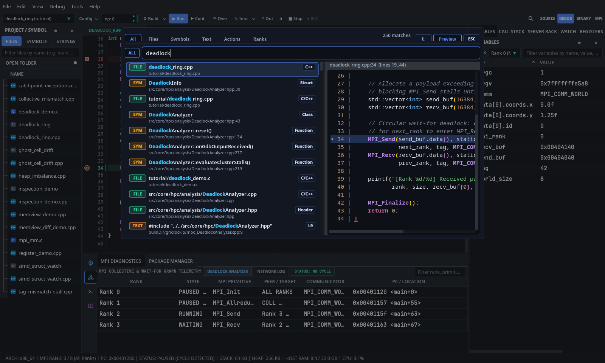
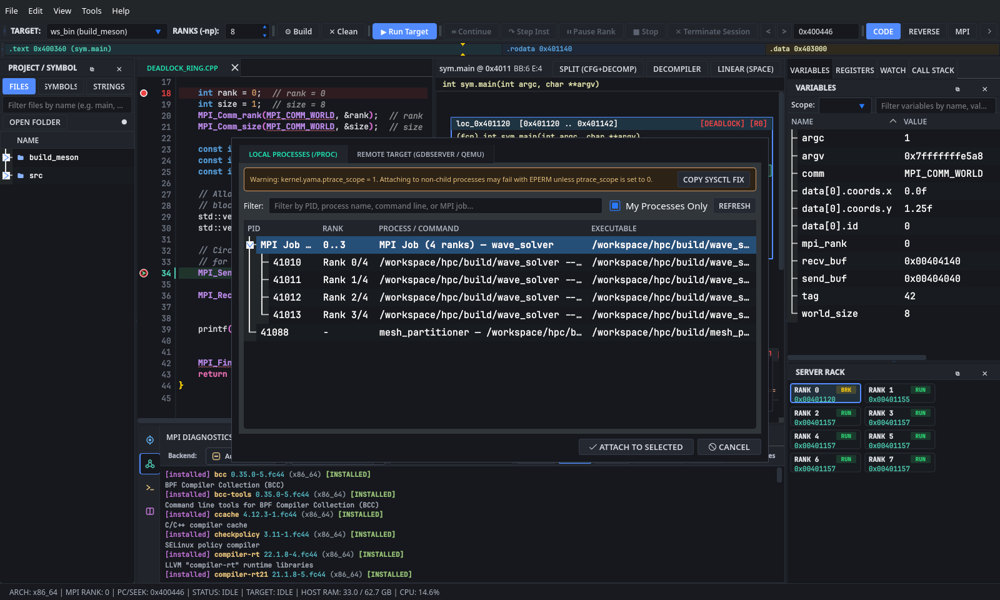
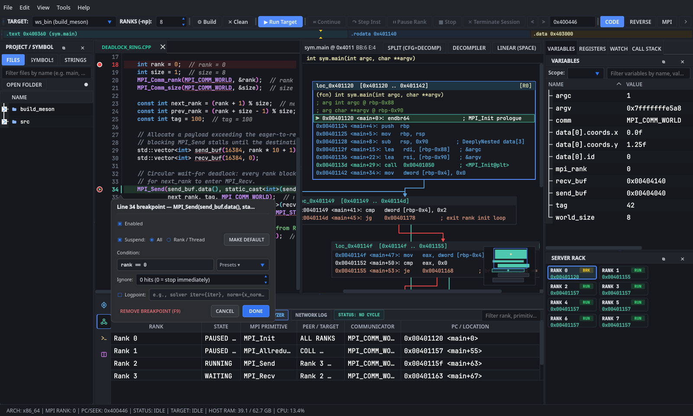
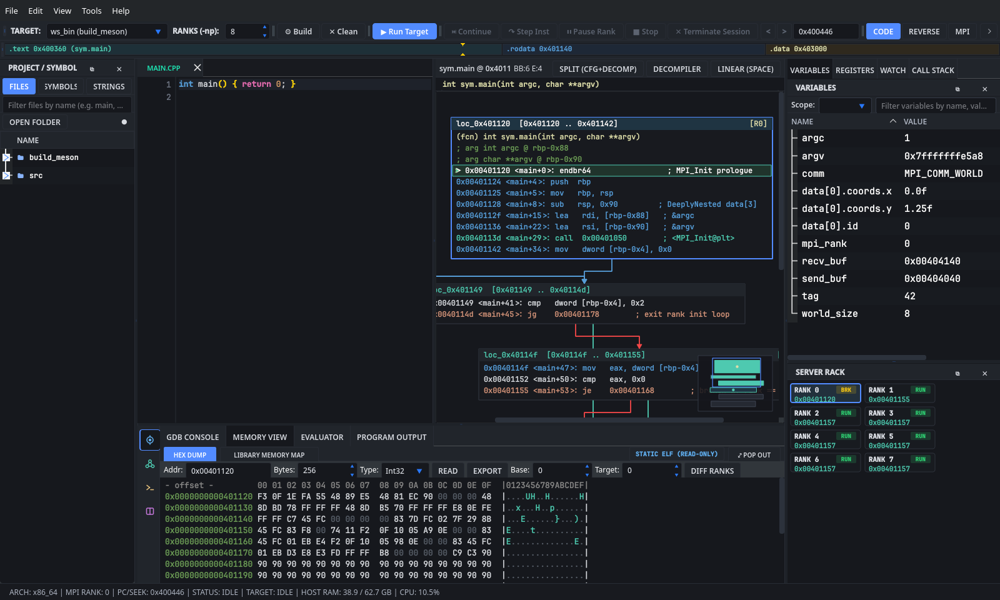

# GridLock: Multi-Rank MPI Debugger & ELF64 Binary Inspector


[](https://github.com/bnorthern42/GridLock/actions/workflows/release.yml)


**GridLock** is a C++23 and Qt6 workstation debugger for multi-rank MPI programs, cross-architecture `qemu-user` / `gdbserver` stubs, and ELF64 binaries on Linux. It coordinates up to 256 MPI processes over GDB/MI3 or LLDB-DAP, attaches to live `/proc` OpenMPI/MPICH/SLURM jobs, flags collective mismatches and circular wait-for deadlocks, diffs process memory across ranks via `process_vm_readv`, profiles virtual memory and `LD_PRELOAD` heap call sites, visualizes topological C/C++ pointer graphs and multi-rank scientific arrays, and pairs `clangd` source editing with Search Everywhere, a 2D Control Flow Graph, and a pseudo-C decompiler.


---

## Quick Install & Launch

### Option 1: Standalone Linux AppImage (`x86_64`, Wayland & X11)

Download either AppImage from [GitHub Releases](https://github.com/bnorthern42/GridLock/releases) (bundles Qt6 Wayland and XCB platform plugins plus `libxcb-cursor.so.0`):
* **`GridLock-0.9.0-x86_64.AppImage`** (Lite Edition)
* **`GridLock-0.9.0-Tutorials-x86_64.AppImage`** (Includes all 8 MPI tutorial `.cpp` sources and pre-built debug binaries)

```bash
chmod +x GridLock-0.9.0-Tutorials-x86_64.AppImage
./GridLock-0.9.0-Tutorials-x86_64.AppImage
```

### Option 2: Build From Source (`Meson` + `Ninja`)

```bash
git clone --recurse-submodules https://github.com/bnorthern42/GridLock.git
cd GridLock

cmake -S external/Qt-Advanced-Stylesheets -B external/Qt-Advanced-Stylesheets/build \
      -GNinja -DQT_VERSION_MAJOR=6 -DCMAKE_BUILD_TYPE=Release
ninja -C external/Qt-Advanced-Stylesheets/build

meson setup builddir
ninja -C builddir
./builddir/gridlock
```

For Arch, Ubuntu/Debian, and Fedora package lists, CLI flags (`--headless`, `--snapshot <file>`, `--verify-plugin <path>`, `--tutorial-mode`, `--test-mode`, `--verbose`, and `[target] -- <args...>`), and AppImage packaging flags, see [Installation and Building](docs/Installation-and-Building.md).

> [!TIP]
> Authoring a custom solver or domain plugin? Run `lua scripts/init_plugin.lua` to scaffold an out-of-tree C++23 or C99 plugin project, then validate the compiled `.so` headlessly with `./builddir/gridlock --verify-plugin <path.so>`.

---

## Screenshot Gallery

| Search Everywhere (`Double Shift` / `Ctrl+P`) | Customizable Toolbar Layout (`Appearance -> Toolbar`) |
| :---: | :---: |
|  |  |

| 2D Control Flow Graph & Decompiler (`BINARY` Perspective) | MPI Deadlock & Collective Analyzer (`MPI` Perspective) |
| :---: | :---: |
|  |  |

| Attach to Running `/proc` MPI Job (`Ctrl+Alt+P`) | Remote GDB Target (`qemu-user -g` / `gdbserver`) |
| :---: | :---: |
|  |  |

| Library & Heap Memory Map Profiler (`smaps` + `LD_PRELOAD`) | Topological Pointer & Struct Graph (`PointerGraphDialog`) |
| :---: | :---: |
|  |  |

| Line-Anchored Conditional Breakpoint & Logpoint Popover | System & HPC Package Search (`spack`, `dnf`, `pacman`, `apt`) |
| :---: | :---: |
|  |  |

| Bottom Tool-Window Rail (`Debug` Mode) | 16-Directive `#SBATCH` Batch Script Importer |
| :---: | :---: |
|  |  |

---

## Feature Summary (`v0.9.0`)

* **Execution, Checkpoints & Target Modes**:
  * **Local MPI & ELF64 Launch**: MPMD `mpirun` / `mpiexec` orchestration (`1..256` ranks) over POSIX FIFOs via `GdbRankCoordinator` (`gdb`, `cuda-gdb`, `rocgdb`) or JSON-RPC via `DapCoordinator` (`lldb-dap`), inline `Config` launch popover (per-target/workspace `--args`, working directory, `Stop at main()`), unified `All Ranks` vs. `Rank k` execution scope, `Pause All Ranks (F6)`, OpenMP `OMP_NUM_THREADS` / `OMP_WAIT_POLICY=PASSIVE` auto-tuning, and time-travel reverse execution (`REC`, `Step Back`, `Rev Continue`).
  * **Source, Instruction & Non-Linear Execution**: Source stepping (`Over F10`, `Into F11`, `Out Shift+F11`), `stepi`, `nexti` (`Ctrl+Shift+F10`), `Run to Cursor` (`Ctrl+F10`), draggable gutter PC arrow and `Set Next Statement / Jump...` with lexical scope safety checks, and `Force Early Return...` (`-exec-return`).
  * **Copy-on-Write Fork Checkpoints (`Ctrl+Alt+K`)**: Save, list, restore (`restart <id>`), and delete GDB process snapshots via `CheckpointDialog` with pre-fork `/proc/[pid]/fd` and `/proc/[pid]/maps` IPC/RDMA/GPU safety scanning.
  * **Attach to Running Process (`Ctrl+Alt+P`) & Remote Targets**: `/proc` process scanner (`ProcessScanner`) grouping live OpenMPI, MPICH/PMI, PMIx, MVAPICH2, and SLURM jobs under `MPI Job (N ranks)` headers, plus `target remote` / `extended-remote` port ranges (`localhost:1234..1237`) for `qemu-user -g` and `gdbserver`.
* **Breakpoints, Signals, Catchpoints & Console Readline**:
  * **Non-Destructive Breakpoint Lifecycle**: Toggle enabled/disabled state (`-break-enable` / `-break-disable`) with hollow gutter markers, one-shot temporary breakpoints (`tbreak`), function regex breakpoints (`rbreak`), multi-line `commands ... end` hit scripts, rank-scoped conditions, ignore counts, non-suspending `{ident}` logpoints, and hardware data watchpoints (`Write`, `Read`, `ReadWrite`).
  * **Signal Disposition Matrix & Catchpoints (`Ctrl+Alt+S`)**: Per-signal `Stop`/`Print`/`Pass` matrix (`handle <SIG>`), C++ `throw`/`rethrow`/`catch` regex catchpoints, Linux syscall catchpoints (`mmap`, `openat`, `clone3`, `ioctl`), and `dlopen`/`dlclose` regex catchpoints.
  * **GDB Console & Terminal Ergonomics**: Persistent `~/.config/gridlock/gdb_history` (`Up`/`Down` with draft preservation), `Ctrl+R` incremental reverse search, live GDB `complete` Tab completion, and embedded `QTermWidget` PTY with `Ctrl+Shift+C`/`V`, smart `Ctrl+C`/`V`, compact context menu, and clean prompt redraw on `Clear Terminal`.
* **MPI & Cross-Rank Inspection**:
  * **`ServerRackView`, `CallStackDockWidget`, `DeadlockAnalyzer`, `MpiNetworkLogWidget`, and `DifferentialGrid`**: Per-rank state cards (`RUN`, `BRK`, `IDLE`, `DEADLOCK`, `EXITED`) with state filtering, master `setFocusedRank()` sync hub, 64-frame stack unwinding, OS/OpenMP thread switching, collective/P2P deadlock detection across 16 `MPI_*` routines, `All Ranks` expression broadcast, live in-place variable/register editing (`-gdb-set`), `Inspect Full Value...` popover, and cross-rank watch outlier highlighting.
* **Memory, Plotting, Reverse Engineering & Workstation UX**:
  * **`MemView` & `MemoryProfilerWidget`**: `process_vm_readv` hex/ASCII reader (`MemoryBoundsValidator`), cross-rank byte diffing (`Diff Ranks`), typed CSV/`.bin` export, and `/proc/<pid>/smaps` + `LD_PRELOAD` heap-caller treemap profiler with 5 palettes.
  * **`ArrayPlotDialog` (`Ctrl+Alt+G`) & `PointerGraphDialog`**: Multi-rank 1D overlays, `start:end:stride` slicing, `Log10` scale, drag-box zoom, scalar history, `Complex64`/`Complex128` decoding, virtualized 2D/3D C/Fortran tensor tables, and validated `splot`/`pm3d` `gnuplot` export; plus Sugiyama DAG pointer graphs with persistent roots, `"old -> new"` mutation badges, `Shift+Click` node width expansion, full-value hover tooltips, corner minimap, `/x` `/d` `/b` format overrides, and `2x` PNG/SVG export.
  * **`ProgrammerCalculatorDialog` (`Ctrl+Alt+C`)**: Floating base converter (`HEX`/`DEC`/`OCT`/`BIN`, IEEE-754 `float`/`double`, `8/16/32/64-bit`, `BSWAP`, 64-bit interactive bit grid, radix keypad) with exact cursor-offset handoff across views.
  * **Search Everywhere, Customizable Toolbar & `ClangdLspClient`**: Multi-scope Search Everywhere overlay (`Double Shift`, `Ctrl+P`, `Ctrl+Shift+P`, 6 scope tabs, 35-line numbered context preview, `S/M/L/XL` size presets), customizable `< 1,040 px` top toolbar (`Appearance -> Toolbar` with `24px` spacers, flex springs, separators), native OS/WM window decorations with optional menu-bar `Minimize`/`Maximize`/`Close` controls, non-destructive `SOURCE | DEBUG | BINARY | MPI` perspectives, ELF64 2D CFG (`Space`) + decompiler + validated `Alt+P` instruction patching, `clangd` LSP (`F12`), exact 4-column soft `Tab`/`Backtab`, `CodeMinimap` toggle, virtualized large-CSV viewer, offline Zeal `.docset`/`man` viewer (`F1`), and 12 dark/light themes.
* **Native C99 / C++23 Plugin Ecosystem**:
  * **Frozen C99 ABI v1.0 & Zero-Call DWARF Introspection**: Binary-stable `include/gridlock/plugin_api.h` (`9` standard-layout POD structs, `28` `GridLockHostApi` callbacks) and header-only `include/gridlock/plugin_cpp_helpers.hpp` (`std::expected`, `noexcept`), including zero-inferior-call `query_type_info` and `resolve_contiguous_range` (`T[N]`, `std::array`, `std::vector`, `std::span`, `std::valarray`), silent plugin MI channels, 5 context-menu surfaces, nested menus, status badges, inline editor annotations, and `PluginReportDockWidget`.
  * **Multi-Forge Installer, Live Hot-Reload, Verifier & Scaffolding**: Install from GitHub, GitLab subgroups, Codeberg, Gitea, or custom Git URLs, sync declarative `plugins.toml` + user-global `plugins-lock.toml`, run per-row **Update** / **Update All** and in-place **Hot-Reload Now** without closing paused MPI sessions, validate binaries via `gridlock --verify-plugin <path>`, and scaffold new repositories with [`scripts/init_plugin.lua`](scripts/init_plugin.lua).

---

## Documentation & GitHub Wiki

All documentation in `docs/` is automatically mirrored to the [GridLock GitHub Wiki](https://github.com/bnorthern42/GridLock/wiki):

* [**Keyboard Shortcuts and Quick Reference**](docs/Keyboard-Shortcuts-and-Reference.md): Scannable lookup tables for execution controls (`F5`, `F6`, `F10`, `F11`, `Shift+F11`), Search Everywhere (`Double Shift`, `Ctrl+P`, `Ctrl+Shift+P`), floating analysis tools (`Ctrl+Alt+C/G/S/K/P`), breakpoint lifecycle, GDB console readline keys, and 2D CFG shortcuts.
* [**Installation and Building**](docs/Installation-and-Building.md): Distro packages (Arch, Ubuntu/Debian, Fedora), AppImage usage, Meson/Ninja build targets, CLI flags, and environment variables.
* [**Quickstart and Workflows**](docs/Quickstart-and-Workflows.md): Launching local MPI targets with per-target `Config` arguments, attaching to `/proc` MPI jobs (`Ctrl+Alt+P`), connecting to `qemu-user -g` and `gdbserver` targets, and importing `#SBATCH` scripts.
* [**User Manual: UI and Debugging**](docs/User-Manual-UI-and-Debugging.md): Menus, customizable toolbar, perspectives (`SOURCE | DEBUG | BINARY | MPI`), Search Everywhere, non-linear execution, live variable/register editing, breakpoint lifecycle, Signals & Catchpoints (`Ctrl+Alt+S`), and Process Checkpoints (`Ctrl+Alt+K`).
* [**MPI Diagnostics and HPC Analysis**](docs/MPI-Diagnostics-and-HPC-Analysis.md): MPMD FIFO coordinator mechanics, `All Ranks` vs. `Rank k` scope, `ServerRackView`, `DeadlockAnalyzer`, `MpiNetworkLogWidget`, `DifferentialGrid` outlier detection, and `HpcConsoleWidget` package search.
* [**Memory, Reverse Engineering, and Profiling**](docs/Memory-Reverse-Engineering-and-Profiling.md): `MemView` (`Diff Ranks` & `Export`), `MemoryProfilerWidget`, `ProgrammerCalculatorDialog` (`Ctrl+Alt+C`), multi-rank `ArrayPlotDialog` (`Ctrl+Alt+G`), topological `PointerGraphDialog`, `DisassemblyView` (CFG + Decompiler + `X` Xrefs + validated `Alt+P` patching), and `RegisterView`.
* [**Tutorials Walkthrough**](docs/Tutorials-Walkthrough.md): Step-by-step labs for all 8 primary C++ MPI showcase programs (`deadlock_ring`, `inspection_demo`, `collective_mismatch`, `ghost_cell_drift`, `heap_imbalance`, `tag_mismatch_stall`, `simd_struct_watch`, `catchpoint_exceptions`) and 5 auxiliary demos.
* [**Configuration and Customization**](docs/Configuration-and-Customization.md): Hierarchical `PreferencesDialog` (`Appearance -> Toolbar` layout editor, `Keybindings` recorder, `Search Everywhere` size presets), 12 dark/light theme hex palettes and previews, `~/.config/gridlock/` and `.gridlock/` files, and build system auto-detection.
* [**Plugins (User Guide)**](docs/Plugins.md): Multi-forge installation (GitHub, GitLab subgroups, Codeberg, Gitea, custom Git URLs), `plugins.toml` + `plugins-lock.toml` sync, `Version (<commit_short>)` provenance, `Update` / `Update All`, live **Hot-Reload Now**, workspace `SHA-256` trust approval, and `gridlock --verify-plugin <path>`.
* **Plugin Developer Encyclopedia**:
  * [**Volume 1: Architecture, Lifecycle, Security & Build Pipeline**](docs/Plugin-Architecture-and-Lifecycle.md): Host subsystem diagrams, pre-`dlopen` `SHA-256` gate, `PluginVerifier`, live `hotReloadPlugins` (`STB_GNU_UNIQUE` check + session replay), silent MI channels (`m_pendingPluginEvals` / `m_pendingPluginMemReads`), quotas, and `PluginInstaller`.
  * [**Volume 2: C99 ABI & C++23 Wrapper Specification**](docs/Plugin-C99-ABI-Reference.md): Exact 64-bit byte-offset tables for all 9 ABI structs, enum constants, all 28 `GridLockHostApi` callbacks (`query_type_info`, `resolve_contiguous_range`), and `include/gridlock/plugin_cpp_helpers.hpp` reference.
  * [**Volume 3: Authoring Recipes, UI Surfaces & Build Templates**](docs/Plugin-Authoring-and-UI-Surfaces.md): [`scripts/init_plugin.lua`](scripts/init_plugin.lua) scaffolding generator, zero-call DWARF container inspection, 5 context-menu surfaces, `PluginReportDockWidget`, `plugin.map` version scripts, `domain_mesh_probe` walkthrough, and `--verify-plugin` CI gating.
* [**Developer Architecture and Testing**](docs/Developer-Architecture-and-Testing.md): Sub-500-line modular codebase structure, CLI flag reference, per-directory `README.md` guides (including [`scripts/README.md`](scripts/README.md)), Graphify AST graph, all 24 Meson test suites, coverage, screenshot generation, and Wiki sync.
* [**Engineering Roadmap (`v0.9.0` to `v1.0.0`)**](docs/ROADMAP.md): Completed `v0.9.0` deliverables and planned pre-`v1.0.0` target milestones (`v0.10.0`, `v0.11.0`).

---

## Project Governance & Policies

* [**Changelog (`CHANGELOG.md`)**](CHANGELOG.md): Version history and release notes.
* [**Accessibility Statement (`ACCESSIBILITY.md`)**](ACCESSIBILITY.md): Keyboard navigation, contrast themes, colorblind-safe palettes, AT-SPI2 support, and barrier reporting.
* [**Contributing Guide (`CONTRIBUTING.md`)**](CONTRIBUTING.md): Coding standards (`< 950` lines per file, C++23, Meson tests) and pull request workflow.
* [**Security Policy (`SECURITY.md`)**](SECURITY.md): Vulnerability reporting and `MiSanitizer` / `MemoryBoundsValidator` hardening boundaries.
* [**License (`LICENSE`)**](LICENSE): MIT License.
