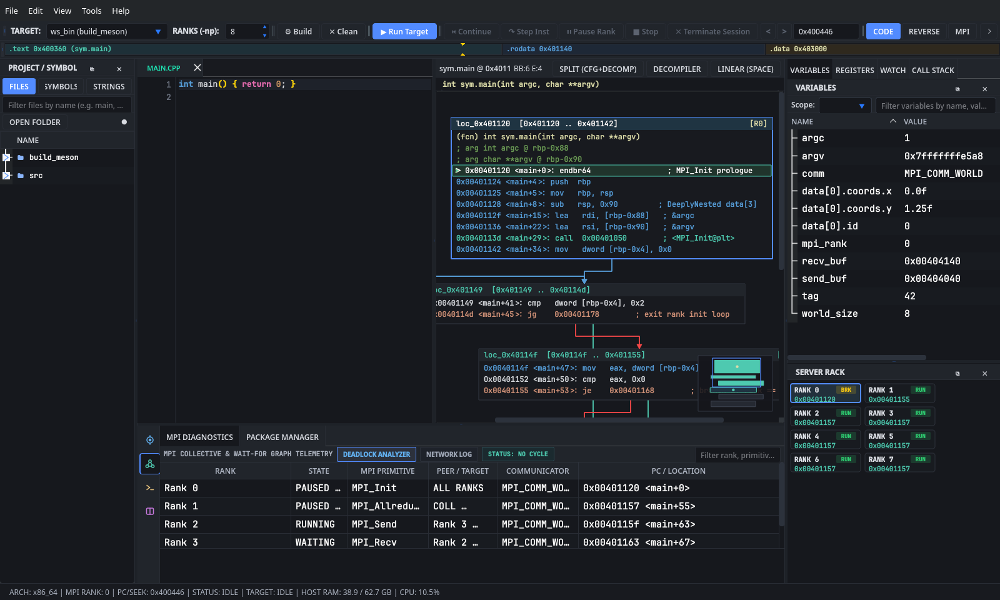
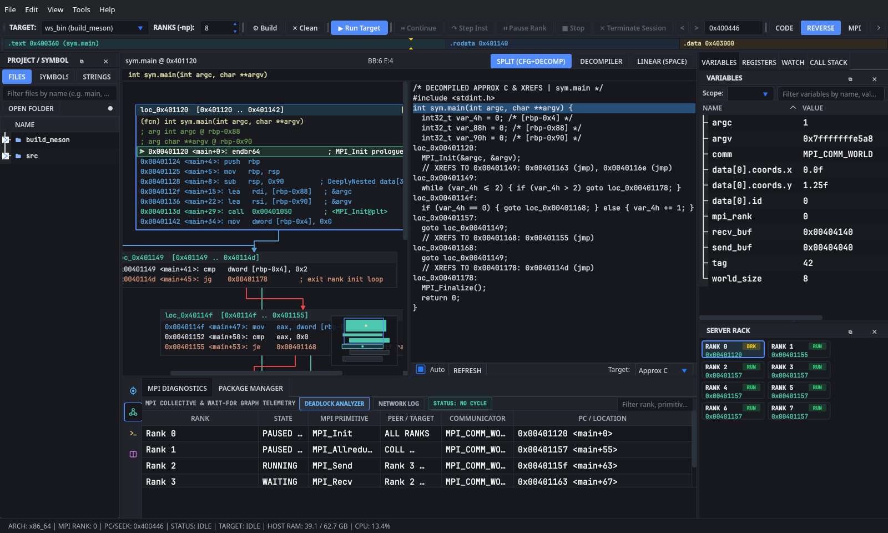
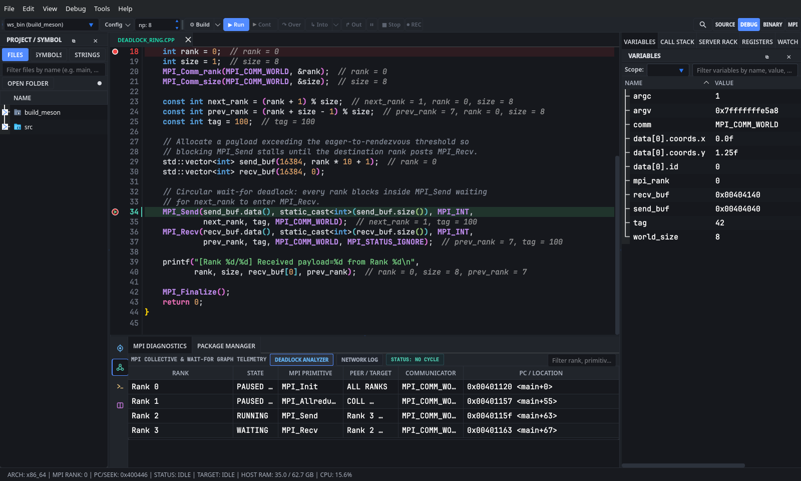
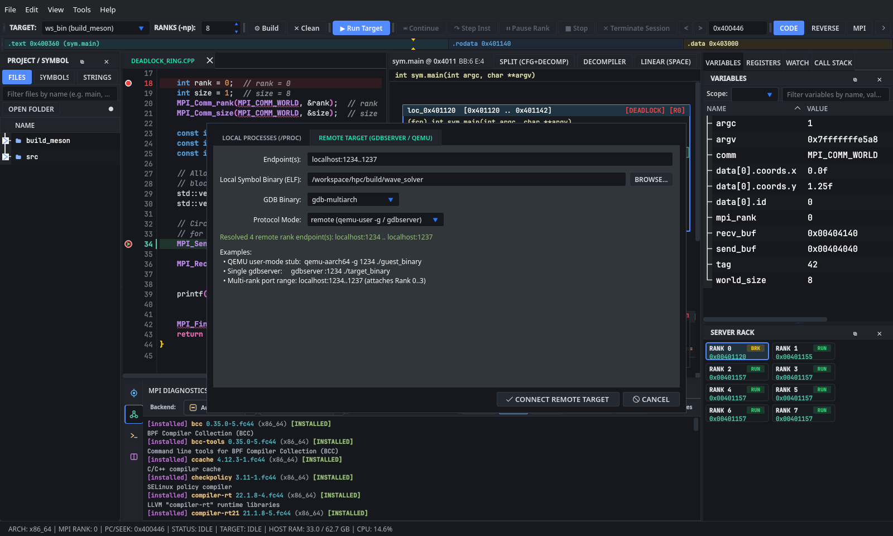
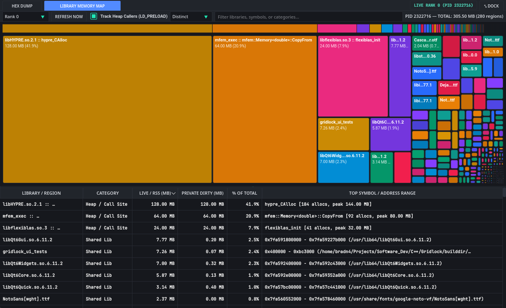
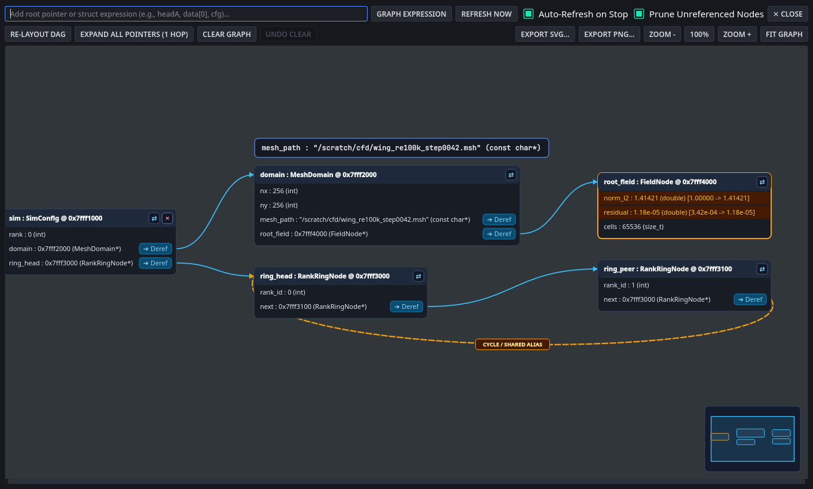
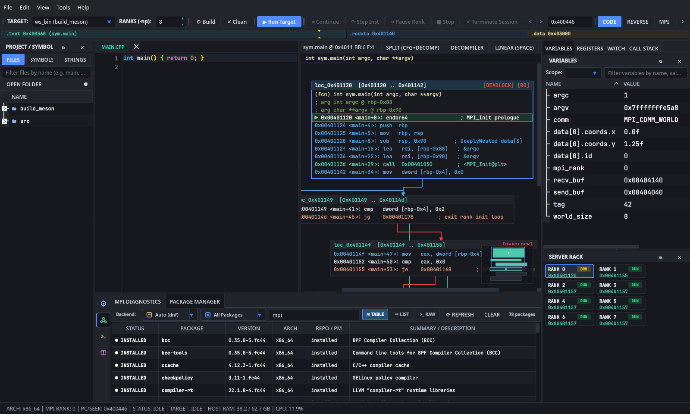
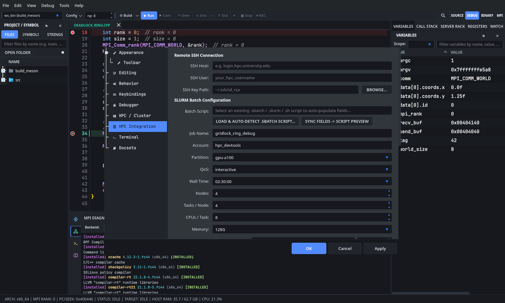

# GridLock: Multi-Rank MPI Debugger & ELF64 Binary Inspector


[](https://github.com/bnorthern42/GridLock/actions/workflows/release.yml)


**GridLock** is a C++23 and Qt6 workstation debugger for multi-rank MPI programs, cross-architecture `qemu-user` / `gdbserver` stubs, and ELF64 binaries on Linux. It coordinates up to 256 MPI processes over GDB/MI3 or LLDB-DAP, attaches to live `/proc` OpenMPI/MPICH/SLURM jobs, flags collective mismatches and circular wait-for deadlocks, diffs process memory across ranks via `process_vm_readv`, profiles virtual memory and `LD_PRELOAD` heap call sites, visualizes C/C++ pointer graphs, and pairs `clangd` source editing with a 2D Control Flow Graph and pseudo-C decompiler.



---

## Quick Install & Launch

### Option 1: Standalone Linux AppImage (`x86_64`, Wayland & X11)

Download either AppImage from [GitHub Releases](https://github.com/bnorthern42/GridLock/releases) (bundles Qt6 Wayland and XCB platform plugins plus `libxcb-cursor.so.0`):
* **`GridLock-0.8.66-x86_64.AppImage`** (Lite Edition)
* **`GridLock-0.8.66-Tutorials-x86_64.AppImage`** (Includes all 7 MPI tutorial `.cpp` sources and pre-built debug binaries)

```bash
chmod +x GridLock-0.8.66-Tutorials-x86_64.AppImage
./GridLock-0.8.66-Tutorials-x86_64.AppImage
```

### Option 2: Build From Source (`Meson` + `Ninja`)

```bash
git clone --recurse-submodules https://github.com/bnorthern42/GridLock.git
cd GridLock

cmake -S external/Qt-Advanced-Stylesheets -B external/Qt-Advanced-Stylesheets/build \
      -GNinja -DQT_VERSION_MAJOR=6 -DCMAKE_BUILD_TYPE=Release
ninja -C external/Qt-Advanced-Stylesheets/build

meson setup builddir
ninja -C builddir
./builddir/gridlock
```

For Arch, Ubuntu/Debian, and Fedora package lists, CLI flags (`--headless`, `--snapshot`, `--tutorial-mode`, `--test-mode`), and AppImage packaging flags, see [Installation and Building](docs/Installation-and-Building.md).

---

## Screenshot Gallery

| 2D Control Flow Graph & Decompiler (`Alt+2`) | MPI Deadlock & Collective Analyzer (`Alt+3`) |
| :---: | :---: |
|  |  |

| Attach to Running `/proc` MPI Job (`Ctrl+Alt+P`) | Remote GDB Target (`qemu-user -g` / `gdbserver`) |
| :---: | :---: |
|  |  |

| Library & Heap Memory Map Profiler (`smaps` + `LD_PRELOAD`) | Pointer & Struct Graph Visualizer (`PointerGraphDialog`) |
| :---: | :---: |
|  |  |

| Line-Anchored Conditional Breakpoint & Logpoint Popover | System & HPC Package Search (`spack`, `dnf`, `pacman`, `apt`) |
| :---: | :---: |
|  |  |

| Bottom Tool-Window Rail (`Debug` Mode, `Alt+4`) | 16-Directive `#SBATCH` Batch Script Importer |
| :---: | :---: |
|  |  |

---

## Feature Summary (`v0.8.7`)

* **Execution, Checkpoints & Target Modes**:
  * **Local MPI & ELF64 Launch**: MPMD `mpirun` / `mpiexec` orchestration (`1..256` ranks) over POSIX FIFOs via `GdbRankCoordinator` (`gdb`, `cuda-gdb`, `rocgdb`) or JSON-RPC via `DapCoordinator` (`lldb-dap`), with OpenMP `OMP_NUM_THREADS` / `OMP_WAIT_POLICY=PASSIVE` auto-tuning and time-travel reverse execution (`⏺ Record`, `↶ Step Back`, `⏮ Rev Continue`).
  * **Complete Instruction & Non-Linear Execution**: `stepi`, `nexti` (`Ctrl+Shift+F10`), `Run to Cursor` (`Ctrl+F10`), draggable gutter PC arrow and `Set Next Statement / Jump...` with lexical scope safety checks, and `Force Early Return...` (`-exec-return`).
  * **Copy-on-Write Fork Checkpoints (`Ctrl+Alt+K`)**: Save, list, restore (`restart <id>`), and delete GDB process snapshots via `CheckpointDialog` with pre-fork `/proc/[pid]/fd` and `/proc/[pid]/maps` IPC/RDMA/GPU safety scanning.
  * **Attach to Running Process (`Ctrl+Alt+P`) & Remote Targets**: `/proc` process scanner (`ProcessScanner`) grouping live OpenMPI, MPICH/PMI, PMIx, MVAPICH2, and SLURM jobs under `MPI Job (N ranks)` headers, plus `target remote` / `extended-remote` port ranges (`localhost:1234..1237`) for `qemu-user -g` and `gdbserver`.
* **Breakpoints, Signals, Catchpoints & Console Readline**:
  * **Non-Destructive Breakpoint Lifecycle**: Toggle enabled/disabled state (`-break-enable` / `-break-disable`) with hollow gutter markers, one-shot temporary breakpoints (`tbreak`), function regex breakpoints (`rbreak`), multi-line `commands ... end` hit scripts, rank-scoped conditions, ignore counts, non-suspending `{ident}` logpoints, and hardware data watchpoints (`Write`, `Read`, `ReadWrite`).
  * **Signal Disposition Matrix & Catchpoints (`Ctrl+Alt+S`)**: Per-signal `Stop`/`Print`/`Pass` matrix (`handle <SIG>`), C++ `throw`/`rethrow`/`catch` regex catchpoints, Linux syscall catchpoints (`mmap`, `openat`, `clone3`, `ioctl`), and `dlopen`/`dlclose` regex catchpoints.
  * **GDB Console Readline Ergonomics**: Persistent `~/.config/gridlock/gdb_history` (`Up`/`Down` with draft preservation), `Ctrl+R` incremental reverse search, and live GDB `complete` Tab completion popup.
* **MPI & Cross-Rank Inspection**:
  * **`ServerRackView`, `CallStackDockWidget`, `DeadlockAnalyzer`, `MpiNetworkLogWidget`, and `DifferentialGrid`**: Per-rank state cards (`RUN`, `BRK`, `IDLE`), 64-frame stack unwinding, OS/OpenMP thread switching, collective/P2P deadlock detection across 16 `MPI_*` routines, and cross-rank watch outlier highlighting.
* **Memory, Plotting, Reverse Engineering & Workstation Tools**:
  * **`MemView` & `MemoryProfilerWidget`**: `process_vm_readv` hex/ASCII reader (`MemoryBoundsValidator`), cross-rank byte diffing (`Diff Ranks`), typed CSV/`.bin` export, and `/proc/<pid>/smaps` + `LD_PRELOAD` heap-caller treemap profiler with 5 palettes.
  * **`ArrayPlotDialog` (`Ctrl+Alt+G`) & `PointerGraphDialog`**: Live auto-refreshing 1D line/stem and 2D colormapped heatmap plotting (`NaN`/`Inf` flags, ghost previous-stop overlay, CSV/PNG/`gnuplot`), plus persistent pinned struct/pointer graph roots with `"old -> new"` mutation highlighting and cycle/alias detection.
  * **`ProgrammerCalculatorDialog` (`Ctrl+Alt+C`)**: Floating base converter (`HEX`/`DEC`/`OCT`/`BIN`, IEEE-754 `float`/`double`, `8/16/32/64-bit`, `BSWAP`, 64-bit interactive bit grid, radix keypad) with right-click selection handoff from editor, variables, registers, memory, and disassembly.
  * **`DisassemblyView`, `CommandPaletteDialog`, `SourceCodeView` & `ClangdLspClient`**: Unified fuzzy Command Palette (`Ctrl+Shift+P` / `Ctrl+P`, `>`, `@`, `#`), ELF64 section/symbol/string parser, 2D Control Flow Graph (`Space`), synchronized decompiler, cross-references (`X`), `Alt+P` instruction patching, `clangd` diagnostics/hover/completion/`F12` definition, offline Zeal `.docset`/`man` viewer (`F1`), `Package Manager`, embedded `QTermWidget` PTY, and 12 dark/light themes.

---

## Documentation & GitHub Wiki

All documentation in `docs/` is automatically mirrored to the [GridLock GitHub Wiki](https://github.com/bnorthern42/GridLock/wiki):

* [**Keyboard Shortcuts and Quick Reference**](docs/Keyboard-Shortcuts-and-Reference.md): Scannable lookup tables for execution controls, Command Palette prefixes (`>`, `@`, `#`), floating analysis tools (`Ctrl+Alt+C/G/S/K/P`), breakpoint lifecycle, GDB console readline keys, and 2D CFG shortcuts.
* [**Installation and Building**](docs/Installation-and-Building.md): Distro packages (Arch, Ubuntu/Debian, Fedora), AppImage usage, Meson/Ninja build targets, CLI flags, and environment variables.
* [**Quickstart and Workflows**](docs/Quickstart-and-Workflows.md): Launching local MPI targets, attaching to `/proc` MPI jobs (`Ctrl+Alt+P`), connecting to `qemu-user -g` and `gdbserver` targets, and importing `#SBATCH` scripts.
* [**User Manual: UI and Debugging**](docs/User-Manual-UI-and-Debugging.md): Menus, toolbars, perspectives (`Alt+1..3`), bottom tool rail (`Alt+4..7`), Command Palette, non-linear execution, breakpoint lifecycle, Signals & Catchpoints (`Ctrl+Alt+S`), Process Checkpoints (`Ctrl+Alt+K`), and GDB console readline ergonomics.
* [**MPI Diagnostics and HPC Analysis**](docs/MPI-Diagnostics-and-HPC-Analysis.md): MPMD FIFO coordinator mechanics, `ServerRackView`, `DeadlockAnalyzer`, `MpiNetworkLogWidget`, `DifferentialGrid` outlier detection, and `HpcConsoleWidget` package search.
* [**Memory, Reverse Engineering, and Profiling**](docs/Memory-Reverse-Engineering-and-Profiling.md): `MemView` (`Diff Ranks` & `Export`), `MemoryProfilerWidget`, `ProgrammerCalculatorDialog` (`Ctrl+Alt+C`), `ArrayPlotDialog` (`Ctrl+Alt+G`), persistent `PointerGraphDialog`, `DisassemblyView` (CFG + Decompiler + `X` Xrefs + `Alt+P` patching), and `RegisterView`.
* [**Tutorials Walkthrough**](docs/Tutorials-Walkthrough.md): Step-by-step labs for all 8 primary C++ MPI showcase programs (`deadlock_ring`, `inspection_demo`, `collective_mismatch`, `ghost_cell_drift`, `heap_imbalance`, `tag_mismatch_stall`, `simd_struct_watch`, `catchpoint_exceptions`) and 5 auxiliary demos.
* [**Configuration and Customization**](docs/Configuration-and-Customization.md): `PreferencesDialog`, 12 dark/light theme hex palettes and previews, `config.toml` / `.gridlock/` session files, and build system auto-detection.
* [**Developer Architecture and Testing**](docs/Developer-Architecture-and-Testing.md): Codebase structure, coordinator/memory/startup-caching internals, all 22 Meson test suites (including 57 offscreen UI tests), coverage, screenshot generation, and Wiki sync.
* [**Engineering Roadmap (`v0.8.7` to `v1.0.0`)**](ROADMAP.md): Completed `v0.8.7` deliverables and planned milestones from `v0.8.8` through `v1.0.0`.

---

## Project Governance & Policies

* [**Changelog (`CHANGELOG.md`)**](CHANGELOG.md): Version history and release notes.
* [**Accessibility Statement (`ACCESSIBILITY.md`)**](ACCESSIBILITY.md): Keyboard navigation, contrast themes, colorblind-safe palettes, AT-SPI2 support, and barrier reporting.
* [**Contributing Guide (`CONTRIBUTING.md`)**](CONTRIBUTING.md): Coding standards (`< 950` lines per file, C++23, Meson tests) and pull request workflow.
* [**Security Policy (`SECURITY.md`)**](SECURITY.md): Vulnerability reporting and `MiSanitizer` / `MemoryBoundsValidator` hardening boundaries.
* [**License (`LICENSE`)**](LICENSE): MIT License.
