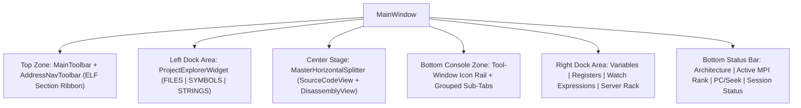

# GridLock Architecture Guide

## 1. Main Window Layout

GridLock organizes its debugging and binary inspection panels into four dock and splitter regions inside `MainWindow`:

### Panel Layout & Bottom Tool Rail
Dock widgets and bottom console tabs share a consistent layout managed by `ThemeManager` and `MainWindow::harmonizeBottomConsoleTabs()`:
1. **Header Bar:** Each panel has a compact top bar containing its title, view mode buttons, and filter inputs.
2. **Content Area:** Tables, trees, text editors, and custom canvas views sit flush inside the panel without nested frames or redundant scrollbars.
3. **Bottom Tool Rail (`#bottomToolWindowRail`):** A vertical icon strip on the left side of the bottom dock groups the seven bottom panels into four modes (`Debug`: `GDB Console`, `Memory View`, `Evaluator`; `MPI`: `MPI Diagnostics`, `Package Manager`; `Terminal`: `Terminal`; `Docs`: `Reference Manual`).

---

## 2. Source File Organization

To keep compilation fast and individual files easy to navigate, UI and backend subsystems are split into focused translation units. `TestMainWindowUI::testFullRepoGoogleStyleAndDocumentation()` checks that `.cpp` and `.hpp` files across `src/` and `tests/` stay under the project's size ceiling (`< 950` lines per file) and include header guards (`#pragma once`), `@file`/`@brief` headers, and Doxygen comments.

| Subsystem | Translation Units | Responsibility |
| :--- | :--- | :--- |
| **MainWindow** | `src/ui/MainWindow.cpp` `src/ui/MainWindowWorkspace.cpp` `src/ui/MainWindowNavigation.cpp` `src/ui/MainWindowDocks.cpp` `src/ui/MainWindowDebugger.cpp` `src/ui/MainWindowCohesion.cpp` | Window lifecycle and rank slots (`MainWindow.cpp`), dock/splitter/toolbar setup (`MainWindowWorkspace.cpp`), address navigation (`MainWindowNavigation.cpp`), detachable docks (`MainWindowDocks.cpp`), stepping and breakpoint handlers (`MainWindowDebugger.cpp`), and theme updates, project build runner, and screenshot capture (`MainWindowCohesion.cpp`). |
| **Source Editor, Breakpoint Popover & LSP** | `src/ui/views/SourceCodeView.cpp` `src/ui/dialogs/ConditionalBreakpointDialog.cpp` `src/core/lsp/ClangdLspClient.cpp` | Editor gutter and hover preview (`SourceCodeView.cpp`), conditional breakpoint popover (`ConditionalBreakpointDialog.cpp`), and JSON-RPC 2.0 `clangd` expression completion (`ClangdLspClient.cpp`). |
| **MPI Diagnostics & Package Manager** | `src/ui/widgets/MpiDiagnosticsWidget.cpp` `src/ui/widgets/HpcConsoleWidget.cpp` | `Deadlock Analyzer` and `Network Log` views (`MpiDiagnosticsWidget.cpp`), plus `Spack`/`Pacman`/`DNF`/`APT`/`Zypper`/`RPM` package search across `Table`/`List`/`Raw` modes (`HpcConsoleWidget.cpp`). |
| **Disassembly, CFG & Decompiler** | `src/ui/views/DisassemblyView.cpp` `src/ui/views/DisassemblyAnalysis.cpp` `src/ui/views/DisassemblyDecompiler.cpp` | Linear assembly view (`DisassemblyView.cpp`), basic-block splitting, CFG edge routing, rank badges, minimap, and cross-references (`DisassemblyAnalysis.cpp`), and `Approx C`/`C++`/`Pseudocode` decompilation (`DisassemblyDecompiler.cpp`). |
| **Preferences & SLURM Importer** | `src/ui/dialogs/PreferencesDialog.cpp` `src/ui/dialogs/PreferencesDialogPages.cpp` | Preferences dialog shell (`PreferencesDialog.cpp`) and settings pages including the `#SBATCH` script importer (`PreferencesDialogPages.cpp`). |
| **UI Integration Tests** | `tests/test_ui.cpp` `tests/test_ui_aux.cpp` `tests/test_ui_cohesion.cpp` `tests/test_ui_debugger.cpp` | Core widget and layout tests (`test_ui.cpp`), CFG/decompiler/style and screenshot tests (`test_ui_aux.cpp`), ELF64/Xrefs/theme tests (`test_ui_cohesion.cpp`), and breakpoint/LSP/tool-rail/package-manager tests (`test_ui_debugger.cpp`). |

---

## 3. Signal Connections Between Views

Views stay synchronized through Qt signal/slot connections set up in `MainWindowWorkspace.cpp`, `MainWindowDebugger.cpp`, and `MainWindowCohesion.cpp`:

1. **Source <-> Disassembly Sync:**
   * Clicking a line in `SourceCodeView` emits `SourceCodeView::sourceLineSelected(int lineOneBased)`, which looks up the corresponding instruction address via `MainWindow::sourceLineToAddress(lineOneBased)` and jumps `DisassemblyView` (linear, CFG, and decompiler) and `MemView` to that address.
   * Clicking an instruction or basic block in `DisassemblyView` emits `DisassemblyView::addressSelected(uint64_t addr)`, which updates `MemView` and highlights the matching source line via `MainWindow::addressToSourceLine(addr)` in `SourceCodeView`.
2. **Breakpoint Popover & `clangd` Completion:**
   * Right-clicking line `N` in `LineNumberArea` opens `ConditionalBreakpointDialog` next to the gutter dot and swallows the `QContextMenuEvent` so the default text editor menu does not appear on top of it. As the user types a condition, `ClangdLspClient::buildVirtualCompletionDocument` splices the expression into line `N` of an in-memory buffer and requests `textDocument/completion` results from `clangd`.
3. **Stepping Workflow (`startTargetWorkflow` / `stepInstructionWorkflow` / `stopTargetWorkflow`):**
   * Starting or stepping a target advances the active rank's program counter via `DisassemblyView::nextInstructionAddress`, refreshes the rank cards in `ServerRackView`, updates `RegisterView` (`rip`, `rsp`, `rbp`, `rax`, `eflags`), scrolls `MemView`, and moves the current-line arrow in `SourceCodeView`.
4. **Watch Promotion & Context Menus:**
   * Promoting a variable from `VariablesDockWidget` or an expression from `ExpressionEvaluatorWidget` emits `watchExpressionRequested(const QString&)`, which adds a column to `DifferentialGrid` (`Watch Expressions`).
   * Context menu actions in `DisassemblyView` and `RegisterView` (`Show in Memory View`, `Open Xrefs Inspector (X)`, `Lookup Documentation (F1)`) jump directly to `MemView`, `XrefInspectorDialog`, and `ReferenceManualWidget`.
