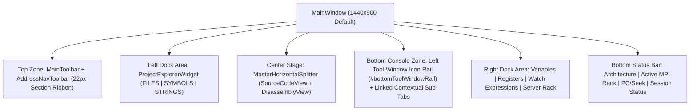

# GridLock Workstation Architecture & Modularity Guide

## 1. Four-Zone Workstation Layout

GridLock organizes all parallel MPI debugging and binary analysis tools into a deterministic 4-zone docking and splitter hierarchy inside `MainWindow`:

### Two-Tier Panel Chrome & Left Vertical Tool-Window Rail
Every dock widget and bottom console tab adheres to a strict two-tier visual contract enforced by `ThemeManager` and `MainWindow::harmonizeBottomConsoleTabs()`:
1. **Tier 1 (Control Header Strip, `24px–26px` height):** Theme-aware header surface (`palette.headerHex`) with `1px solid` structural border, `6px` horizontal padding, and compact `20px–22px` buttons, combo boxes, and filter inputs.
2. **Tier 2 (Content Viewport):** Theme-aware canvas (`palette.canvasHex`) with `0px` outer `contentsMargins` and `QFrame::NoFrame` so tables, trees, text browsers, and custom-painted views sit flush against the `1px` splitter and dock borders without double-walled frames.
3. **Left Vertical Tool-Window Icon Rail (`#bottomToolWindowRail`, `36px` wide):** Partitions the 7 bottom panels into 4 linked contextual tool groups (`Debug`: `GDB Console`, `Memory View`, `Evaluator`; `MPI`: `MPI Diagnostics`, `Package Manager`; `Terminal`: `Terminal`; `Docs`: `Reference Manual`).

---

## 2. Translation Unit Partitioning & `< 950` Line Ceiling

To prevent monolithic source files and ensure fast incremental compilation, major UI subsystems are partitioned into focused translation units. Every `.cpp` and `.hpp` file across `src/` and `tests/` is continuously audited by `TestMainWindowUI::testFullRepoGoogleStyleAndDocumentation()` to enforce:
* **Strict `< 950` lines per file (`< 880` lines for `MainWindow*.cpp`)**
* **`>= 20%` Doxygen and inline comment density**
* **Google C++ Style Guide header guards (`#pragma once`), `@file`/`@brief` file headers, and closing `// namespace` comments**

| Subsystem | Translation Units | Responsibility |
| :--- | :--- | :--- |
| **MainWindow** | `src/ui/MainWindow.cpp` `src/ui/MainWindowWorkspace.cpp` `src/ui/MainWindowNavigation.cpp` `src/ui/MainWindowDocks.cpp` `src/ui/MainWindowDebugger.cpp` `src/ui/MainWindowCohesion.cpp` | Lifecycle & rank state slots (`MainWindow.cpp`), 4-zone dock/splitter/toolbar & tool-rail construction (`MainWindowWorkspace.cpp`), address seek routing (`MainWindowNavigation.cpp`), detachable dock management (`MainWindowDocks.cpp`), step/breakpoint debugger workflow (`MainWindowDebugger.cpp`), and UI cohesion, theme propagation, smart build system, & documentation screenshot capture (`MainWindowCohesion.cpp`). |
| **Source Editor, Breakpoint Popover & LSP** | `src/ui/views/SourceCodeView.cpp` `src/ui/dialogs/ConditionalBreakpointDialog.cpp` `src/core/lsp/ClangdLspClient.cpp` | Two-lane vector gutter & ghost hover preview (`SourceCodeView.cpp`), cursor-anchored breakpoint popover (`ConditionalBreakpointDialog.cpp`), and JSON-RPC 2.0 `clangd` virtual-buffer C++ expression completion (`ClangdLspClient.cpp`). |
| **MPI Diagnostics & Package Manager** | `src/ui/widgets/MpiDiagnosticsWidget.cpp` `src/ui/widgets/HpcConsoleWidget.cpp` | Flattened single-row `Deadlock Analyzer` + `Network Log` (`MpiDiagnosticsWidget.cpp`) and multi-distro `Spack`/`Pacman`/`DNF`/`APT`/`Zypper`/`RPM` package search across `Table`/`List`/`Raw` views (`HpcConsoleWidget.cpp`). |
| **Disassembly, CFG & Decompiler** | `src/ui/views/DisassemblyView.cpp` `src/ui/views/DisassemblyAnalysis.cpp` `src/ui/views/DisassemblyDecompiler.cpp` | Linear assembly widget & branch gutter (`DisassemblyView.cpp`), basic-block partitioning, Manhattan CFG edge routing, rank badges, minimap, & Xref extraction (`DisassemblyAnalysis.cpp`), and multi-language `Approx C`/`C++`/`Pseudocode` decompilation (`DisassemblyDecompiler.cpp`). |
| **Preferences & SLURM Auto-Detector** | `src/ui/dialogs/PreferencesDialog.cpp` `src/ui/dialogs/PreferencesDialogPages.cpp` | Modal dialog shell & category navigation (`PreferencesDialog.cpp`) and per-category settings cards including the 16-directive `#SBATCH` batch script parser (`PreferencesDialogPages.cpp`). |
| **UI Integration Tests** | `tests/test_ui.cpp` `tests/test_ui_aux.cpp` `tests/test_ui_cohesion.cpp` `tests/test_ui_debugger.cpp` | Core widget & layout tests (`test_ui.cpp`), CFG/decompiler/style audit & screenshot tests (`test_ui_aux.cpp`), ELF64/Xrefs/theme propagation tests (`test_ui_cohesion.cpp`), and breakpoint/LSP/tool-rail/package-manager tests (`test_ui_debugger.cpp`). |

---

## 3. Cross-Pane Signal Choreography

GridLock eliminates behavioral silos between views through deterministic signal bridges wired in `MainWindowWorkspace.cpp`, `MainWindowDebugger.cpp`, and `MainWindowCohesion.cpp`:

1. **Bidirectional Source <-> Assembly Synchronization:**
   * Clicking a C/C++ line in `SourceCodeView` emits `SourceCodeView::sourceLineSelected(int lineOneBased)`, which resolves `MainWindow::sourceLineToAddress(lineOneBased)` and seeks `DisassemblyView` (Linear, CFG, and Decompiler) and `MemView`.
   * Clicking an instruction or basic block in `DisassemblyView` emits `DisassemblyView::addressSelected(uint64_t addr)`, which seeks `MemView` and highlights `MainWindow::addressToSourceLine(addr)` in `SourceCodeView`.
2. **Cursor-Anchored Breakpoint Popover & Virtual-Buffer `clangd` LSP Completion:**
   * Right-clicking line `N` in `LineNumberArea` opens `ConditionalBreakpointDialog` anchored at the gutter dot, consumes `QContextMenuEvent` so the editor's viewport menu does not collide, and splices typed condition expressions into `ClangdLspClient::buildVirtualCompletionDocument` at line `N` for live `textDocument/completion` suggestions.
3. **Synchronized Step Execution Loop (`startTargetWorkflow` / `stepInstructionWorkflow` / `stopTargetWorkflow`):**
   * Launching or stepping advances the active rank's program counter via `DisassemblyView::nextInstructionAddress`, updates `ServerRackView` rank cards, updates `RegisterView` (`rip`, `rsp`, `rbp`, `rax`, `eflags`), seeks `MemView`, and advances the emerald `▶` execution line highlight in `SourceCodeView`.
4. **Cross-View Watch Promotion & Context Actions:**
   * Variables in `VariablesDockWidget` and expressions in `ExpressionEvaluatorWidget` emit `watchExpressionRequested(const QString&)`, adding columns directly to `DifferentialGrid` (`Watch Expressions`).
   * Context actions in `DisassemblyView` and `RegisterView` (`Show in Memory View`, `Open Xrefs Inspector (X)`, `Lookup Documentation (F1)`) route directly to `MemView`, `XrefInspectorDialog`, and `ReferenceManualWidget`.

