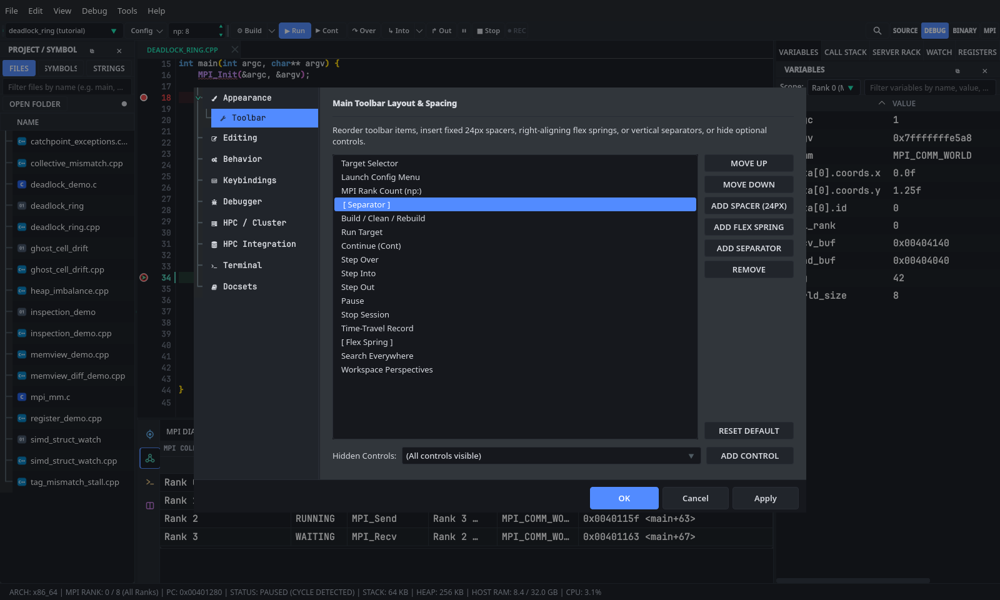
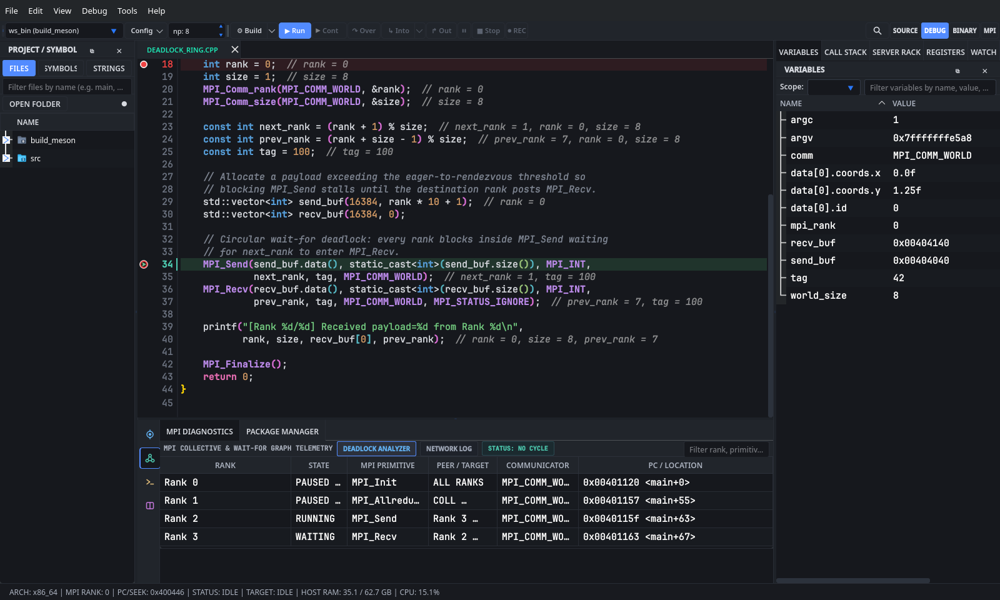
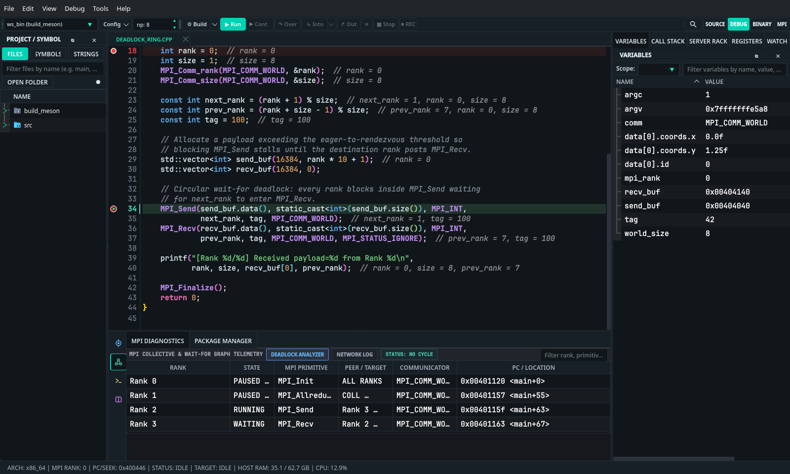
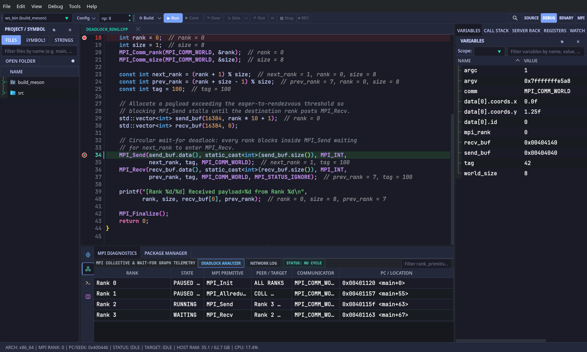
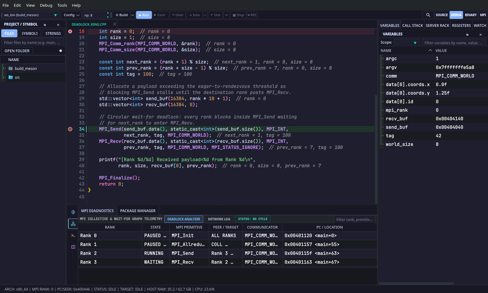
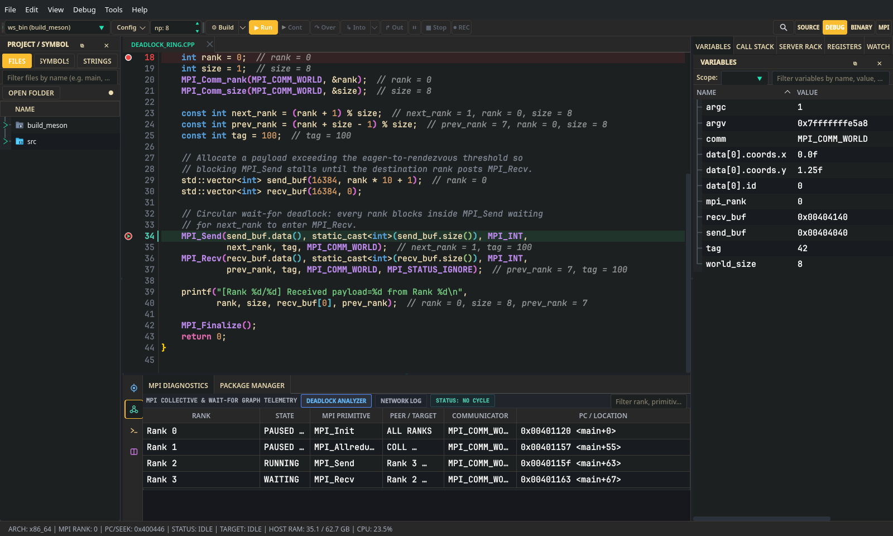
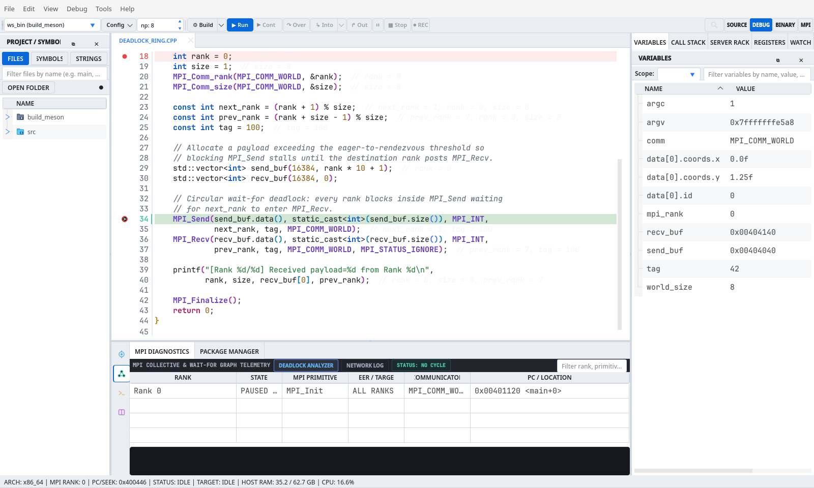
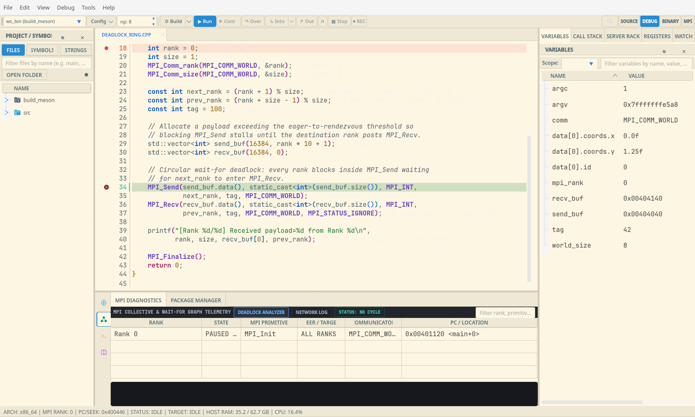
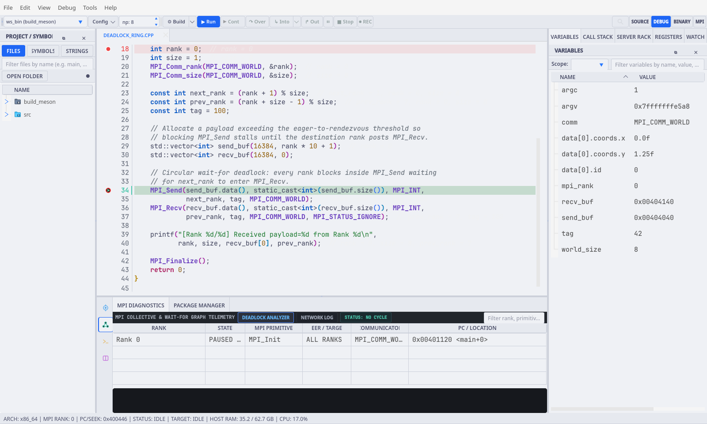

# Configuration and Customization

GridLock stores global preferences in `~/.config/gridlock/config.toml` and `~/.config/gridlock/debugger.conf` (`QSettings`), and per-workspace project and session state in `<workspace>/.gridlock/settings.toml` and `<workspace>/.gridlock/workspace.toml`.

---

## 1. Hierarchical Preferences Dialog (`Edit -> Preferences` / `Ctrl+,`)

`PreferencesDialog` uses a hierarchical `QTreeWidget` category sidebar (`#preferencesCategoryTree`, expanded by default) grouping UI layout and chrome customization under **`Appearance`**:



### 1. `Appearance` & `Appearance -> Toolbar`
* **`Color Theme`**: Live-switching dropdown across all 12 built-in dark and light themes (`ThemeManager`), paired with 5 luminance-checked swatch chips (`Canvas`, `Header`, `Border`, `Accent`, `Text`).
* **`Memory Map Color Scheme`**: Default palette for `MemoryProfilerWidget`: `Category & Library Distinct` (`Distinct`), `Viridis Scientific` (`Viridis`), `Plasma Thermal` (`Plasma`), `Ocean Cool-Warm` (`Ocean`), or `High-Contrast Accessible` (`HighContrast`, Okabe-Ito).
* **`File Tree Style`** (`Compact`, `Comfortable`, `Large`) and **`Enable Colorful File Icons`**.
* **`UI Font Family` & `UI Font Size`**: `Inter` (default), `Cantarell`, `Ubuntu`, `JetBrains Mono`, or `Monospace`, `7..32 pt` (default `11 pt`).
* **`Code Font Family` & `Code Font Size`**: Seeded with 16 monospace families (`JetBrains Mono`, `Fira Code`, `FiraCode Nerd Font`, `Hack`, `Source Code Pro`, `Cascadia Code`, `Iosevka`, `IBM Plex Mono`, `DejaVu Sans Mono`, `Liberation Mono`, `Ubuntu Mono`, `Noto Sans Mono`, `Inconsolata`, `Victor Mono`, `Terminus`, `Monospace`) plus system fixed-pitch fonts, `7..48 pt` (default `11 pt`).
* **`Search Everywhere Popup Size`**: Configures `CommandPaletteDialog` modal scale across `Small (760 x 440)`, `Medium (840 x 500)`, `Large (940 x 560)` *(default)*, and `X-Large (1080 x 640)`.
* **`Appearance -> Toolbar` (`Main Toolbar Layout & Spacing`)**: Nested child page allowing you to reorder `#MainToolbar` items (`Move Up` / `Move Down`), hide or restore optional controls, insert `24px` fixed spacers (`Add Spacer (24px)`), insert right-aligning flexible springs (`Add Flex Spring`, ignored if trailing), insert vertical dividers (`Add Separator`), or click `Reset Default`.

### 2. `Editing`
* **`Tab Width`** (`1..16`, default `4`, enforced as exact soft-tab spaces on `Tab`/`Shift+Tab` and pixel-exact `tabStopDistance`), **`Indent With`** (`Spaces` or `Tabs`), **`Whitespace`** (`Hidden` or `Visible`).
* **`Enable Word Wrap`** (default `false`), **`Show Edge Column Line`** (default `true`), **`Edge Column`** (`1..300`, default `80`), **`Show Code Minimap`**.
* **`Enable Rainbow Brackets`** (5-level cyclic depth coloring on `()`, `{}`, `[]`, default `true`).
* **`Enable Syntax Highlighting for Config & Docs`** (`TOML`, `YAML`, `Markdown`, `CSV`/`TSV`, default `true`, with automatic virtualized preview for multi-megabyte CSV files).
* **`Show Inline Variable Values in Editor when Paused`** (default `true`).

### 3. `Behavior`
* **`Restore Breakpoints`**: `Always` (default), `Ask`, or `Never`.
* **`Confirm Quit`**: `Yes` (default) or `No`.
* **`Focus on Stop`**: `Yes` (default) or `No`.
* **`Status Bar Resource Format`**: `GB / Total GB + CPU %` (`gb`), `Percentage (%) Only` (`percent`), or `Both (GB / Total GB + %)` (`both`).

### 4. `Keybindings`
* Filterable shortcut table backed by `ShortcutManager` and `ShortcutItemDelegate` (`KeySequenceRecorderWidget`), supporting click-to-record key sequences (including `Toggle Code Minimap`), conflict detection, **`Clear Shortcut`**, and **`Reset Defaults`** across all 12 dark and light themes.

### 5. `Debugger`
* **`Debugger Engine`**: `GNU GDB (gdb)`, `LLVM LLDB-DAP (lldb-dap)`, `NVIDIA CUDA-GDB (cuda-gdb)`, or `AMD ROCm GDB (rocgdb)`.
* **`Default Disassembly View`**: `Control Flow Graph (Map)` (`cfg`, default), `Linear Assembly List` (`linear`), or `Split CFG + Decompiler` (`split`).
* **`Clangd Path`**, **`DAP Adapter Path`**, **`GDB Path`**: Executable names or absolute paths with `Browse...` pickers.
* **`MPI Executable`** (default `mpiexec`), **`MPI Args`** (default `--oversubscribe`), **`Default Rank Count`** (`1..256`, default `2`).
* **`Trap FPE (NaN/Overflow)`**: Sends `catch signal SIGFPE` across GDB ranks on session start.
* **`Show Pseudo-C Decompiler when Source Editor is visible`**: Keeps the decompiler split open even when DWARF C/C++ source is already displayed.

### 6. `HPC / Cluster`
* **`MPI Hosts File`** (`--hostfile`), **`MPI Env Vars`** (multi-line `KEY=VALUE`), and **`Strict Node Affinity`** (`--map-by node`).

### 7. `HPC Integration`
* **`Remote SSH Connection`**: `SSH Host`, `SSH User`, and `SSH Key Path`.
* **`SLURM Batch Configuration`**: `"Load & Auto-Detect .sbatch Script..."`, `"Sync Fields -> Script Preview"`, 16 `#SBATCH` form controls (`--job-name`, `--account`, `--partition`, `--qos`, `--time`, `--mem`, `--nodes`, `--ntasks-per-node`, `--cpus-per-task`, `--constraint`, `--gres`, `MPI Launcher`, `module load`, `--output`, `--mail-type`, `--mail-user`), and editable `Script Template` (`{FILE}` placeholder).
* **`Spack Install Path`**: Default `/opt/spack`.

### 8. `Terminal`
* **`Shell Path`** (defaults to `$SHELL` or `/bin/bash`), **`Font Family`** (default `FiraCode Nerd Font`), and **`Font Size`** (`6..72 pt`, default `12 pt`).

### 9. `Docsets` (`Offline Docsets`)
* **`Docset Directory`**, **`Auto-Detect Zeal Docsets`** (scans `~/.local/share/Zeal/Zeal/docsets`, `~/.config/Zeal/Zeal.conf`, Flatpak `org.zealdocs.Zeal`, and `/usr/share/zeal/docsets`, attaching up to 10 SQLite `.docset` indices), and **`Auto-Detect Needs`** (scans workspace `#include` headers for `<mpi.h>` and C++ STL usage).

---

## 2. Built-In Dark and Light Themes (`ThemeManager`)

All 12 theme palettes in `src/core/managers/ThemeManager.cpp` propagate across `QtAdvancedStylesheet`, QSS chrome, `SourceCodeView`, `DisassemblyView` (CFG cards, branch arcs, decompiler), `MemView`, `MemoryProfilerWidget`, `ServerRackView`, and dialogs:

| Theme ID | Display Name | Polarity | Canvas | Header | Border | Accent | Text |
| :--- | :--- | :--- | :--- | :--- | :--- | :--- | :--- |
| `gridlock_slate` | **GridLock Slate** *(default)* | Dark | `#16181d` | `#21252b` | `#282c34` | `#528bff` | `#d7dae0` |
| `dark_teal` | **Obsidian Teal** | Dark | `#11161a` | `#172026` | `#22303a` | `#00d2b4` | `#d8e6eb` |
| `tokyo_night` | **Tokyo Night** | Dark | `#1a1b26` | `#24283b` | `#2f3549` | `#7aa2f7` | `#c0caf5` |
| `catppuccin_mocha` | **Catppuccin Mocha** | Dark | `#1e1e2e` | `#181825` | `#313244` | `#89b4fa` | `#cdd6f4` |
| `gruvbox_dark` | **Gruvbox Industrial** | Dark | `#1d2021` | `#282828` | `#3c3836` | `#fabd2f` | `#ebdbb2` |
| `nord_dark` | **Nord** | Dark | `#2e3440` | `#3b4252` | `#4c566a` | `#88c0d0` | `#eceff4` |
| `one_dark_pro` | **One Dark Pro** | Dark | `#282c34` | `#21252b` | `#3e4451` | `#61afef` | `#abb2bf` |
| `dracula_dark` | **Dracula** | Dark | `#282a36` | `#21222c` | `#44475a` | `#bd93f9` | `#f8f8f2` |
| `daylight_light` | **Daylight Paper (Light)** | Light | `#ffffff` | `#eaeef2` | `#d0d7de` | `#0969da` | `#1f2328` |
| `solarized_light` | **Solarized Warm (Light)** | Light | `#fdf6e3` | `#eee8d5` | `#d3cbb7` | `#268bd2` | `#586e75` |
| `catppuccin_latte` | **Catppuccin Latte (Light)** | Light | `#eff1f5` | `#e6e9ef` | `#ccd0da` | `#1e66f5` | `#4c4f69` |
| `one_light` | **One Light (Light)** | Light | `#fafafa` | `#f0f0f1` | `#d3d4d8` | `#4078f2` | `#383a42` |

### Theme Gallery Previews

| GridLock Slate (`gridlock_slate`) | Obsidian Teal (`dark_teal`) |
| :---: | :---: |
|  |  |

| Tokyo Night (`tokyo_night`) | Catppuccin Mocha (`catppuccin_mocha`) |
| :---: | :---: |
|  |  |

| Gruvbox Industrial (`gruvbox_dark`) | Daylight Paper (`daylight_light`) |
| :---: | :---: |
|  |  |

| Solarized Warm (`solarized_light`) | Catppuccin Latte (`catppuccin_latte`) |
| :---: | :---: |
|  |  |

---

## 3. Configuration Files and Build Auto-Detection

### Global `~/.config/gridlock/config.toml`

```toml
[global]
clangd_path = "clangd"
dap_adapter_path = "lldb-dap"
gdb_path = "gdb"
mpi_launch_args = "--oversubscribe"

[debugger]
default_ranks = 2
gdb_path = "gdb"

[ui]
preferred_monitor = ""
open_unfocused = false
search_popup_size = "large"
toolbar_layout = ["target", "launch_config", "ranks", "separator", "build", "run", "continue", "step_over", "step_into", "step_out", "pause", "stop", "record", "flex_spacer", "search", "perspectives"]

[appearance]
memory_map_color_scheme = "Distinct"

[editing]
rainbow_brackets = true
data_doc_highlighting = true
show_minimap = true

[editor]
inline_variable_values = true

[terminal]
shell_path = "/bin/bash"
font_family = "FiraCode Nerd Font"
font_size = 12
```

### Per-Target & Per-Workspace `.gridlock/` Files (`settings.toml` & `workspace.toml`)

* **Scoped `programArguments`**: Target CLI arguments (`--args`) are scoped per target binary and per workspace (`<workspace>/.gridlock/settings.toml` and per-target entries in `ConfigManager`) so arguments configured for one executable never leak onto unrelated binaries or tutorial targets.
* **`<workspace>/.gridlock/settings.toml`** (`ProjectSettingsDialog` / `ProjectWizard`):
  ```toml
  [project]
  targetBinary = "builddir/solver"
  programArguments = "--grid 256"
  workingDirectory = "/path/to/workspace"
  customGdbPath = "gdb"
  mpiRanks = 4
  mpiArgs = "--oversubscribe"
  ```
* **`<workspace>/.gridlock/workspace.toml`** (`SessionManager` / `ConfigManager`):
  * `File -> Save Session` and `File -> Save Session As...` write `[workspace]` (`watched_variables`, `active_breakpoints`, `selected_ranks`).
  * `ConfigManager` also reads per-workspace `[appearance] theme_id`, `[debugger] engine`, `[debugger] default_disassembly_mode`, `[debugger] show_decompiler_with_source`, and `[ui] telemetry_display_format`.
  * Note that `.gridlock/` is listed in `.gitignore` so local debugger state is not committed into git repositories by default.

### Build Runner Auto-Detection (`Tools -> Build Target` / `Ctrl+B`)

`MainWindow::detectBuildSystem` checks the active target directory and workspace root in strict priority order:

1. **Meson (`meson.build`)**: Uses existing `build_meson/`, `builddir/`, or `build/` (`ninja -C "<dir>/<bdir>"`), or runs `meson setup "<dir>/builddir" "<dir>" && ninja -C "<dir>/builddir"`.
2. **CMake (`CMakeLists.txt`)**: Runs `cmake -S "<dir>" -B "<dir>/build" -DCMAKE_BUILD_TYPE=Debug && cmake --build "<dir>/build" -j` (prefers `build_cmake/` if present).
3. **GNU Make (`Makefile` or `GNUmakefile`)**: Runs `make -C "<dir>" -j`.
4. **Single C/C++ MPI File**: Runs `mpicxx -g -O0 "<src>" -o "<bin>"` (or `mpicc` for `.c`, falling back to `g++` / `gcc`).
