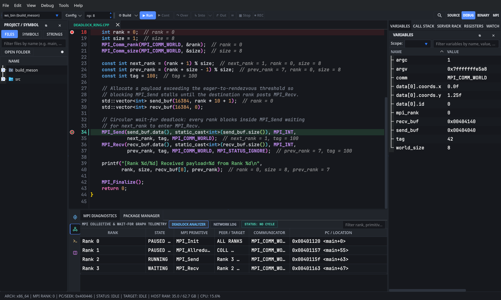
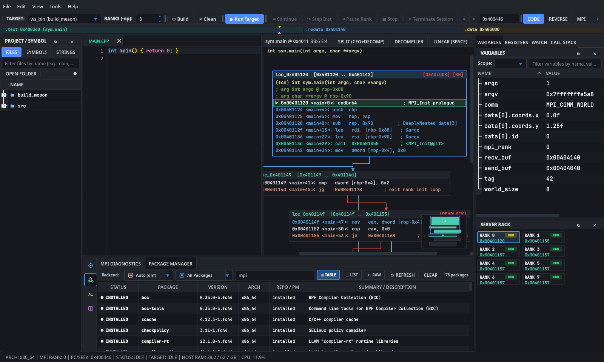
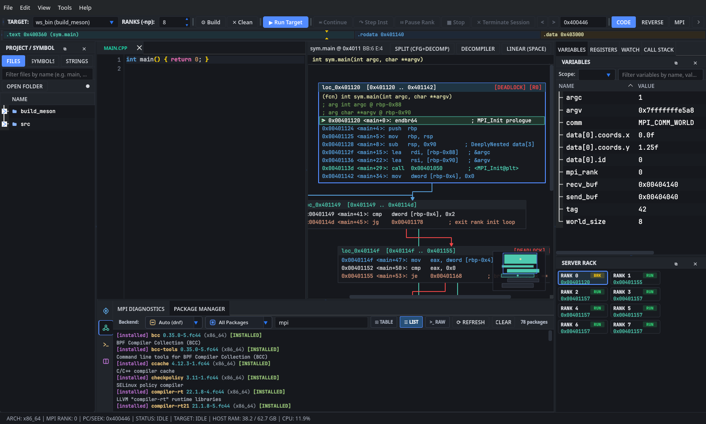

# MPI Diagnostics and HPC Analysis

GridLock coordinates multi-rank MPI processes in real time, tracks per-rank execution states across `ServerRackView` and the 2D Control Flow Graph, detects collective mismatches and point-to-point stalls in `DeadlockAnalyzer`, highlights divergent variable values across ranks in `DifferentialGrid`, and queries installed HPC toolchains in `HpcConsoleWidget`.

---

## 1. Multi-Rank Process Orchestration (`GdbRankCoordinator` & `DapCoordinator`)

* **MPMD `mpirun` over Named Pipes (`GdbRankCoordinator`)**:
  * When launching `-np N` ranks under `gdb`, `cuda-gdb`, or `rocgdb`, `GdbRankCoordinator` creates a private directory `/tmp/gridlock_mi_<pid>_<seq>` containing `0600` POSIX FIFOs (`r0.in`/`r0.out` .. `rN-1.in`/`rN-1.out`) monitored via non-blocking `QSocketNotifier`s.
  * It invokes a single `mpirun` job with `:`-separated `-np 1` MPMD clauses so every MPI rank shares one `MPI_COMM_WORLD` while talking over its own dedicated GDB/MI3 stream (`--interpreter=mi3 --quiet --nx -iex "set debuginfod enabled off"`).
  * During bootstrap, each GDB instance configures `pagination off`, `confirm off`, `breakpoint pending on`, `max-value-size unlimited`, and `nostop noprint pass` signal dispositions for MPI transport signals (`SIGPIPE`, `SIGUSR1`, `SIGUSR2`, `SIG32`, `SIG33`, `SIG34`). If `Trap FPE (NaN/Overflow)` is enabled in `Preferences -> Debugger`, `LaunchCommand` also broadcasts `catch signal SIGFPE` across all ranks.
* **OpenMP Hybrid Thread Control**:
  * Unless `OMP_NUM_THREADS` is already set in your environment or `MPI Args`, `GdbRankCoordinator` sets `OMP_NUM_THREADS = max(1, idealThreadCount / rankCount)` and `OMP_WAIT_POLICY=PASSIVE` so oversubscribed multi-rank + OpenMP jobs do not spin-lock host cores.
  * Within any stopped rank, use the **`Thread:`** dropdown at the top of **`CALL STACK`** to switch between OpenMP worker threads (`-thread-info` / `-thread-select`).

> [!IMPORTANT]
> Set `OMP_NUM_THREADS` explicitly in **Preferences -> HPC / Cluster -> MPI Env Vars** (or your shell) if you need to debug oversubscribed OpenMP teams where `idealThreadCount / rankCount == 1`.
* **Debug Adapter Protocol (`DapCoordinator`)**:
  * Selecting `LLVM LLDB-DAP (lldb-dap)` in `Preferences -> Debugger` switches `MainWindow` to `DapCoordinator`, communicating over `Content-Length` JSON-RPC framing for `launch`, `attach`, `setBreakpoints`, `dataBreakpointInfo` / `setDataBreakpoints`, `stackTrace`, `scopes`, `variables`, `evaluate`, `readMemory`, and `stepBack` / `reverseContinue`.

---

## 2. Multi-Rank Control in `ServerRackView`, Execution Scope, and CFG Rank Badges

* **`Server Rack` Dock (`ServerRackView`)**:
  * Renders a wrapping grid of compact blade cards (`RANK 0 .. RANK N-1`) with a state filter dropdown (`All`, `Running`, `Paused`, `Deadlock`, `Exited`).
  * Each card displays a color-coded state pill:
    * **`RUN`** (green `#2ecc71`): Rank is actively executing.
    * **`BRK`** (amber `#f1c40f`): Rank is paused at a breakpoint, step, signal, or `Pause`.
    * **`DEADLOCK`** (crimson `#f44747`): Rank participates in a detected MPI wait-for cycle or collective divergence.
    * **`EXITED` / `IDLE`** (gray `#64748b` / `#7f8c8d`): The rank has exited or the session is idle.
  * Below the rank title, each card shows the rank's live instruction pointer (`0x...`) when stopped.
  * **Master `setFocusedRank()` Synchronization & Execution Scope**: Clicking any card routes through `MainWindow::setFocusedRank()`, synchronizing `Variables`, `Registers`, `Call Stack`, `SourceCodeView`, `DisassemblyView`, `Memory View`, `ArrayPlotDialog` (supporting all `1..256` ranks), and `PointerGraphDialog`. Toggle execution scope between **`All Ranks`** and **`Rank k`**, or press **`F6`** (`Pause All Ranks`) to halt all running processes simultaneously.
* **CFG Basic-Block Rank Occupancy Badges (`DisassemblyView`)**:
  * In 2D Control Flow Graph mode (`Space`), every basic block displays pills on its header bar indicating which MPI ranks are currently stopped inside that block's address range (for example `[R0]` or collapsed `[R0-R3 (4)]`), plus a crimson **`[DEADLOCK]`** badge when a rank participates in a stall cycle.

---

## 3. Deadlock and Collective Divergence Detection (`DeadlockAnalyzer`)

Switch to the **`MPI`** perspective (or click **`MPI`** on the bottom tool rail) to open **`MPI Diagnostics`** (`MpiDiagnosticsWidget`).

### Recognized Blocking MPI Primitives (32 Symbols)

`DeadlockAnalyzer` inspects the innermost 8 stack frames (`0..7`) of every paused rank (normalizing `PMPI_*` profiling symbols to `MPI_*`) for 16 canonical blocking MPI calls:

* **9 Collective Routines**: `MPI_Barrier`, `MPI_Bcast`, `MPI_Reduce`, `MPI_Allreduce`, `MPI_Gather`, `MPI_Scatter`, `MPI_Allgather`, `MPI_Alltoall`, `MPI_Scan`.
* **7 Point-to-Point and Wait Routines**: `MPI_Send`, `MPI_Ssend`, `MPI_Sendrecv`, `MPI_Recv`, `MPI_Wait`, `MPI_Waitall`, `MPI_Waitany`.

When a rank stops inside an internal MPI library frame without DWARF symbols (`func="??"`), `DeadlockAnalyzer` walks up to the first user C/C++ caller frame outside `MPI_*`/`PMPI_*` (and falls back to scanning the caller source line on disk) so table locations always point to your own source file and line.

### Stall Classifications & Status Badge

The header badge (`#mpiDeadlockStatusBadge`) updates automatically as ranks pause or resume:

1. **`STATUS: NO CYCLE`** (teal `#4ec9b0`): Fewer than two ranks are stalled in incompatible blocking MPI primitives.
2. **`STATUS: COLL DIVERGENCE`** (crimson `#f44747`): Triggered when two or more paused ranks are blocked in **different** collective calls (for example Rank 0 in `MPI_Bcast` while Rank 1 is in `MPI_Barrier`), or when at least one rank is in a collective call while another rank is blocked in a point-to-point wait.
3. **`STATUS: CYCLE DETECTED`** (crimson `#f44747`): Triggered when two or more ranks are simultaneously paused in blocking point-to-point or `MPI_Wait*` primitives (such as every rank blocked in `MPI_Send` in `deadlock_ring.cpp`, or Rank 0/Rank 1 stalled on mismatched tags in `tag_mismatch_stall.cpp`).

### Inspecting Stalled Ranks

* **`DEADLOCK ANALYZER` Table (`#mpiRankWaitTable`)**: Shows `RANK` (with live OS PID), `STATE`, `MPI PRIMITIVE`, `PEER / TARGET`, `COMMUNICATOR`, and `PC / LOCATION` (`file:line`), filtered live via the header search box.
* **Jump to Stalled Rank**: **Double-click** any row in the wait table or the bottom alert list to focus that rank and jump `SourceCodeView` and `DisassemblyView` to its caller site.

> [!TIP]
> When multiple ranks stall inside stripped MPI library frames (`func="??"`), double-clicking a row in **`DEADLOCK ANALYZER`** unwinds directly to the first user C/C++ caller frame outside `MPI_*` / `PMPI_*` so you land on your own communication call site.

---

## 4. MPI Network Log (`MpiNetworkLogWidget`)

Inside **`MPI Diagnostics`**, click **`NETWORK LOG`** in the header bar to switch from the wait-for table to the message event log:

* **Columns**: `TIMESTAMP`, `SRC RANK`, `DST RANK`, `PRIMITIVE`, `TAG / COMM`, and `PAYLOAD BYTES`.
* **Controls**: Substring search box (`Filter traffic / rank / tag...`), traffic category dropdown (`All Traffic`, `Point-to-Point`, `Collectives`), and **`Clear`**.

---

## 5. Cross-Rank Outlier Detection (`DifferentialGrid` / `WATCH` Dock)

When debugging numerical drift, ghost-cell corruption, or rank-dependent branching across `N` processes, evaluating variables one rank at a time does not scale. Use the **`WATCH`** dock (`DifferentialGrid`) or broadcast an expression across **`All Ranks`** in **`Evaluator`**:

1. **Add Expressions**:
   * Type any C/C++ expression (such as `cfg.rank_branch_tag`, `left_ghost`, `stencil_center`, or `data[1].coords.x`) into `New watch expression...` at the top of **`WATCH`** and click **`+ Watch`** (or press `Enter`).
   * You can also right-click a row in **`Variables`** and choose **`Add to Watch Expressions`**, click **`+ Watch`** inside **`Evaluator`**, or **`Ctrl+LeftClick`** / **`DoubleClick`** an identifier in **`SourceCodeView`**.
2. **Consensus Outlier Highlighting**:
   * Rows correspond to `Rank 0 .. Rank N-1`; columns correspond to watched expressions.
   * On every stop, `DifferentialGrid::updateHighlights()` computes the modal (majority-vote) value string in each column across active ranks. Any rank cell whose value differs from the majority consensus is shaded light red (`rgb(255, 200, 200)`), immediately isolating a single diverged or `nan`-corrupted rank. double-click any cell to open the copyable **`Inspect Full Value...`** popover.

> [!NOTE]
> **Multidimensional Array & Multi-Rank Plotting**: `Tools -> Array & Field Plotter...` (`Ctrl+Alt+G`) supports multi-rank 1D curve overlays for halo/ghost-cell comparison, `start:end:stride` slicing, `Log10` scaling, `Complex64`/`Complex128` decoding, 2D colormapped heatmaps (`splot`/`pm3d` `gnuplot` export), and virtualized 2D/3D tensor tables (`[Nx, Ny, Nz]` C row-major and Fortran column-major).

---

## 6. System and HPC Package Manager (`HpcConsoleWidget`)

Click **`MPI`** on the bottom tool rail (`Alt+5`) and open the **`Package Manager`** tab to verify which MPI implementations, math libraries (`hypre`, `petsc`, `fftw`, `hdf5`), debuggers, and compilers are installed on your workstation or cluster login node.

| Sortable Table Mode (`⊞ Table`) | Rich Card Mode (`☰ List`) |
| :---: | :---: |
|  |  |

* **Auto-Detected Package Backends**: Probes `PATH` in order: `spack`, `pacman`, `dnf` (supports both DNF4 and DNF5 output formats), `apt-cache` / `apt`, `zypper`, `rpm`, `dpkg-query`, and `eb`. Override via the **`Backend:`** dropdown (`Auto`, `spack`, `pacman`, `dnf`, `apt`, `zypper`, `rpm`).
* **Two-Stage Query Pipeline**: Queries the local installed package database first (`rpm -qa`, `dpkg-query -W`, `pacman -Qs`) for instant `● INSTALLED` results, then runs a debounced (`300 ms`) repository search (`spack list -d`, `dnf --quiet search`, `pacman -Ss`, `apt-cache search`, `zypper --non-interactive se -s`) to merge `○ AVAILABLE` packages.
* **Filters & Display Modes**: Filter by **`All Packages`**, **`Installed Only`**, or **`Available Only`**, and switch between **`⊞ Table`** (6 sortable columns), **`☰ List`** (two-line summary cards), and **`>_ Raw`** (unformatted CLI output).
