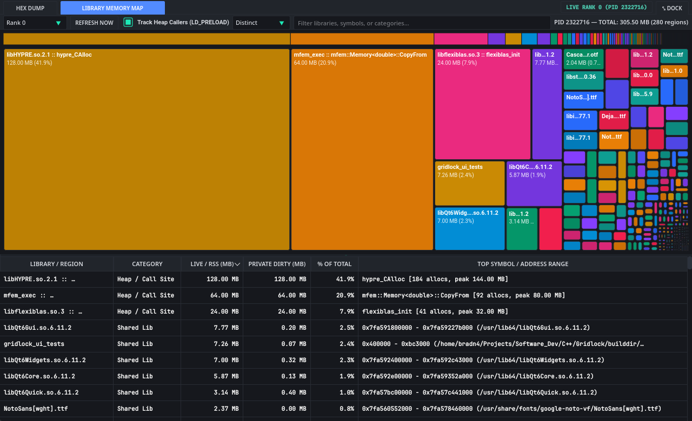
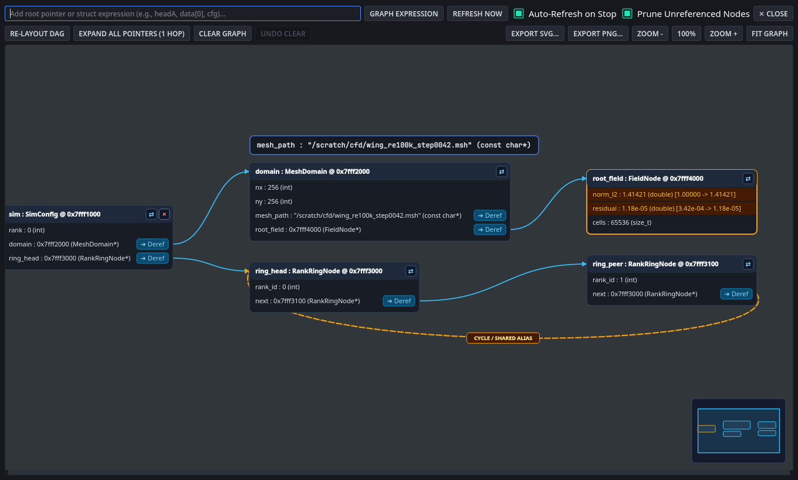
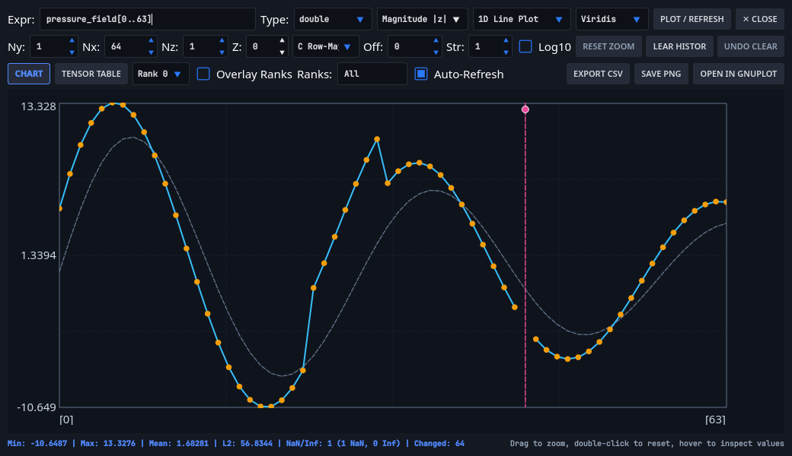
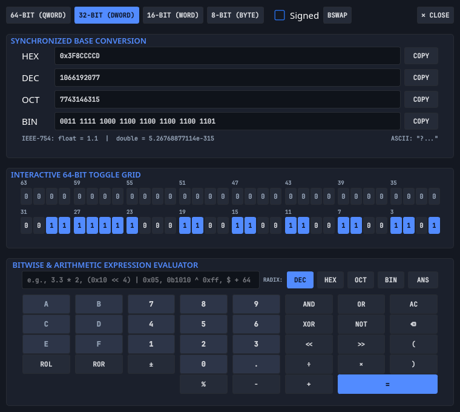
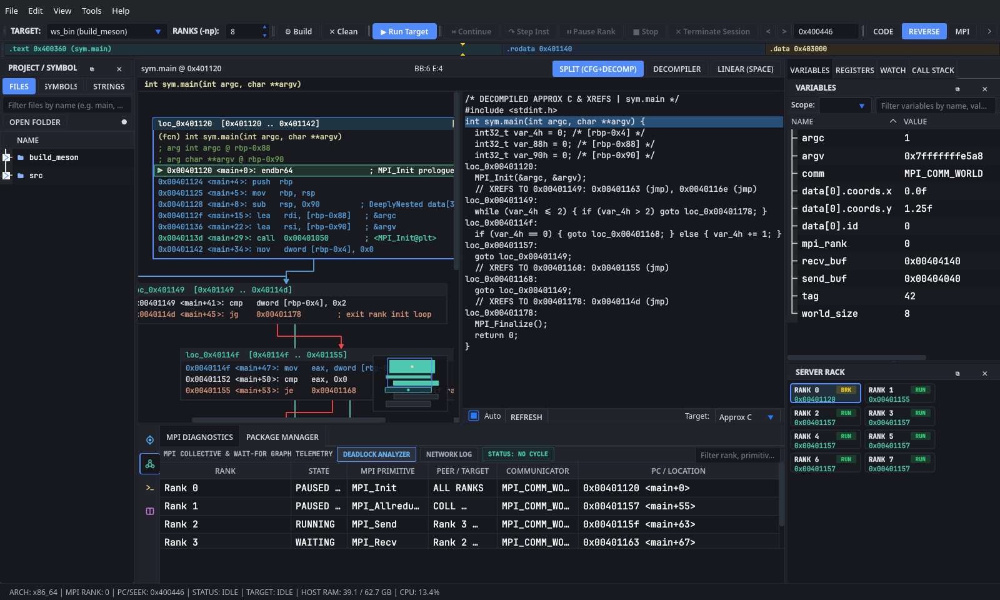

# Memory, Reverse Engineering, and Profiling

This guide covers process memory inspection and cross-rank byte diffing (`MemView`), virtual memory and heap-caller profiling (`MemoryProfilerWidget`), persistent pointer and struct graph visualization (`PointerGraphDialog`), live 1D/2D array plotting (`ArrayPlotDialog`), floating base/bit conversion (`ProgrammerCalculatorDialog`), ELF64 disassembly, 2D Control Flow Graphs, decompilation (`DisassemblyView`), and CPU register telemetry (`RegisterView`).

---

## 1. Hex Memory View, Cross-Rank Diffing, and Matrix Export (`MemView`)

Open the **`Memory View`** tab in the bottom dock (`Alt+4` -> `Memory View`). Ensure **`HEX DUMP`** is selected in the top bar.

### Reading Process and Static ELF Memory

* **Source Status Badge**: Shows **`IDLE (NO BINARY)`**, **`STATIC ELF (READ-ONLY)`** (reading virtual sections directly from disk via `ElfBinaryInspector`), **`LIVE RANK N (PID P)`**, or **`REMOTE RANK N (...)`**.
* **Fast `process_vm_readv` Path (`NativeMemoryReader` + `MemoryBoundsValidator`)**:
  * For local live processes, GridLock reads target memory directly via Linux `process_vm_readv`, enforcing `MIN_VALID_BASE_ADDRESS >= 0x1000`, natural element/stride alignment, 64-bit overflow guards, and a `64 MiB` per-transfer cap before falling back to GDB/MI or DAP memory reads when `ptrace_scope` restricts cross-process reads or when connected to a remote `gdbserver`/`qemu-user` target.
* **Seeking to an Address or Expression**:
  * Enter a hex address (`0x404040`), decimal literal (`0d16384`), symbol/pointer variable (`send_buf.data()`), or register (`$rsp`) in **`Addr:`**, set **`Bytes:`** (`1..4096`, default `256`), and click **`Read`** (or press `Enter`).
  * Left-clicking any `0x...` pointer value in the **`Variables`** dock automatically reads 256 bytes from that address into `MemView`.
* **Step Mutation Highlighting**: Bytes that changed since the previous debugger stop are highlighted in bold red (`#f44747`) across the 16-byte-per-row hex and ASCII columns.
* **Standalone Pop-Out Window**: Click **`⤢ POP OUT`** in the top-right corner of `MemView` to detach the entire memory inspector (`1280x820`) onto a second monitor; click **`⤡ DOCK`** (or close the window) to snap it back into the bottom dock.

> [!NOTE]
> When reading local targets, `NativeMemoryReader` transfers up to `64 MiB` via Linux `process_vm_readv` and falls back to GDB/MI or DAP memory commands automatically if `kernel.yama.ptrace_scope` denies direct reads or when debugging a remote `gdbserver` / `qemu-user` target.

### Cross-Rank Byte Diffing (`Diff Ranks` / `MemoryDiffer`)

1. Pause at least two MPI ranks at a synchronization point (for example before `MPI_Allreduce` or `MPI_Barrier`).
2. Enter the buffer address or expression (such as `&packet` or `domain.data()`) in **`Addr:`** and set **`Bytes:`**.
3. Set **`Base:`** (for example `0`) and **`Target:`** (for example `1` or `2`), then click **`Diff Ranks`**.
4. `MemView` compares `Base` against `Target` byte-by-byte (using `MemoryDiffer::compareMemory` over `process_vm_readv` when addresses match, or per-rank debugger evaluation when ASLR/stack addresses differ). Every differing byte is highlighted in bold red (`#f44747`); hover over any red byte to see a tooltip showing `Baseline: 0x.. | Target: 0x..`.

### Exporting Typed CSV Matrices and Raw Binary Slices (`Export` / `MemoryExporter`)

1. Read the desired buffer into `MemView` (`Addr:` and `Bytes:`).
2. Select the element type in **`Type:`**: **`Int32`** (`int32_t`), **`Float`** (`float`), or **`Double`** (`double`).
3. Click **`Export`** and choose an output path:
   * **`CSV Files (*.csv)`**: Unpacks the buffer as a typed row-major CSV slice (`std::setprecision(9)`) via `MemoryExporter::exportToCsv`.
   * **`Binary Files (*.bin)`**: Writes the exact raw byte slice verbatim via `MemoryExporter::exportToBinary`.

---

## 2. Library and Heap Memory Map Profiler (`MemoryProfilerWidget`)

Inside **`Memory View`**, click **`LIBRARY MEMORY MAP`** in the top bar to switch from the hex dump to the virtual memory profiler.

### How Memory Attribution Works

1. **`/proc/<pid>/smaps` VMA Categorization**: Parses `Size`, `Rss`, and `Private_Dirty` across all mapped regions of the selected rank (`Rank 0 .. Rank N-1` or `All Ranks Overview`) and classifies each region into five categories:
   * **`Shared Lib`**: Loaded `.so` libraries (`libmpi.so`, `libc.so`, `libstdc++.so`, CUDA/ROCm runtimes).
   * **`Heap / Call Site`**: Process `[heap]` and attributed dynamic allocations.
   * **`Anon mmap`**: Anonymous `rw-p` mappings outside `[heap]`.
   * **`MPI /dev/shm`**: Shared-memory transport segments (`/dev/shm/*`, POSIX shm, XPMEM/Vader buffers).
   * **`Stack`**: Thread `[stack]` mappings.
2. **`LD_PRELOAD` Heap Caller Attribution (`Track Heap Callers (LD_PRELOAD)`)**:
   * Checked by default. When `gcc` or `cc` is available, GridLock compiles a small interposition library (`/tmp/gridlock_memtrack_v2_<uid>.so`) and injects it via `LD_PRELOAD` into GDB-spawned ranks.
   * Allocations `>= 4 KB` via `malloc`, `calloc`, `realloc`, and `free` unwind past `libstdc++` `operator new` frames using `_Unwind_Backtrace`, `dladdr`, and `addr2line`, writing live call-site totals to `/tmp/gridlock_mem_<pid>.tsv` and deducting attributed heap bytes from the raw `[heap]` bucket so totals are never double-counted.

> [!WARNING]
> **`LD_PRELOAD` Attribution Scope**: Heap call-site attribution applies only to locally launched GDB ranks (`< 4 KB` small allocations stay grouped in `[heap]`) and requires `gcc` or `cc` on `PATH` to compile `/tmp/gridlock_memtrack_v2_<uid>.so`. Attach and remote targets still show full `/proc/<pid>/smaps` VMA attribution.

### Visual Controls and Colorblind-Safe Palettes

* **Proportional Bar & 2D Treemap (`MemoryTreemapCanvas`)**: Hover over any tile to inspect `Category`, `Live / RSS`, `Private Dirty`, and symbol/range details. Single-click a tile to select its row in the breakdown table; **double-click** any tile or table row to jump straight back to **`HEX DUMP`** at that mapping's start address.
* **Sortable Breakdown Table**: 6 columns (`Library / Region`, `Category`, `Live / RSS (MB)`, `Private Dirty (MB)`, `% of Total`, `Top Symbol / Address Range`) with numeric MB/% sorting and instant substring filtering (`Filter libraries, symbols, or categories...`).
* **5 Color Schemes** (synced with `Edit -> Preferences -> Appearance -> Memory Map Color Scheme`):
  * **`Distinct`** (category and library distinct hues, default)
  * **`Viridis`** (perceptually uniform sequential green-blue-yellow)
  * **`Plasma`** (perceptually uniform purple-orange-yellow)
  * **`Ocean`** (cool-to-warm blue-cyan)
  * **`High-Contrast`** (Okabe-Ito colorblind-safe palette)

---

## 3. Topological Pointer and Struct Graph Visualizer (`PointerGraphDialog`)

Open **`Tools -> Pointer & Struct Graph Visualizer...`** from the menu bar, or right-click any struct/pointer variable in **`SourceCodeView`** or **`Variables`** and select **`Visualize in Pointer / Struct Graph...`**.

### Operating the Graph Canvas

1. **Graph, Pin, and Unpin Multiple Root Expressions**: Type a C/C++ struct or pointer variable (with live symbol/variable autocomplete) into the top input box and click **`Graph Expression`**. Pin multiple roots simultaneously and unpin individual roots (`✕`) with optional orphan pruning.
2. **Persistent Auto-Updating Roots & Mutation Diffs**:
   * Enable **`Auto-Refresh on Stop`** (checked by default) to re-evaluate pinned roots on every breakpoint stop, highlighting changed scalar and pointer fields with inline **`[old -> new]`** mutation badges and dynamically splitting or merging alias edges when pointers change.
3. **Interactive Dereferencing, `Shift+Click` Width Expansion & Tooltips**:
   * Click **`-> Deref`** or **double-click** any pointer/composite field row to expand that child node live via `IBackendCoordinator::requestVariableChildren`, or click **`Expand All Pointers (1 Hop)`**.
   * **`Shift+Click`** any node card (or right-click -> `Expand Card Width`) to widen that card up to `900px` for long strings/paths, hover any field row to read its un-elided full-value tooltip, suppress noisy fields (`+N hidden`), toggle horizontal/vertical card orientation, or apply `/x`, `/d`, `/b` scalar format overrides.
4. **Sugiyama Layered DAG, Cycle Detection, Minimap & Export**:
   * **`Re-Layout DAG`** arranges nodes in layered Sugiyama ranks while preserving manual drag coordinates across debugger steps (`Clear Graph` includes 1-click **`Undo Clear`**).
   * Forward tree edges render as solid cyan (`#38bdf8`) cubic Bezier curves; cyclic back-edges and shared aliases render as dashed amber (`#f59e0b`) curves labeled **`CYCLE / SHARED ALIAS`**.
   * Zoom smoothly with the mouse wheel (`0.25x` to `2.5x`), navigate via the bottom-right interactive minimap, and export `2x` high-DPI PNGs or vector SVGs (**`Export PNG...`** / **`Export SVG...`**).

---

## 4. Multi-Rank & Scientific Array Plotter (`ArrayPlotDialog`, `Ctrl+Alt+G`)

Open **`Tools -> Array & Field Plotter...`** (`Ctrl+Alt+G`) or right-click an array/pointer expression in **`Variables`** to plot live numerical arrays, multi-rank overlays, 2D matrices, and 3D tensors directly from inferior memory.

* **Data Types, Slicing & Multi-Rank Overlays**:
  * Supports `double`, `float`, `int32_t`, `int64_t`, `uint8_t`, **`Complex64`**, and **`Complex128`** (`Magnitude`, `Phase`, `Real`, `Imaginary`) with `start:end:stride` slice notation.
  * Switch between **`1D Line Plot`**, **`1D Bar / Stem`**, **Multi-Rank 1D Overlay** (comparing halo/ghost cells across up to 256 ranks), **Scalar Time-Series History**, **`2D Heatmap`** (`Viridis`, `Plasma`, `Diverging Cool-Warm`, `Grayscale`), and zero-copy virtualized **2D/3D Tensor Tables** (`[Nx, Ny, Nz]` C row-major vs. Fortran column-major).
* **Log10 Scaling, Drag-Box Zoom & Anomaly Flagging**:
  * Toggle base-10 logarithmic (**`Log10`**) Y/colorbar scaling, drag a selection rectangle to zoom into subtle boundary features, and inspect live **`Min`**, **`Max`**, **`Mean`**, **`L2 Norm`**, and **`NaN` / `Inf`** counts with translucent previous-stop ghost overlays.
* **Validated Export & External Plotting**: Click **`Export CSV`**, **`Save PNG`**, or **`Open in gnuplot`** (supports both 1D curves and 2D `splot`/`pm3d` matrices with `gnuplot` executable and stderr validation).

---

## 5. Floating Programmer's Calculator (`ProgrammerCalculatorDialog`, `Ctrl+Alt+C`)

Open **`Tools -> Programmer's Calculator...`** (`Ctrl+Alt+C`), launch `> Programmer's Calculator` from Search Everywhere, or right-click any value/address/byte offset in **`SourceCodeView`**, **`Variables`**, **`Registers`**, **`Memory View`** (using the exact byte under the hex cursor), or **`DisassemblyView`** and select **`Open in Programmer's Calculator`**.

* **Synchronized Multi-Base Readouts**: Edit **`HEX`**, **`DEC`** (signed or unsigned), **`OCT`**, or **`BIN`** and watch all four bases update immediately, alongside live **IEEE-754 `float`/`double`** hex bit-pattern decoding and **ASCII** byte readout.
* **Word Width, Endianness & Bit Grid**:
  * Switch word width between **`8-bit`**, **`16-bit`**, **`32-bit`**, and **`64-bit`** (with automatic masking and default width/signedness configurable in `Project Settings` and `Preferences`).
  * Click **`BSWAP`** to reverse byte order for inspecting little-endian vs. big-endian network/MPI payloads.
  * Click any bit (`63..0`) in the **64-bit interactive toggle grid** to flip individual flag/mask bits in place.
* **Radix-Aware Keypad & Expression Evaluator**: Includes a full clickable `0-9` / `A-F` / bitwise (`AND`, `OR`, `XOR`, `NOT`, `<<`, `>>`) / arithmetic / floating-point keypad plus a free-form C expression bar (such as `(0x10 << 4) | 0x05` or `3.3 * 2`).

---

## 6. Disassembly, 2D Control Flow Graph, Decompiler, and Validated Patching

Switch to the **`BINARY`** perspective (`Alt+3`), or inspect assembly alongside C/C++ code when needed.

### Modes and Navigation (`DisassemblyView`)

* **`CFG (Space)` / `Linear (Space)`**: Press **`Space`** (or click the top-right toggle button) to switch between:
  * **Linear Assembly**: Intel-syntax disassembly (`objdump -d -l -C -M intel`) with a `46px` left `BranchFlowGutter` drawing multi-lane forward/backward conditional and unconditional jump arcs, emerald `▶` PC chevrons, and amber `◆` bookmark diamonds.
  * **2D Control Flow Graph (`CfgGraphView`)**: Basic-block cards connected by orthogonal true (green), false (red), and unconditional (blue) edges, annotated with live MPI rank badges (`[R0]`, `[R0-R3 (4)]`), `[DEADLOCK]` alerts, and a `120x90` bottom-right minimap. Pan with middle-drag, `Space`+left-drag, or `Left`/`Right` arrow keys; press `Home` to snap back to the active block.
* **Toolbar Stepping (`stepi` / `nexti`)**: Step into (`-exec-step-instruction`) or step over (`-exec-next-instruction`, `Ctrl+Shift+F10`) individual machine instructions directly from the disassembly header bar.
* **`DECOMPILER` and `SPLIT (CFG+DECOMP)`**:
  * Generates structured **`Approx C`**, **`C++ / MPI`**, or **`Pseudocode`** (selectable in the footer **`Target:`** dropdown, with **`Auto`** refresh and manual **`Refresh`**).
  * Clicking any line in the decompiler or `SourceCodeView` jumps the linear disassembly, CFG, and `MemView` to the corresponding DWARF instruction address; selecting any identifier token (`2..32` chars) highlights every occurrence across assembly, CFG blocks, and decompiled output.
  * By default, the decompiler pane hides automatically when `SourceCodeView` already shows matching DWARF source; enable `Show Pseudo-C Decompiler when Source Editor is visible` in `Preferences -> Debugger` to keep all three panes open together.

### Cross-References (`X`) and Validated Instruction Patching (`Alt+P`)

* **Cross-Reference Inspector (`XrefInspectorDialog`)**: Press **`X`** (or right-click -> **`Inspect Cross-References (X)`**) to inspect incoming callers/branches (**`XREFS TO`**) and outgoing `CALL`, `CJMP`, `JMP`, and RIP-relative `DATA` references (**`XREFS FROM`**) with a live filter bar and assembly preview pane. Double-click any row to jump to that address.
* **Single-Popup Context Menu**: Provides **`Run to Instruction Address`**, **`Jump / Set PC to Address`**, **`Open Address in Programmer's Calculator`**, **`Seek in Memory View`**, **`Inspect Cross-References (X)`**, **`Lookup in Reference Manual (F1)`**, **`Toggle Bookmark`**, **`Patch Instruction`**, and **`Revert All Patches`**.
* **Validated Instruction & ELF64 Patching**: Press **`Alt+P`** in `DisassemblyView` to validate hex byte sequences or `nop` mnemonics against the instruction byte width, splicing `; [PATCHED]` into the listing, supporting **`Revert All Patches`**, and exporting via `ElfBinaryInspector::savePatchedBinary`.

> [!CAUTION]
> Exporting patched binaries via `savePatchedBinary` modifies executable `.text` bytes on disk. Always verify instruction byte lengths and relative branch targets (or use **`Revert All Patches`**) before writing over production or cluster executables.

---

## 7. CPU Registers (`RegisterView`) and Status Bar Telemetry

* **`Registers` Dock (`RegisterView`)**:
  * Pins `rip`, `rsp`, and `rbp` at the top, color-coding instruction pointers, stack pointers, and `eflags`.
  * Supports live in-place register modification (`-gdb-set $reg=...`), **`Inspect Full Value...`**, and bold red step-delta highlighting.
  * The search bar (`Filter registers by name or hex/dec value...`) matches register names, hex strings (`401125`), and converted unsigned decimal values. Double-clicking any register seeks `DisassemblyView` and `MemView` to its pointer value; right-clicking sends its value to **`Programmer's Calculator`**.
* **Bottom Status Bar Telemetry (`ElfBinaryInspector`)**:
  * Displays `ARCH`, focused `MPI RANK`, active `PC/SEEK`, session `STATUS`, per-rank `STACK` (active frame delta `stackTop - $rsp` plus mapped `[stack]` RSS) and `HEAP` (`[heap]` RSS from `/proc/<pid>/smaps`), plus host `RAM` (`/proc/meminfo`) and delta `CPU %` (`/proc/stat`), configurable as `GB`, `%`, or `Both` in `Preferences -> Behavior`.
