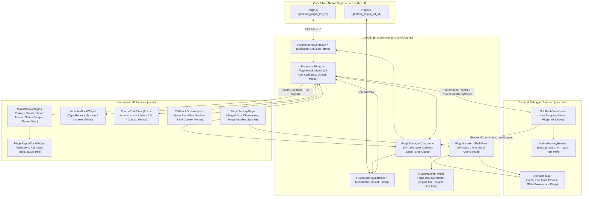
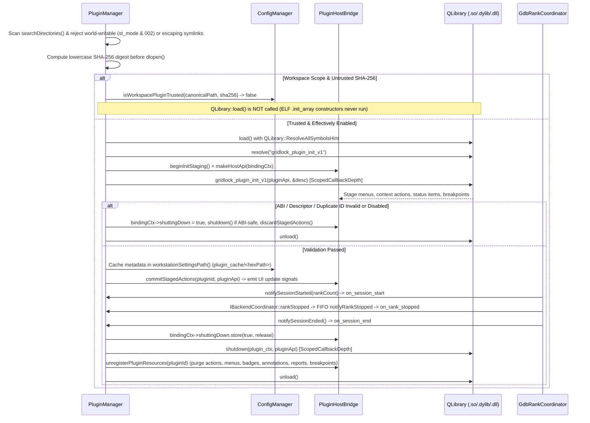

# Plugin Architecture, Lifecycle, Security & Build Pipeline (Developer Encyclopedia - Volume 1)

This reference documents the host-side architecture of GridLock's native C99 plugin subsystem (`src/core/plugins/` and `src/ui/`), including component ownership, `dlopen` pre-verification, initialization staging, callback re-entrancy and threading state machines, enforced memory/regex/UI security quotas, and the shell-free multi-forge `PluginInstaller` + `PluginManifest` build pipeline.

---

## 1. System Architecture & Module Ownership

GridLock isolates dynamically loaded C99/C++23 shared libraries behind a zero-Qt C99 function-pointer table (`GridLockHostApi` in `include/gridlock/plugin_api.h`). Every loaded plugin receives a private `GridLockHostApi` copy whose `host_ctx` points to a dedicated `PluginBindingContext`, enabling `PluginHostBridge` to attribute every allocation, action, menu, status badge, breakpoint, annotation, and report panel to its owning plugin and purge them deterministically prior to `QLibrary::unload()`.



### Subsystem Translation Units & Thread Affinity

| Translation Unit | Primary Classes / Structs | Thread Affinity & Responsibility |
| :--- | :--- | :--- |
| `include/gridlock/plugin_api.h` | `GridLockHostApi` (`296 B`), `GridLockPluginDescriptor` (`160 B`), POD context/theme structs | Pure C99 ABI header (`GRIDLOCK_CALL`, zero Qt types, 16-byte versioned struct headers, `void* reserved[8]`). |
| `src/core/plugins/PluginUiModels.hpp` | `PluginBindingContext`, `RegisteredMenuAction`, `PluginStatusItem`, `RegisteredContextAction`, `PluginEditorAnnotation`, `PluginReportPanel` | Host-side value models and per-plugin `std::atomic<bool> shuttingDown` binding context. |
| `src/core/plugins/PluginManager.{hpp,cpp}` | `PluginManager`, `LoadedPluginInfo`, `ActivePluginHandle`, `ScopedCallbackDepth` | GUI/owner thread. Directory scanning, POSIX/symlink checks, pre-`dlopen` `SHA-256` workspace gate, `m_callbackDepth` unload deferral, and FIFO `m_pendingStops` dispatch. |
| `src/core/plugins/PluginHostBridge.cpp` | `PluginHostBridge`, `CoordinatorReplyWaiter` | Thread-safe (`m_mutex` + `runOnObjectThread` / `runOnGuiThread`). Lifecycle staging, memory allocators, `eval_expr`, tokenized `read_memory`/`write_memory`, and sanitized breakpoints. |
| `src/core/plugins/PluginHostBridgeUi.cpp` | `PluginHostBridge` UI callbacks, `CachedPromptReply` | Thread-safe (`noexcept` + `runOnGuiThread`). Dialogs, two-pass cached `prompt_input`, toasts, nested menus, status badges, 5-surface regex actions, annotations, theme queries, and report views. |
| `src/core/plugins/PluginManifest.{hpp,cpp}` | `PluginManifest`, `PluginManifestEntry`, `PluginLockEntry` | Multi-forge Git URL normalization (`GitHub`, `GitLab`, `Codeberg`, `CustomUrl`, `file://`), `toml++` manifest/lockfile I/O, and `git ls-remote` / `SHA-256` freshness checks. |
| `src/core/plugins/PluginInstaller.{hpp,cpp}` | `PluginInstaller`, `PluginBuildResult`, `GitForgeHost` | Asynchronous `QProcess` state machine driving `git clone`, Meson/CMake/Make/single-file compilation, diagnostic classification, atomic `.tmp.<pid>` `rename()`, and sequential `syncFromManifests()`. |
| `src/ui/MainWindowPlugins.cpp` | `MainWindow` plugin slots | GUI thread. Renders `QMessageBox`, `QInputDialog`, floating toast banners, `Tools -> Plugins` submenu trees (`ShortcutManager` collision check), status-bar pills, `ThemeManager` sync, and `PluginReportDockWidget` routing. |
| `src/ui/dialogs/preferences/PluginSettingsPage.{hpp,cpp}` | `PluginSettingsPage` | GUI thread. Staged `Global` / `Workspace` / `Trust` table edits, multi-forge Git installer tab (`#pluginInstallTab`), `Sync plugins.toml`, and detached self-restart (`QProcess::startDetached`). |

---

## 2. Discovery, Pre-`dlopen` SHA-256 Gate, Init Staging & Teardown Sequence

`PluginManager::discoverAndLoad()` scans `~/.config/gridlock/plugins/` (`PluginScope::UserGlobal`) followed by `<workspace>/.gridlock/plugins/` (`PluginScope::Workspace`). Any registrations performed by a plugin inside `gridlock_plugin_init_v1` are buffered in `PluginHostBridge`'s staging vectors (`m_stagingActive = true`) and committed atomically only after all ABI, descriptor, enablement, and action-ID uniqueness checks succeed.



---

## 3. Re-Entrancy, Threading & Teardown State Machine

Synchronous host queries (`eval_expr`, `read_memory`, `write_memory`) wait on coordinator MI replies using a local `CoordinatorReplyWaiter` (`QEventLoop::ExcludeUserInputEvents`). Because Qt timers and queued socket deliveries remain active while waiting, a plugin callback could otherwise trigger recursive `on_rank_stopped` invocations or re-entrant `unloadAll()` calls (`dlclose()` while plugin frames are still on the C call stack). `PluginManager` and `PluginHostBridge` eliminate both hazards with explicit depth counters, FIFO queues, and atomic shutdown lockouts.

```mermaid
stateDiagram-v2
  [*] --> Unloaded
  Unloaded --> PreLoadVerify : discoverAndLoad() / loadPluginFromPath()
  PreLoadVerify --> BlockedUntrusted : Workspace SHA-256 unapproved or world-writable / symlink escape
  PreLoadVerify --> InitStaging : Regular binary + trusted + enabled
  InitStaging --> Unloaded : ABI mismatch / duplicate ID -> discardStagedActions() + unload()
  InitStaging --> ActiveIdle : commitStagedActions()

  ActiveIdle --> InCallback : ScopedCallbackDepth (++m_callbackDepth)
  InCallback --> StopQueueDrain : rankStopped arrives while m_dispatchingStop == true (enqueue PendingStopEvent)
  StopQueueDrain --> InCallback : Drain next FIFO PendingStopEvent at top-level loop
  InCallback --> DeferredReload : unloadAll() or discoverAndLoad() called while m_callbackDepth > 0
  InCallback --> ActiveIdle : m_callbackDepth == 0 (no pending deferred flags)
  DeferredReload --> ShuttingDownLockedOut : leaveCallbackScope() unwinds to m_callbackDepth == 0

  ActiveIdle --> ShuttingDownLockedOut : unloadAll() / setPluginEnabled(false) / ~PluginManager()
  ShuttingDownLockedOut --> Unloaded : on_session_end -> shutdown -> unregisterPluginResources -> QLibrary::unload()
```

### Concurrency, Marshaling & Teardown Invariants

| Mechanism | Location | Enforced Guarantee |
| :--- | :--- | :--- |
| **`m_callbackDepth` & `ScopedCallbackDepth`** | `PluginManager.{hpp,cpp}`, `PluginHostBridge.cpp` | Incremented across `gridlock_plugin_init_v1`, `on_session_start`, `on_rank_stopped`, `on_session_end`, `on_theme_changed`, `shutdown`, and every UI/context/status callback (`m_callbackScopeHook`). Calling `unloadAll()`, `discoverAndLoad()`, or `setPluginEnabled(id, false)` while `m_callbackDepth > 0` sets `m_pendingUnloadAll` / `m_pendingDiscoverAndLoad` and defers `QLibrary::unload()` until `leaveCallbackScope()` reaches depth `0`. |
| **FIFO `m_pendingStops` & `m_dispatchingStop`** | `PluginManager.cpp` | Copies `GridLockStopInfo` strings into owned `QByteArray` buffers (`PendingStopEvent`) and enqueues them. If a synchronous `eval_expr` or `read_memory` call inside `on_rank_stopped` spins a `QEventLoop` while another rank stops, the new stop waits in `m_pendingStops` and dispatches strictly after the active stop iteration completes. |
| **Dedicated `IBackendCoordinator::rankStopped`** | `GdbMiParser.cpp`, `PluginManager.cpp` | Emitted exclusively on genuine GDB/MI `*stopped` records. Clicking frames in `CallStackDockWidget` (`selectStackFrame()`) updates `VariablesDockWidget` without firing `on_rank_stopped`. |
| **`PluginBindingContext::shuttingDown` Lockout** | `PluginUiModels.hpp`, `PluginManager.cpp`, `PluginHostBridge*.cpp` | Stored with `std::memory_order_release` before `on_session_end` / `shutdown` and checked with `std::memory_order_acquire`. Rejects late action/menu/context/status/annotation/report registrations, modal dialogs, breakpoint insertions (`GRIDLOCK_ERR_UNSUPPORTED`), and coordinator queries (`GRIDLOCK_ERR_NOT_STOPPED`). |
| **Cross-Thread Marshaling (`runOnGuiThread` / `runOnObjectThread`)** | `PluginHostBridge.cpp` | Executes directly when called from `PluginHostBridge::thread()`; otherwise marshals via `QMetaObject::invokeMethod(..., Qt::BlockingQueuedConnection)`, re-checking `ctx->shuttingDown` inside the target-thread lambda. |
| **`CoordinatorReplyWaiter` Abort & Token Cleanup** | `PluginHostBridge.cpp`, `GdbRankCoordinator` | Aborts the local `QEventLoop` immediately on `rankStateChanged` (`currentState != "stopped"`), `sessionErrorOccurred`, `QObject::destroyed`, or `QTimer::timeout` (`default 2500 ms`), then calls `cancelPluginMemoryRequest(rank, expectedTok)` so late GDB/MI replies never touch freed stack state or `MemView`. |
| **Two-Pass `CachedPromptReply`** | `PluginHostBridgeUi.cpp` | When `cbPromptInput` is probed with a small buffer (`cap <= payloadLen`) and returns `GRIDLOCK_ERR_BUFFER_TOO_SMALL`, the accepted UTF-8 input is cached under `(pluginId, title, label)` so the immediate resized retry (`plugin_cpp_helpers.hpp`) copies the answer without opening a second `QInputDialog`. |
| **Exception Firewalls (`noexcept` + `try / catch (...)`)** | `PluginHostBridge.{hpp,cpp}`, `PluginHostBridgeUi.cpp` | Every `GRIDLOCK_CALL` static callback is `noexcept` and wrapped in `try { ... } catch (...)`, translating unexpected C++ exceptions into `GRIDLOCK_ERR_UNSUPPORTED` (or `nullptr` for `alloc_bytes`) so exceptions never cross the C99 ABI boundary. |

---

## 4. Security Gates & Enforced Resource Quotas

Every pointer, string length, integer range, filesystem path, and regex pattern crossing the C99 ABI or installer boundary is validated prior to use:

| Boundary / Operation | Enforced Quota or Gate | Rejection Status / Behavior |
| :--- | :--- | :--- |
| **Plugin Directory & Binary Permissions** | Rejects POSIX world-writable directories or shared libraries (`(st.st_mode & 002) != 0`). | Skipped (directory) or recorded as `Rejected world-writable plugin binary` prior to `dlopen()`. |
| **Symlink Containment** | `QFileInfo::canonicalFilePath()` of every candidate `.so`/`.dylib`/`.dll` must begin with `<canonicalPluginRoot>/`. | Recorded as `Rejected symlink escaping plugin directory` without `dlopen()`. |
| **Workspace Binary `SHA-256` Gate** | Computes lowercase `SHA-256` prior to `QLibrary::load()` and checks `[plugins.trusted_workspace_binaries]` in `~/.config/gridlock/config.toml`. | Blocked before `dlopen()`; ELF `.init_array` constructors cannot execute until approved. |
| **`read_memory` Size & Overflow** | `numBytes <= 64 MiB` (`67,108,864 B`), `address <= UINT64_MAX - (numBytes - 1)`, `64 KiB` MI read chunks (`kPluginReadChunkBytes`), Linux `process_vm_readv` local fast path. | `GRIDLOCK_ERR_INVALID_ARG` on bounds/wrap; `GRIDLOCK_ERR_MEMORY_READ_FAILED` or `GRIDLOCK_ERR_TIMEOUT` on fault/timeout. |
| **`write_memory` Size & Overflow** | `numBytes <= 16 MiB` (`16,777,216 B`), `address <= UINT64_MAX - (numBytes - 1)`, `16 KiB` MI write chunks (`kPluginWriteChunkBytes`). | `GRIDLOCK_ERR_INVALID_ARG` on bounds/wrap; `GRIDLOCK_ERR_MEMORY_READ_FAILED` or `GRIDLOCK_ERR_TIMEOUT` on fault/timeout. |
| **`plugin_cpp_helpers.hpp` String Retry Cap** | `kMaxHelperStringBytes = 16 MiB` (`16,777,216 B`) on two-pass `evalExpr` and `promptInput` retries. | `std::unexpected(GRIDLOCK_ERR_BUFFER_TOO_SMALL)` if reported `*out_len > 16 MiB`. |
| **Breakpoints (`set_breakpoint`)** | `line > 0`, non-empty `file_utf8` with zero control characters (`< 0x20`, `0x7F`, `QChar::Other_Control`), and `validateSafeDebuggerInput(condition)` rejecting newlines/MI command injection. | `GRIDLOCK_ERR_INVALID_ARG`. |
| **PCRE2 Regexes (`type_regex`, `filter_regex`)** | Pattern length `<= 512 B` (`kMaxTypeRegexBytes`), prepended with `(*LIMIT_MATCH=10000)(*LIMIT_RECURSION=250)`, `compiled.optimize()`, and `2048`-char input truncation evaluated outside `m_mutex`. | `GRIDLOCK_ERR_INVALID_ARG` on oversized or invalid regex; ReDoS backtracking aborts cleanly without holding `m_mutex`. |
| **Identifiers, Titles, Labels & Menu Paths** | `<= 256 B` (`kMaxTitleBytes`) via `strnlen`, non-empty where required, and zero ASCII/Unicode control characters. | `GRIDLOCK_ERR_INVALID_ARG`. |
| **Nested Menu Path (`register_menu_action`)** | `1..4` non-empty `"/"`-delimited segments (`kMaxMenuPathDepth = 4`); shortcut hints checked against `ShortcutManager::registeredBindings()`. | `GRIDLOCK_ERR_INVALID_ARG` if depth `> 4` or empty segment; colliding shortcuts silently omitted in UI. |
| **Dialog Bodies, JSON Events & Report Content** | `<= 1 MiB` (`kMaxPayloadBytes = 1,048,576 B`) via `strnlen`. | `GRIDLOCK_ERR_INVALID_ARG`. |
| **`prompt_input` Default Value** | `<= 64 KiB` (`kMaxPromptDefaultBytes = 65,536 B`). | `GRIDLOCK_ERR_INVALID_ARG`. |
| **File Paths, Tooltips & Annotation Details** | `<= 4096 B` (`file_utf8`, `tooltip_utf8`, `detail_utf8`); color token `<= 64 B` (`accent`, `warning`, `error`, or `#RRGGBB`). | `GRIDLOCK_ERR_INVALID_ARG`. |
| **Toast Duration (`show_toast`)** | Clamped to `[500, 30000]` ms (`<= 0` defaults to `4000` ms). | Clamped in-place (`GRIDLOCK_OK`). |
| **Per-Plugin Status Items (`set_status_item`)** | `<= 16` distinct `item_id` entries per plugin (`kMaxStatusItemsPerPlugin = 16`). | `GRIDLOCK_ERR_INVALID_ARG` when quota is exceeded or `item_id` belongs to another plugin. |
| **Per-Plugin Editor Annotations** | `<= 256` distinct `annotation_id` entries per plugin (`kMaxAnnotationsPerPlugin = 256`). | `GRIDLOCK_ERR_INVALID_ARG` when quota is exceeded or `annotation_id` belongs to another plugin. |
| **Plugin Log Sink (`log_message`)** | Truncated at `16 KiB` (`kMaxLogMessageBytes`); `TRACE`/`DEBUG` suppressed unless `GRIDLOCK_PLUGIN_VERBOSE_LOGS=1`; UI flushes up to `512` coalesced lines every `30 ms`. | Prevents console UI starvation under high-frequency plugin logging. |

---

## 5. `PluginInstaller` Build Pipeline & `PluginManifest` Reference

`PluginInstaller` and `PluginManifest` never invoke `/bin/sh -c` or shell command strings. Every `git`, `meson`, `ninja`, `cmake`, `make`, `c++`, and `cc` invocation runs directly through `QProcess::start(program, QStringList args)` with `GIT_TERMINAL_PROMPT=0` and `LC_ALL=C.UTF-8`.

### Multi-Forge URL & Shorthand Normalization (`PluginManifest::normalizeGitUrl`)

All inputs reject empty strings, leading `-` characters, whitespace, ASCII/Unicode control/format characters, `@` userinfo in HTTPS authorities, and `.` / `..` or leading-`-` path segments:

| Input Pattern | `defaultForge` | Segment Bounds | Normalized Clone URL |
| :--- | :--- | :---: | :--- |
| `github:<owner>/<repo>` | Any | `2` | `https://github.com/<owner>/<repo>.git` |
| `gitlab:<group>[/<sub...>]/<repo>` | Any | `2..8` | `https://gitlab.com/<path>.git` |
| `codeberg:<owner>/<repo>` | Any | `2` | `https://codeberg.org/<owner>/<repo>.git` |
| `<owner>/<repo>` | `GitForgeHost::GitHub` | `2` | `https://github.com/<owner>/<repo>.git` |
| `<group>[/<sub...>]/<repo>` | `GitForgeHost::GitLab` | `2..8` | `https://gitlab.com/<path>.git` |
| `<owner>/<repo>` | `GitForgeHost::Codeberg` | `2` | `https://codeberg.org/<owner>/<repo>.git` |
| `<owner>/<repo>` | `GitForgeHost::CustomUrl` | Rejected | Rejected (requires full URL or explicit forge prefix). |
| `https://<host>[:<port>]/<path>[.git]` | Any | `2` (`github.com`, `codeberg.org`), `2..8` (`gitlab.com`), `1..10` (Gitea/custom) | `https://<lower_host>[:<port>]/<path>.git` |
| `git@<host>:<path>[.git]` | Any | Same host rules (no `:port`) | `git@<lower_host>:<path>.git` |
| `file:///<abs_path>` | Any (unit tests) | `>= 1` | `file:///<clean_abs_path>` (clones with `-c protocol.file.allow=always`). |

Git refs (`PluginInstaller::validateGitRef`) must match `^[A-Za-z0-9._/-]{1,128}$` with no leading `-` or `/`, no trailing `/` or `.lock`, and no `..` or `@{`. Branch/tag refs clone with `git clone --depth 1 [--branch <ref>] -- <url> <dest>`, while 7..40 character hex commit SHAs run `git clone --no-checkout -- <url> <dest>` followed by `git checkout <sha>`.

### Build-System Auto-Detection & Explicit `build` Modes

`PluginInstaller::enqueueDetectedBuildSteps()` inspects `<clonedRepo>` (falling back to `<clonedRepo>/plugin/` if the repository root contains no build manifest or C/C++ sources) and resolves `gridlock/plugin_api.h` via `GRIDLOCK_INCLUDE_DIR`, `<appDir>/../include`, `<appDir>/include`, `$APPDIR/usr/include`, `./include`, `/usr/local/include`, and `/usr/include`:

| Priority | `build` Mode | Trigger File(s) | Exact `QProcess` Invocations (`program`, `args`) |
| :---: | :---: | :--- | :--- |
| `1` | `"meson"` or `"auto"` | `meson.build` | 1. `meson` `["setup", "<staging>/build", "-Dgridlock_include_dir=<incDir>"]`<br>2. `ninja` `["-C", "<staging>/build"]` |
| `2` | `"cmake"` or `"auto"` | `CMakeLists.txt` | 1. `cmake` `["-B", "<staging>/build", "-DGRIDLOCK_INCLUDE_DIR=<incDir>"]`<br>2. `cmake` `["--build", "<staging>/build"]` |
| `3` | `"make"` or `"auto"` | `Makefile` or `GNUmakefile` | 1. `make` `["GRIDLOCK_INCLUDE_DIR=<incDir>"]` |
| `4a` | `"single"` or `"auto"` | `*.cpp`, `*.cc`, `*.cxx` | 1. `c++` (or `g++`) `["-std=c++23", "-Wall", "-Wextra", "-fvisibility=hidden", "-fPIC", "-shared", "-I<incDir>", <sources...>, "-o", "<staging>/build/lib<slug><ext>"]` |
| `4b` | `"single"` or `"auto"` | `*.c` | 1. `cc` (or `gcc`) `["-std=c99", "-Wall", "-Wextra", "-fvisibility=hidden", "-fPIC", "-shared", "-I<incDir>", <sources...>, "-o", "<staging>/build/lib<slug><ext>"]` |

Built shared libraries (excluding `.git/`, `CMakeFiles/`, `meson-private/`, `.p/`, `CompilerId*`, and `sanitycheck*`) are copied to `<destDir>/.<name>.tmp.<pid>`, set `0750` (`rwxr-x---`), and atomically installed via POSIX `rename()`.

### `plugins.toml` & User-Global `plugins-lock.toml` Schemas

| File & Location | TOML Table | Key | Type | Semantics |
| :--- | :---: | :--- | :---: | :--- |
| `~/.config/gridlock/plugins.toml`<br>`<workspace>/.gridlock/plugins.toml` | `[[plugins]]` | `repo` | `string` | Required shorthand or full Git URL validated via `normalizeAndValidateUrl()`. |
| `plugins.toml` | `[[plugins]]` | `ref` | `string` | Optional branch, tag, or 7..40 hex commit SHA validated via `validateGitRef()`. |
| `plugins.toml` | `[[plugins]]` | `build` | `string` | Optional `"auto"` (default), `"meson"`, `"cmake"`, `"make"`, or `"single"`. |
| `plugins.toml` | `[[plugins]]` | `enabled` | `bool` | Optional boolean (`true` default); `false` skips the entry during `syncFromManifests()`. |
| `~/.config/gridlock/plugins-lock.toml` *(user-global only)* | `[[plugins]]` | `repo` | `string` | Canonical normalized clone URL (`https://...git` or `git@...git`). |
| `plugins-lock.toml` | `[[plugins]]` | `scope` | `string` | `"global"` or `"workspace"` (keyed by `(repo, scope)`). |
| `plugins-lock.toml` | `[[plugins]]` | `ref` | `string` | Declared `ref` recorded when the binary was built (omitted if empty). |
| `plugins-lock.toml` | `[[plugins]]` | `commit_sha` | `string` | 40-character lowercase SHA from `git rev-parse HEAD` in the staging clone. |
| `plugins-lock.toml` | `[[plugins]]` | `binary_name` | `string` | Basename of the installed shared library (rejects `/` or `..` on read). |
| `plugins-lock.toml` | `[[plugins]]` | `binary_sha256` | `string` | 64-character lowercase `SHA-256` digest verified against disk during `isManifestEntryUpToDate()`. |
