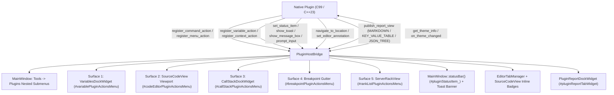
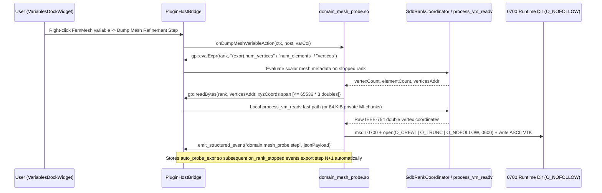

# Plugin Authoring, UI Surfaces & Build Recipes (Developer Encyclopedia - Volume 3)

This guide covers building out-of-tree C99 and C++23 plugins, wiring every workstation UI surface (`Tools -> Plugins` nested menus, the five `GridLockContextSurface` context menus, status-bar items, inline editor annotations, live theme tokens, and `PluginReportDockWidget`), packaging repositories for multi-forge installation, and testing plugins headlessly.

See also:
* [Using Plugins in GridLock](Plugins.md) (End-User Guide)
* [Plugin Architecture, Lifecycle, Security & Build Pipeline](Plugin-Architecture-and-Lifecycle.md) (Volume 1)
* [C99 Plugin ABI & C++23 Wrapper Specification](Plugin-C99-ABI-Reference.md) (Volume 2)

---

## 1. Workstation UI Extension Surfaces



### 1.1 Multi-Surface Context Menus (`GridLockContextSurface` Field Matrix)

When a plugin calls `register_context_action(host_ctx, surface, action_id, menu_label, filter_regex, cb, plugin_ctx)`, GridLock evaluates `filter_regex` (if non-empty, capped at `512 B` with PCRE2 match/recursion limits against the first `2048` characters of the surface's **Filter Target**) when building the right-click **Plugin Actions** submenu and populates `GridLockSurfaceContext` as follows:

| `GridLockContextSurface` | Host Widget & Submenu `objectName` | `filter_regex` Target String | Populated `GridLockSurfaceContext` Fields |
| :--- | :--- | :--- | :--- |
| `GRIDLOCK_SURFACE_VARIABLES` (`1`) | `VariablesDockWidget`<br>`#variablePluginActionsMenu` | Debugger C/C++ type (`varTyp`, e.g. `"PetscVec"`) | `rank` = focused rank, `frame_level` = active frame, `address` = parsed pointer/hex address, `symbol_utf8` = full evaluable expression path, `type_utf8` = variable type, `selected_text_utf8` = formatted value (`line = column = bp_id = -1`, `file_utf8 = NULL`). |
| `GRIDLOCK_SURFACE_CODE_EDITOR` (`2`) | `SourceCodeView`<br>`#codeEditorPluginActionsMenu` | `selectedText` if non-empty, else cursor `symbol`, else `filePath` | `rank` = focused rank, `frame_level` = active frame, `line` = 1-based cursor line, `column` = 1-based cursor column, `address` = `sourceLineToAddress(line)`, `symbol_utf8` = token under cursor, `file_utf8` = source path, `selected_text_utf8` = selection (`bp_id = -1`, `type_utf8 = NULL`). |
| `GRIDLOCK_SURFACE_CALL_STACK` (`3`) | `CallStackDockWidget`<br>`#callStackPluginActionsMenu` | Unwound function name (`entry.function`, e.g. `"solveStep"`) | `rank` = focused rank, `frame_level` = `entry.level`, `line` = `entry.line` (or `-1`), `address` = frame PC `entry.address`, `symbol_utf8` = `entry.function`, `file_utf8` = `entry.file` (`column = bp_id = -1`, `type_utf8 = selected_text_utf8 = NULL`). |
| `GRIDLOCK_SURFACE_BREAKPOINTS` (`4`) | `SourceCodeView` gutter<br>`#breakpointPluginActionsMenu` | `"<filePath>:<lineOneBased>"` | `rank` = focused rank, `frame_level` = active frame, `line` = 1-based gutter line, `bp_id` = breakpoint ID on that line (or `-1`), `address` = `sourceLineToAddress(line)`, `file_utf8` = source path (`column = -1`, `symbol_utf8 = type_utf8 = selected_text_utf8 = NULL`). |
| `GRIDLOCK_SURFACE_RANK_LIST` (`5`) | `ServerRackView`<br>`#rankListPluginActionsMenu` | `"<currentState> <currentFunction>"` (e.g. `"stopped MPI_Sendrecv"`) | `rank` = clicked `rankId`, `frame_level = 0`, `line` = `currentLine` (or `-1`), `address` = `rankPcAddress(rankId)`, `symbol_utf8` = `currentFunction` (or state), `type_utf8` = `currentState`, `file_utf8` = `currentFile`, `selected_text_utf8` = `currentState` (`column = bp_id = -1`). |

### 1.2 Menus, Status Badges, Annotations, Themes & Declarative Report Formats

| Capability | Host Callbacks | Behavior & Styling Rules |
| :--- | :--- | :--- |
| **Nested Menus (`Tools -> Plugins`)** | `register_menu_action` (`"Group/Sub/Leaf"`), `register_command_action` | Splits `"/"` into `1..4` non-empty segments (`#pluginSubMenu_<prefix>`, `#pluginMenuAct_<id>`). `ShortcutManager::registeredBindings()` is checked first; colliding plugin shortcuts are omitted and noted in the action tooltip. |
| **Status-Bar Badges** | `set_status_item`, `remove_status_item` | Mounts up to `16` permanent `QToolButton` pills (`#pluginStatusItem_<id>`) on `MainWindow::statusBar()`. `color_token_utf8` accepts `"accent"`, `"warning"`, `"error"`, `#RRGGBB`, or `NULL`/`""` (default foreground). |
| **Editor Navigation & Inline Annotations** | `navigate_to_location`, `set_editor_annotation`, `clear_editor_annotations` | Opens or focuses the target tab at 1-based `line:column` and renders up to `256` rounded inline pill badges + line background tints + hover detail tooltips across `EditorTabManager` views. |
| **Theme Token Sync** | `get_theme_info`, `desc.on_theme_changed` | Returns `is_dark` (`1`/`0`), `theme_id_utf8`, and 8 `#RRGGBB` tokens (`bg_primary_hex`, `bg_secondary_hex`, `fg_primary_hex`, `fg_muted_hex`, `accent_hex`, `selection_hex`, `warning_hex`, `error_hex`). `MainWindow` invokes `on_theme_changed` whenever `ThemeManager::themeModeChanged` changes ID or polarity. |
| **Report Panel: Markdown** | `publish_report_view(..., GRIDLOCK_REPORT_MARKDOWN, md)` | Opens or updates a closable tab in `PluginReportDockWidget` backed by a read-only `QTextBrowser` rendering GitHub-style Markdown (`<= 1 MiB`). |
| **Report Panel: Key-Value Table** | `publish_report_view(..., GRIDLOCK_REPORT_KEY_VALUE_TABLE, payload)` | Renders a two-column (`Key`, `Value`) `QTableWidget` from either a JSON object (`{"l2_norm": 1.4e-6}`), an array of `{"key","value"}` objects, or newline-delimited `key=value` / `key: value` pairs. |
| **Report Panel: JSON Tree** | `publish_report_view(..., GRIDLOCK_REPORT_JSON_TREE, json)` | Parses arbitrary hierarchical JSON objects/arrays into an expandable two-column (`Field / Index`, `Value`) `QTreeWidget`. |

---

## 2. Minimal Pure C99 UI & Inspection Recipe

```c
#include "gridlock/plugin_api.h"
#include <stdio.h>
#include <stdlib.h>
#include <string.h>

typedef struct {
  int32_t stop_count;
  char accent_hex[16];
} RankSummaryCtx;

static GridLockStatus GRIDLOCK_CALL on_SummaryMenu(
    void* plugin_ctx, const GridLockHostApi* host, const GridLockCommandSpec* spec) {
  RankSummaryCtx* ctx = (RankSummaryCtx*)plugin_ctx;
  if (!ctx || !host || !spec) return GRIDLOCK_ERR_INVALID_ARG;

  char md[512];
  snprintf(md, sizeof(md),
           "### Rank Summary\n\n* **Active Rank**: `%d` / `%d`\n* **Stops Recorded**: `%d`\n* **Theme Accent**: `%s`\n",
           spec->active_rank, spec->rank_count, ctx->stop_count, ctx->accent_hex);

  host->publish_report_view(host->host_ctx, "c99_demo.summary",
                            "Rank Summary", GRIDLOCK_REPORT_MARKDOWN, md);
  return host->show_toast(host->host_ctx, GRIDLOCK_DIALOG_INFO,
                          "Summary Updated", "Published Markdown report tab.", 3000);
}

static GridLockStatus GRIDLOCK_CALL on_RankStopped(
    void* plugin_ctx, const GridLockHostApi* host, const GridLockStopInfo* info) {
  RankSummaryCtx* ctx = (RankSummaryCtx*)plugin_ctx;
  if (!ctx || !host || !info) return GRIDLOCK_ERR_INVALID_ARG;
  ctx->stop_count += 1;

  char badge[64];
  snprintf(badge, sizeof(badge), "Stops: %d (R%d)", ctx->stop_count, info->rank);
  host->set_status_item(host->host_ctx, "c99_demo.stops", badge,
                        "Total rank stop events observed", "accent", NULL, NULL);
  if (info->file_utf8 && info->line > 0) {
    host->set_editor_annotation(host->host_ctx, "c99_demo.last_stop", info->file_utf8,
                                info->line, badge, info->reason_utf8, "warning");
  }
  return GRIDLOCK_OK;
}

static void GRIDLOCK_CALL on_ThemeChanged(void* plugin_ctx, const GridLockThemeInfo* theme) {
  RankSummaryCtx* ctx = (RankSummaryCtx*)plugin_ctx;
  if (ctx && theme) {
    memcpy(ctx->accent_hex, theme->accent_hex, sizeof(ctx->accent_hex));
    ctx->accent_hex[sizeof(ctx->accent_hex) - 1] = '\0';
  }
}

static void GRIDLOCK_CALL on_Shutdown(void* plugin_ctx, const GridLockHostApi* host) {
  (void)host;
  free(plugin_ctx);
}

GRIDLOCK_PLUGIN_EXPORT GridLockStatus GRIDLOCK_CALL gridlock_plugin_init_v1(
    const GridLockHostApi* host, GridLockPluginDescriptor* out_desc) {
  if (!host || !out_desc) return GRIDLOCK_ERR_INVALID_ARG;
  if (host->abi_major != GRIDLOCK_PLUGIN_ABI_MAJOR ||
      host->struct_size < offsetof(GridLockHostApi, reserved)) {
    return GRIDLOCK_ERR_ABI_MISMATCH;
  }

  RankSummaryCtx* ctx = (RankSummaryCtx*)calloc(1, sizeof(RankSummaryCtx));
  if (!ctx) return GRIDLOCK_ERR_BUFFER_TOO_SMALL;

  GridLockThemeInfo theme;
  memset(&theme, 0, sizeof(theme));
  theme.struct_size = (uint32_t)sizeof(theme);
  if (host->get_theme_info(host->host_ctx, &theme) == GRIDLOCK_OK) {
    on_ThemeChanged(ctx, &theme);
  }

  GridLockStatus st = host->register_menu_action(
      host->host_ctx, "c99_demo.open_summary", "Diagnostics/Rank Summary",
      "Ctrl+Alt+Shift+R", &on_SummaryMenu, ctx);
  if (st != GRIDLOCK_OK) {
    free(ctx);
    return st;
  }

  host->set_status_item(host->host_ctx, "c99_demo.stops", "Stops: 0",
                        "Total rank stop events observed", "accent", NULL, NULL);

  memset(out_desc, 0, sizeof(*out_desc));
  out_desc->struct_size = (uint32_t)sizeof(*out_desc);
  out_desc->abi_major = GRIDLOCK_PLUGIN_ABI_MAJOR;
  out_desc->abi_minor = GRIDLOCK_PLUGIN_ABI_MINOR;
  out_desc->plugin_id_utf8 = "org.example.c99_rank_summary";
  out_desc->plugin_name_utf8 = "C99 Rank Summary";
  out_desc->plugin_version_utf8 = "1.0.0";
  out_desc->description_utf8 = "Tracks rank stops with status badges, annotations, and Markdown reports.";
  out_desc->plugin_ctx = ctx;
  out_desc->on_rank_stopped = &on_RankStopped;
  out_desc->on_theme_changed = &on_ThemeChanged;
  out_desc->shutdown = &on_Shutdown;
  return GRIDLOCK_OK;
}
```

---

## 3. Out-of-Tree Build Templates & Multi-Forge Publishing

`PluginInstaller` automatically passes the host's `include/` path to Meson (`-Dgridlock_include_dir=...`), CMake (`-DGRIDLOCK_INCLUDE_DIR=...`), Make (`GRIDLOCK_INCLUDE_DIR=...`), or single-file compiler invocations. Providing one of the templates below at your repository root (or inside a `plugin/` subdirectory) enables one-click installation from **Preferences -> Plugins -> Install from Git** and declarative `plugins.toml` synchronization.

### Build System Comparison

| Build File | `plugins.toml` `build` Value | Recommended Use Case |
| :--- | :---: | :--- |
| `meson.build` | `"auto"` or `"meson"` | Multi-file C99/C++23 plugins with external library dependencies (HDF5, NetCDF, Eigen). |
| `CMakeLists.txt` | `"auto"` or `"cmake"` | Teams standardizing on CMake across Linux, macOS, and Windows. |
| `Makefile` | `"auto"` or `"make"` | Lightweight POSIX plugins with zero external build generator dependencies. |
| Single `.cpp` / `.c` | `"auto"` or `"single"` | Single-file header-only C99/C++23 probes without any build file in the repo. |

### Template 1: `meson.build` (+ `meson_options.txt`)

```meson
# meson_options.txt
option('gridlock_include_dir', type: 'string', value: '/usr/local/include',
       description: 'Path containing gridlock/plugin_api.h')
```

```meson
# meson.build
project('my_gridlock_plugin', 'cpp',
  version: '1.0.0',
  default_options: ['cpp_std=c++23', 'warning_level=3'])

inc = include_directories(get_option('gridlock_include_dir'))

shared_module('my_gridlock_plugin',
  'my_plugin.cpp',
  include_directories: inc,
  gnu_symbol_visibility: 'hidden',
  name_prefix: 'lib')
```

### Template 2: `CMakeLists.txt`

```cmake
cmake_minimum_required(VERSION 3.22)
project(my_gridlock_plugin LANGUAGES CXX)

set(GRIDLOCK_INCLUDE_DIR "/usr/local/include" CACHE PATH "Path to gridlock/plugin_api.h")

add_library(my_gridlock_plugin MODULE my_plugin.cpp)
target_compile_features(my_gridlock_plugin PRIVATE cxx_std_23)
target_include_directories(my_gridlock_plugin PRIVATE "${GRIDLOCK_INCLUDE_DIR}")
set_target_properties(my_gridlock_plugin PROPERTIES
  CXX_VISIBILITY_PRESET hidden
  VISIBILITY_INLINES_HIDDEN ON
  PREFIX "lib")
```

### Template 3: `Makefile` & Direct Compiler Commands

```makefile
CXX ?= c++
GRIDLOCK_INCLUDE_DIR ?= /usr/local/include
CXXFLAGS := -std=c++23 -O2 -Wall -Wextra -Wpedantic -fvisibility=hidden -fvisibility-inlines-hidden -fPIC

libmy_gridlock_plugin.so: my_plugin.cpp
	$(CXX) $(CXXFLAGS) -shared -I"$(GRIDLOCK_INCLUDE_DIR)" $< -o $@
```

Verify that **only** `gridlock_plugin_init_v1` is exported in the dynamic symbol table before publishing:

```bash
nm -D --defined-only libmy_gridlock_plugin.so | awk '$2 == "T" { print $3 }'
# Expected output:
# gridlock_plugin_init_v1
```

Tag the repository with the `gridlock-plugin` topic on GitHub, GitLab, Codeberg, or Gitea so users can discover it and add `repo = "owner/my-gridlock-plugin"` (or `gitlab:group/my-gridlock-plugin`, `codeberg:owner/my-gridlock-plugin`) to `plugins.toml`.

---

## 4. End-to-End Case Study: `examples/plugins/domain_mesh_probe/`

[`examples/plugins/domain_mesh_probe/domain_mesh_probe.cpp`](../examples/plugins/domain_mesh_probe/domain_mesh_probe.cpp) demonstrates a production-hardened C++23 scientific mesh exporter:



Key engineering patterns in `domain_mesh_probe.cpp`:
1. **Header Validation**: `initMeshProbePlugin()` calls `gp::validateHostAbi(host)` and `gp::initPluginDescriptorHeader(outDesc)` before touching any callback pointer.
2. **Regex Variable Action**: Registers `"mesh_probe.dump_refinement_step"` with `type_regex = ".*Mesh.*"`, matching any C/C++ struct or class containing `Mesh` in its debugger type name, and remembers `varCtx->expression_utf8` in `ctx->auto_probe_expr` so subsequent `on_rank_stopped` events export a continuous VTK time series (`mesh_step_<rank>_<step>.vtk`).
3. **Bounded Memory Reads**: Caps vertex count at `kMaxProbeVertices = 65536u` (`1.5 MiB` per step) and reads raw `double` coordinates directly into `std::vector<double>` via `gp::readBytes(...)`.
4. **Symlink-Safe Private File Output**: Resolves `$GRIDLOCK_MESH_PROBE_DIR`, `$XDG_RUNTIME_DIR/gridlock/mesh_probe`, or `/tmp/gridlock-<uid>/mesh_probe`, enforces `0700` ownership via `lstat()` + `geteuid()`, and opens VTK files with `O_WRONLY | O_CREAT | O_TRUNC | O_NOFOLLOW | O_CLOEXEC` (`0600`) followed by `fstat()` `S_ISREG` verification.

---

## 5. Testing Plugins Headlessly (`QtTest` + Mock MI Sessions)

GridLock tests plugins at three layers without launching external MPI jobs or interactive modal windows:

1. **ABI Layout & Mock Host Table (`tests/core/test_plugin_abi.cpp`)**:
   * Instantiate a stack `GridLockHostApi` pointing at in-memory mock callbacks (`meson test -C builddir plugin_abi_tests`) to unit-test your `gridlock_plugin_init_v1` and action callbacks in isolation.
2. **`PluginManager` + Mock `GdbRankCoordinator` (`tests/core/test_plugin_manager.cpp`)**:
   * Isolate config state by setting `qputenv("GRIDLOCK_TEST_CONFIG_DIR", tempDir.path().toUtf8())`.
   * Call `coord.initializeMockSession(2)`, feed a synthetic stop line via `coord.processGdbOutput(0, "*stopped,reason=\"breakpoint-hit\",frame={addr=\"0x401234\",func=\"solve\",fullname=\"/tmp/sim.c\",line=\"77\"}\n")`, intercept `GdbRankCoordinator::commandSentToGdb` to reply to `-data-evaluate-expression` or `-data-read-memory-bytes`, and assert emitted payloads with `QSignalSpy` on `PluginHostBridge::structuredEventEmitted`.
3. **Offscreen Workstation UI Integration (`tests/ui/test_ui_plugins.cpp`)**:
   * Run with `QT_QPA_PLATFORM=offscreen`. Pre-seed non-blocking modal dialog answers on `MainWindow` using dynamic properties before triggering a plugin action:
     * `mw.setProperty("gl_plugin_msgbox_auto_result", static_cast<int>(GRIDLOCK_RESULT_YES));`
     * `mw.setProperty("gl_plugin_prompt_auto_accept", true);`
     * `mw.setProperty("gl_plugin_prompt_auto_value", QStringLiteral("step_tag_01"));`
   * Inspect rendered report tabs via `mw.pluginReportDockWidget()->panelWidget("panel_id")` and editor badges via `mw.sourceCodeView()->pluginAnnotations()`.
