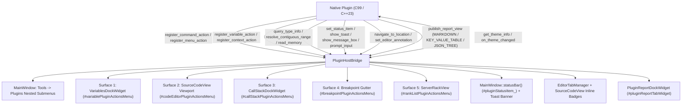

# Plugin Authoring, UI Surfaces & Build Recipes (Developer Encyclopedia - Volume 3)

This guide covers scaffolding out-of-tree C99 and C++23 plugins with [`scripts/init_plugin.lua`](../scripts/init_plugin.lua), inspecting contiguous buffers with zero inferior calls, wiring every workstation UI surface (`Tools -> Plugins` nested menus, the five `GridLockContextSurface` context menus, status-bar items, inline editor annotations, live theme tokens, and `PluginReportDockWidget`), configuring `plugin.map` linker version scripts for live hot-reloading, and verifying plugins headlessly with `gridlock --verify-plugin`.

See also:
* [Using Plugins in GridLock](Plugins.md) (End-User Guide)
* [Plugin Architecture, Lifecycle, Security & Build Pipeline](Plugin-Architecture-and-Lifecycle.md) (Volume 1)
* [C99 Plugin ABI & C++23 Wrapper Specification](Plugin-C99-ABI-Reference.md) (Volume 2)

---

## 0. Quick Start: Scaffolding a New Plugin (`scripts/init_plugin.lua`)

GridLock ships an interactive and flag-driven Lua project generator ([`scripts/init_plugin.lua`](../scripts/init_plugin.lua), compatible with Lua 5.1, 5.3, 5.4, and LuaJIT) that scaffolds a ready-to-build out-of-tree plugin repository:

```bash
# Interactive prompt mode (walks through 9 prompts; press Enter for [defaults]):
lua scripts/init_plugin.lua

# Non-interactive CI / scripted mode (--yes):
lua scripts/init_plugin.lua --yes \
  --name "STL Domain Inspector" \
  --author "gridlock" \
  --lang c++23 \
  --build meson \
  --license MIT \
  --dir ./stl-domain-inspector

# Build and run the sandboxed conformance verifier:
meson setup ./stl-domain-inspector/build ./stl-domain-inspector -Dgridlock_include_dir="$PWD/include"
ninja -C ./stl-domain-inspector/build
gridlock --verify-plugin ./stl-domain-inspector/build/libgridlock_stl_domain_inspector.so
```

### Interactive Prompts & CLI Flags Reference

| Prompt # | CLI Flag(s) | Default Value | Behavior |
| :---: | :--- | :--- | :--- |
| `1` | `--name <title>`<br>`--slug <kebab>` | `"My Domain Inspector"`<br>(`my-domain-inspector`) | Derives kebab-case `slug` and C target `gridlock_<snake_slug>`. |
| `2` | `--id <reverse.dns>` | `io.github.<author>.<slug>` | Globally unique `plugin_id_utf8` written to `GridLockPluginDescriptor`. |
| `3` | `--version <semver>` | `"0.1.0"` | Initial `plugin_version_utf8` and Meson/CMake project version. |
| `4` | `--description <text>`<br>`--desc <text>` | `"Custom MPI domain inspection extension for GridLock."` | One-line summary populated in `description_utf8` and `README.md`. |
| `5` | `--author <name>` | `git config user.name` (or `$USER`) | Author/organization recorded in `LICENSE` and `plugins.toml` snippet. |
| `6` | `--license <spdx>` | `"MIT"` | `MIT`, `Apache-2.0`, `BSD-3-Clause`, `GPL-3.0-or-later`, or `Unlicense`. |
| `7` | `--lang <std>` | `"c++23"` | `c++23` (`src/plugin.cpp` with `plugin_cpp_helpers.hpp`) or `c99` (`src/plugin.c`). |
| `8` | `--build <sys>` | `"meson"` | `meson` (`meson.build` + `meson_options.txt`), `cmake` (`CMakeLists.txt`), or `make` (`Makefile`). |
| `9` | `--dir <path>` | `./<slug>` | Target directory created for the generated repository. |
| - | `-y`, `--yes` / `-h`, `--help` | `false` | `--yes` skips interactive `io.read("*l")` prompts; `--help` prints usage and exits. |

> [!TIP]
> Every project generated by `scripts/init_plugin.lua` includes `plugin.map` (`global: gridlock_plugin_init_v1; local: *;`), symmetric `host->alloc_bytes` / `host->free_bytes` state management, a **Tools -> Plugins** Markdown report action, a Variables `resolve_contiguous_range` context action, and a clickable status-bar badge that passes `gridlock --verify-plugin` with zero warnings.

---

## 1. Workstation UI Extension Surfaces



### 1.1 Multi-Surface Context Menus (`GridLockContextSurface` Field Matrix)

When a plugin calls `register_context_action(host_ctx, surface, action_id, menu_label, filter_regex, cb, plugin_ctx)`, GridLock evaluates `filter_regex` (if non-empty, capped at `512 B` with PCRE2 match/recursion limits against the first `2048` characters of the surface's **Filter Target**) when building the right-click **Plugin Actions** submenu and populates `GridLockSurfaceContext` as follows:

| `GridLockContextSurface` | Host Widget & Submenu `objectName` | `filter_regex` Target String | Populated `GridLockSurfaceContext` Fields |
| :--- | :--- | :--- | :--- |
| `GRIDLOCK_SURFACE_VARIABLES` (`1`) | `VariablesDockWidget`<br>`#variablePluginActionsMenu` | Debugger C/C++ type (`varTyp`, e.g. `"PetscVec"`) | `rank` = focused rank, `frame_level` = active frame, `address` = parsed pointer/hex address, `symbol_utf8` = full evaluable expression path, `type_utf8` = variable type, `selected_text_utf8` = formatted value (`line = column = bp_id = -1`, `file_utf8 = NULL`). |
| `GRIDLOCK_SURFACE_CODE_EDITOR` (`2`) | `SourceCodeView`<br>`#codeEditorPluginActionsMenu` | `selectedText` if non-empty, else cursor variable `symbol` (plus its resolved DWARF `type_utf8` when stopped), else `filePath` | `rank` = focused rank, `frame_level` = active frame, `line` = 1-based cursor line, `column` = 1-based cursor column, `address` = `sourceLineToAddress(line)`, `symbol_utf8` = variable expression under cursor (stripping trailing `.method(...)` / `->method(...)` calls and rejecting bare function calls), `type_utf8` = resolved DWARF variable type when stopped (or `NULL`), `file_utf8` = source path, `selected_text_utf8` = selection (`bp_id = -1`). |
| `GRIDLOCK_SURFACE_CALL_STACK` (`3`) | `CallStackDockWidget`<br>`#callStackPluginActionsMenu` | Unwound function name (`entry.function`, e.g. `"solveStep"`) | `rank` = focused rank, `frame_level` = `entry.level`, `line` = `entry.line` (or `-1`), `address` = frame PC `entry.address`, `symbol_utf8` = `entry.function`, `file_utf8` = `entry.file` (`column = bp_id = -1`, `type_utf8 = selected_text_utf8 = NULL`). |
| `GRIDLOCK_SURFACE_BREAKPOINTS` (`4`) | `SourceCodeView` gutter<br>`#breakpointPluginActionsMenu` | `"<filePath>:<lineOneBased>"` | `rank` = focused rank, `frame_level` = active frame, `line` = 1-based gutter line, `bp_id` = breakpoint ID on that line (or `-1`), `address` = `sourceLineToAddress(line)`, `file_utf8` = source path (`column = -1`, `symbol_utf8 = type_utf8 = selected_text_utf8 = NULL`). |
| `GRIDLOCK_SURFACE_RANK_LIST` (`5`) | `ServerRackView`<br>`#rankListPluginActionsMenu` | `"<currentState> <currentFunction>"` (e.g. `"stopped MPI_Sendrecv"`) | `rank` = clicked `rankId`, `frame_level = 0`, `line` = `currentLine` (or `-1`), `address` = `rankPcAddress(rankId)`, `symbol_utf8` = `currentFunction` (or state), `type_utf8` = `currentState`, `file_utf8` = `currentFile`, `selected_text_utf8` = `currentState` (`column = bp_id = -1`). |

### 1.2 Zero-Call DWARF Type & Contiguous Container Introspection

Plugins inspecting C/C++ buffers should prefer `query_type_info` (`gp::queryTypeInfo`) and `resolve_contiguous_range` (`gp::resolveContiguousRange`) over calling `.size()` or `.data()` via `eval_expr`:

* **Works Without Inferior Calls**: Inlined template methods (such as `std::vector::size()` or `std::span::data()` under `-O2`) are frequently absent from binary symbol tables and cannot be invoked on core files. `PluginHostBridge` resolves DWARF types via temporary MI `-var-create` objects and reads internal struct pointers (`_M_impl._M_start` / `_M_finish` on `libstdc++`, `__begin_` / `__end_` on `libc++`, `_M_ptr` / `_M_extent` / `__data_` / `__size_`, `_M_data` / `_M_size`, and static template extents) with zero inferior execution.
* **Zero Evaluator Tab Noise**: Both `eval_expr` and DWARF range queries use dedicated silent MI tokens (`m_pendingPluginEvals`) that never emit `expressionEvaluated` into the user's **Evaluator** dock.
* **Supported Contiguous Types**: Fixed C arrays (`T[N]`), `std::array<T, N>`, `std::vector<T>` (excluding `std::vector<bool>`), `std::span<T, Extent>`, and `std::valarray<T>`.

```cpp
// Inspect any contiguous array/vector/span on a stopped rank without inferior calls:
if (const auto info = gp::queryTypeInfo(host, ctx->rank, expr);
    info && info->is_contiguous_container != 0) {
  if (const auto rng = gp::resolveContiguousRange(host, ctx->rank, expr);
      rng && rng->element_count > 0u) {
    std::vector<std::byte> raw(static_cast<size_t>(rng->element_count * rng->element_size));
    (void)gp::readBytes(host, ctx->rank, rng->data_address, std::span<std::byte>(raw));
  }
}
```

### 1.3 Menus, Status Badges, Annotations, Themes & Declarative Report Formats

| Capability | Host Callbacks | Behavior & Styling Rules |
| :--- | :--- | :--- |
| **Nested Menus (`Tools -> Plugins`)** | `register_menu_action` (`"Group/Sub/Leaf"`), `register_command_action` | Splits `"/"` into `1..4` non-empty segments (`#pluginSubMenu_<prefix>`, `#pluginMenuAct_<id>`). `ShortcutManager::registeredBindings()` is checked first; colliding plugin shortcuts are omitted and noted in the action tooltip. |
| **Status-Bar Badges** | `set_status_item`, `remove_status_item` | Mounts up to `16` permanent `QToolButton` pills (`#pluginStatusItem_<id>`) on `MainWindow::statusBar()`. `color_token_utf8` accepts `"accent"` (`#38bdf8`), `"warning"` (`#f59e0b`), `"error"` (`#ef4444`), custom `#RRGGBB`, or `NULL`/`""` (default foreground). |
| **Editor Navigation & Inline Annotations** | `navigate_to_location`, `set_editor_annotation`, `clear_editor_annotations` | Opens or focuses the target tab at 1-based `line:column` and renders up to `256` rounded inline pill badges + line background tints + hover detail tooltips across `EditorTabManager` views. |
| **Theme Token Sync** | `get_theme_info`, `desc.on_theme_changed` | Returns `is_dark` (`1`/`0`), `theme_id_utf8`, and 8 `#RRGGBB` tokens (`bg_primary_hex` `#14171f`, `bg_secondary_hex` `#1b1f2a`, `fg_primary_hex` `#e5e9f0`, `fg_muted_hex` `#8c96a8`, `accent_hex` `#38bdf8`, `selection_hex` `#2b3a55`, `warning_hex` `#f59e0b`, `error_hex` `#ef4444`). `MainWindow` invokes `on_theme_changed` whenever `ThemeManager::themeModeChanged` changes ID or polarity. |
| **Report Panel: Markdown** | `publish_report_view(..., GRIDLOCK_REPORT_MARKDOWN, md)` | Opens or updates a closable tab in `PluginReportDockWidget` backed by a read-only `QTextBrowser` rendering GitHub-style Markdown (`<= 1 MiB`). |
| **Report Panel: Key-Value Table** | `publish_report_view(..., GRIDLOCK_REPORT_KEY_VALUE_TABLE, payload)` | Renders a two-column (`Key`, `Value`) `QTableWidget` from either a JSON object (`{"l2_norm": 1.4e-6}`), an array of `{"key","value"}` objects, or newline-delimited `key=value` / `key: value` pairs. |
| **Report Panel: JSON Tree** | `publish_report_view(..., GRIDLOCK_REPORT_JSON_TREE, json)` | Parses arbitrary hierarchical JSON objects/arrays into an expandable two-column (`Field / Index`, `Value`) `QTreeWidget`. |

---

## 2. Minimal Pure C99 UI & Inspection Recipe

```c
#include "gridlock/plugin_api.h"
#include <stdio.h>
#include <string.h>

typedef struct {
  int32_t stop_count;
  char accent_hex[16];
} RankSummaryCtx;

static GridLockStatus GRIDLOCK_CALL on_SummaryMenu(
    void* plugin_ctx, const GridLockHostApi* host, const GridLockCommandSpec* spec) {
  RankSummaryCtx* ctx = (RankSummaryCtx*)plugin_ctx;
  if (!ctx || !host || !spec) return GRIDLOCK_ERR_INVALID_ARG;

  char md[512];
  snprintf(md, sizeof(md),
           "### Rank Summary\n\n* **Active Rank**: `%d` / `%d`\n* **Stops Recorded**: `%d`\n* **Theme Accent**: `%s`\n",
           spec->active_rank, spec->rank_count, ctx->stop_count, ctx->accent_hex);

  host->publish_report_view(host->host_ctx, "c99_demo.summary",
                            "Rank Summary", GRIDLOCK_REPORT_MARKDOWN, md);
  return host->show_toast(host->host_ctx, GRIDLOCK_DIALOG_INFO,
                          "Summary Updated", "Published Markdown report tab.", 3000);
}

static GridLockStatus GRIDLOCK_CALL on_RankStopped(
    void* plugin_ctx, const GridLockHostApi* host, const GridLockStopInfo* info) {
  RankSummaryCtx* ctx = (RankSummaryCtx*)plugin_ctx;
  if (!ctx || !host || !info) return GRIDLOCK_ERR_INVALID_ARG;
  ctx->stop_count += 1;

  char badge[64];
  snprintf(badge, sizeof(badge), "Stops: %d (R%d)", ctx->stop_count, info->rank);
  host->set_status_item(host->host_ctx, "c99_demo.stops", badge,
                        "Total rank stop events observed", "accent", NULL, NULL);
  if (info->file_utf8 && info->line > 0) {
    host->set_editor_annotation(host->host_ctx, "c99_demo.last_stop", info->file_utf8,
                                info->line, badge, info->reason_utf8, "warning");
  }
  return GRIDLOCK_OK;
}

static void GRIDLOCK_CALL on_ThemeChanged(void* plugin_ctx, const GridLockThemeInfo* theme) {
  RankSummaryCtx* ctx = (RankSummaryCtx*)plugin_ctx;
  if (ctx && theme) {
    memcpy(ctx->accent_hex, theme->accent_hex, sizeof(ctx->accent_hex));
    ctx->accent_hex[sizeof(ctx->accent_hex) - 1] = '\0';
  }
}

static void GRIDLOCK_CALL on_Shutdown(void* plugin_ctx, const GridLockHostApi* host) {
  if (plugin_ctx && host && host->free_bytes) {
    host->free_bytes(host->host_ctx, plugin_ctx);
  }
}

GRIDLOCK_PLUGIN_EXPORT GridLockStatus GRIDLOCK_CALL gridlock_plugin_init_v1(
    const GridLockHostApi* host, GridLockPluginDescriptor* out_desc) {
  if (!host || !out_desc) return GRIDLOCK_ERR_INVALID_ARG;
  if (host->abi_major != GRIDLOCK_PLUGIN_ABI_MAJOR ||
      host->struct_size < offsetof(GridLockHostApi, reserved)) {
    return GRIDLOCK_ERR_ABI_MISMATCH;
  }

  RankSummaryCtx* ctx = (RankSummaryCtx*)host->alloc_bytes(host->host_ctx, sizeof(RankSummaryCtx));
  if (!ctx) return GRIDLOCK_ERR_BUFFER_TOO_SMALL;
  memset(ctx, 0, sizeof(*ctx));

  GridLockThemeInfo theme;
  memset(&theme, 0, sizeof(theme));
  theme.struct_size = (uint32_t)sizeof(theme);
  if (host->get_theme_info(host->host_ctx, &theme) == GRIDLOCK_OK) {
    on_ThemeChanged(ctx, &theme);
  }

  GridLockStatus st = host->register_menu_action(
      host->host_ctx, "c99_demo.open_summary", "Diagnostics/Rank Summary",
      "Ctrl+Alt+Shift+R", &on_SummaryMenu, ctx);
  if (st != GRIDLOCK_OK) {
    host->free_bytes(host->host_ctx, ctx);
    return st;
  }

  host->set_status_item(host->host_ctx, "c99_demo.stops", "Stops: 0",
                        "Total rank stop events observed", "accent", NULL, NULL);

  memset(out_desc, 0, sizeof(*out_desc));
  out_desc->struct_size = (uint32_t)sizeof(*out_desc);
  out_desc->abi_major = GRIDLOCK_PLUGIN_ABI_MAJOR;
  out_desc->abi_minor = GRIDLOCK_PLUGIN_ABI_MINOR;
  out_desc->plugin_id_utf8 = "org.example.c99_rank_summary";
  out_desc->plugin_name_utf8 = "C99 Rank Summary";
  out_desc->plugin_version_utf8 = "1.0.0";
  out_desc->description_utf8 = "Tracks rank stops with status badges, annotations, and Markdown reports.";
  out_desc->plugin_ctx = ctx;
  out_desc->on_rank_stopped = &on_RankStopped;
  out_desc->on_theme_changed = &on_ThemeChanged;
  out_desc->shutdown = &on_Shutdown;
  return GRIDLOCK_OK;
}
```

---

## 3. Out-of-Tree Build Templates, `plugin.map` & Live Hot-Reloading

`PluginInstaller` automatically passes the host's `include/` path to Meson (`-Dgridlock_include_dir=...`), CMake (`-DGRIDLOCK_INCLUDE_DIR=...`), Make (`GRIDLOCK_INCLUDE_DIR=...`), or single-file compiler invocations.

> [!WARNING]
> **Why C++ Plugins Must Link with `-Wl,--version-script=plugin.map`**: On Linux (`glibc`), C++ inline functions containing `static` local variables or template static data members emit `STB_GNU_UNIQUE` (`'u'`) dynamic symbols by default. When `dlopen()` loads an `.so` containing `STB_GNU_UNIQUE` symbols, `glibc` marks that library `DF_1_NODELETE` and pins its old code pages in memory across `dlclose()`. Supplying `plugin.map` hides all internal and vague-linkage symbols so **Hot-Reload Now** (`PluginManager::hotReloadPlugins`) can unmap and reload rebuilt `.so` binaries in-place while an MPI debug session remains paused.

```ld
{
  global:
    gridlock_plugin_init_v1;
  local:
    *;
};
```

### Build System Comparison

| Build File | `plugins.toml` `build` Value | Recommended Use Case |
| :--- | :---: | :--- |
| `meson.build` | `"auto"` or `"meson"` | Multi-file C99/C++23 plugins with external library dependencies (HDF5, NetCDF, Eigen). |
| `CMakeLists.txt` | `"auto"` or `"cmake"` | Teams standardizing on CMake across Linux, macOS, and Windows. |
| `Makefile` | `"auto"` or `"make"` | Lightweight POSIX plugins with zero external build generator dependencies. |
| Single `.cpp` / `.c` | `"auto"` or `"single"` | Single-file header-only C99/C++23 probes without any build file in the repo. |

### Template 1: `meson.build` (+ `meson_options.txt`)

```meson
# meson_options.txt
option('gridlock_include_dir', type: 'string', value: '/usr/local/include',
       description: 'Path containing gridlock/plugin_api.h')
```

```meson
# meson.build
project('my_gridlock_plugin', 'cpp',
  version: '1.0.0',
  default_options: ['cpp_std=c++23', 'warning_level=3'])

inc = include_directories(get_option('gridlock_include_dir'))
map_file = meson.current_source_dir() / 'plugin.map'

shared_module('my_gridlock_plugin',
  'src/plugin.cpp',
  include_directories: inc,
  cpp_args: ['-fvisibility-inlines-hidden'],
  gnu_symbol_visibility: 'hidden',
  link_args: host_machine.system() == 'linux' ? ['-Wl,--version-script=' + map_file] : [],
  name_prefix: 'lib')
```

### Template 2: `CMakeLists.txt`

```cmake
cmake_minimum_required(VERSION 3.22)
project(my_gridlock_plugin LANGUAGES CXX)

set(GRIDLOCK_INCLUDE_DIR "/usr/local/include" CACHE PATH "Path to gridlock/plugin_api.h")

add_library(my_gridlock_plugin MODULE src/plugin.cpp)
target_compile_features(my_gridlock_plugin PRIVATE cxx_std_23)
target_include_directories(my_gridlock_plugin PRIVATE "${GRIDLOCK_INCLUDE_DIR}")
if(CMAKE_SYSTEM_NAME STREQUAL "Linux")
  target_link_options(my_gridlock_plugin PRIVATE
    "-Wl,--version-script=${CMAKE_CURRENT_SOURCE_DIR}/plugin.map")
endif()
set_target_properties(my_gridlock_plugin PROPERTIES
  CXX_VISIBILITY_PRESET hidden
  VISIBILITY_INLINES_HIDDEN ON
  PREFIX "lib")
```

### Template 3: `Makefile` & Direct Compiler Commands

```makefile
CXX ?= c++
GRIDLOCK_INCLUDE_DIR ?= /usr/local/include
CXXFLAGS := -std=c++23 -O2 -Wall -Wextra -Wpedantic -fvisibility=hidden -fvisibility-inlines-hidden -fPIC
LDFLAGS := -Wl,--version-script=plugin.map

build/libmy_gridlock_plugin.so: src/plugin.cpp plugin.map
	@mkdir -p build
	$(CXX) $(CXXFLAGS) -shared -I"$(GRIDLOCK_INCLUDE_DIR)" $< $(LDFLAGS) -o $@
```

Tag the repository with the `gridlock-plugin` topic on GitHub, GitLab, Codeberg, or Gitea so users can discover it and add `repo = "owner/my-gridlock-plugin"` (or `gitlab:group/my-gridlock-plugin`, `codeberg:owner/my-gridlock-plugin`) to `plugins.toml`.

---

## 4. End-to-End Case Study: `examples/plugins/domain_mesh_probe/`

[`examples/plugins/domain_mesh_probe/domain_mesh_probe.cpp`](../examples/plugins/domain_mesh_probe/domain_mesh_probe.cpp) demonstrates a production-hardened C++23 scientific mesh exporter:


Key engineering patterns in `domain_mesh_probe.cpp`:
1. **Header Validation**: `initMeshProbePlugin()` calls `gp::validateHostAbi(host)` and `gp::initPluginDescriptorHeader(outDesc)` before touching any callback pointer.
2. **Regex Variable Action**: Registers `"mesh_probe.dump_refinement_step"` with `type_regex = ".*Mesh.*"`, matching any C/C++ struct or class containing `Mesh` in its debugger type name, and remembers `varCtx->expression_utf8` in `ctx->auto_probe_expr` so subsequent `on_rank_stopped` events export a continuous VTK time series (`mesh_step_<rank>_<step>.vtk`).
3. **Bounded Memory Reads**: Caps vertex count at `kMaxProbeVertices = 65536u` (`1.5 MiB` per step) and reads raw `double` coordinates directly into `std::vector<double>` via `gp::readBytes(...)`.
4. **Symlink-Safe Private File Output**: Resolves `$GRIDLOCK_MESH_PROBE_DIR`, `$XDG_RUNTIME_DIR/gridlock/mesh_probe`, or `/tmp/gridlock-<uid>/mesh_probe`, enforces `0700` ownership via `lstat()` + `geteuid()`, and opens VTK files with `O_WRONLY | O_CREAT | O_TRUNC | O_NOFOLLOW | O_CLOEXEC` (`0600`) followed by `fstat()` `S_ISREG` verification.

---

## 5. Sandboxed Conformance Verification (`--verify-plugin`) & Headless Testing

### 5.1 Automated CLI & Post-Build Conformance Verifier (`PluginVerifier`)

GridLock includes `PluginVerifier::verifyBinary`, which runs automatically at the end of every `PluginInstaller` build and is exposed directly on the CLI for local development and CI pipelines:

```bash
gridlock --verify-plugin ./build/libmy_gridlock_plugin.so
```

> [!IMPORTANT]
> Gate every plugin release workflow in GitHub Actions or GitLab CI on `gridlock --verify-plugin <path.so>`. It exits `0` (`[PASS]`) only when symbol resolution, ABI v1.0 headers, regex/menu registrations, lifecycle callbacks, and zero host-heap leaks (`outstanding_alloc_bytes=0`) all succeed, and exits `1` (`[FAIL]`) on any conformance error.

`--verify-plugin` loads the shared library inside an isolated temporary `PluginManager` + `PluginHostBridge` sandbox without touching `~/.config/gridlock/` or opening a GUI window, checking four gates:
1. **Symbol Export Hygiene**: Confirms `gridlock_plugin_init_v1` resolves under `RTLD_NOW`, and emits warnings if extra global text symbols (`STT_FUNC`) or `STB_GNU_UNIQUE` (`'u'`) symbols are exported without `-fvisibility=hidden` or `-Wl,--version-script`.
2. **ABI & Descriptor Validation**: Verifies `struct_size >= 96`, `abi_major == 1`, `reserved_flags == 0`, and non-empty single-line `plugin_id_utf8`, `plugin_name_utf8`, and `plugin_version_utf8`.
3. **Registration Validation**: Intercepts `register_variable_action`, `register_command_action`, `register_menu_action`, and `register_context_action` during `init` to ensure every action ID, `"/"`-delimited menu path (`<= 4` segments), and PCRE2 regular expression compiles and commits cleanly.
4. **Dry-Run Lifecycle & Leak Detection**: Executes `gridlock_plugin_init_v1` -> `on_session_start(2)` -> `on_session_end()` -> `shutdown()` and fails if `outstandingAllocBytes() != 0` after `shutdown()` returns.

### 5.2 Multi-Layer `QtTest` Suites

GridLock also tests plugins across three `QtTest` layers without launching external MPI jobs or modal dialogs:

1. **ABI Layout & Mock Host Table (`tests/core/test_plugin_abi.cpp`)**:
   * Instantiate a stack `GridLockHostApi` pointing at in-memory mock callbacks (`meson test -C builddir plugin_abi_tests`) to unit-test `gridlock_plugin_init_v1`, `queryTypeInfo`, `resolveContiguousRange`, and action callbacks in isolation.
2. **`PluginManager` + Mock `GdbRankCoordinator` (`tests/core/test_plugin_manager.cpp`)**:
   * Isolate config state by setting `qputenv("GRIDLOCK_TEST_CONFIG_DIR", tempDir.path().toUtf8())`.
   * Call `coord.initializeMockSession(2)`, feed a synthetic stop line via `coord.processGdbOutput(...)`, intercept `GdbRankCoordinator::commandSentToGdb` to reply to MI `-var-create`, `-data-evaluate-expression`, or `-data-read-memory-bytes`, and verify `PluginVerifier::verifyBinary` plus live `hotReloadPlugins` session replay.
3. **Offscreen Workstation UI Integration (`tests/ui/test_ui_plugins.cpp`)**:
   * Run with `QT_QPA_PLATFORM=offscreen`. Pre-seed non-blocking modal dialog answers on `MainWindow` using dynamic properties before triggering a plugin action:
     * `mw.setProperty("gl_plugin_msgbox_auto_result", static_cast<int>(GRIDLOCK_RESULT_YES));`
     * `mw.setProperty("gl_plugin_prompt_auto_accept", true);`
     * `mw.setProperty("gl_plugin_prompt_auto_value", QStringLiteral("step_tag_01"));`
   * Inspect rendered report tabs via `mw.pluginReportDockWidget()->panelWidget("panel_id")` and editor badges via `mw.sourceCodeView()->pluginAnnotations()`.
