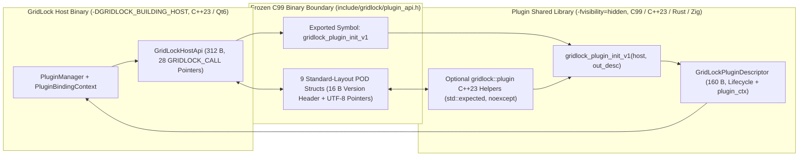

# C99 Plugin ABI & C++23 Wrapper Specification (Developer Encyclopedia - Volume 2)

This specification defines the binary contract frozen in [`include/gridlock/plugin_api.h`](../include/gridlock/plugin_api.h) (`GRIDLOCK_PLUGIN_ABI_MAJOR = 1u`, `GRIDLOCK_PLUGIN_ABI_MINOR = 0u`), locked at compile time by [`tests/core/test_plugin_abi.cpp`](../tests/core/test_plugin_abi.cpp), and wrapped for optional C++23 ergonomics by [`include/gridlock/plugin_cpp_helpers.hpp`](../include/gridlock/plugin_cpp_helpers.hpp).

See also:
* [Using Plugins in GridLock](Plugins.md) (End-User Guide)
* [Plugin Architecture, Lifecycle, Security & Build Pipeline](Plugin-Architecture-and-Lifecycle.md) (Volume 1)
* [Plugin Authoring, UI Surfaces & Build Recipes](Plugin-Authoring-and-UI-Surfaces.md) (Volume 3)

---

## 1. Binary Boundary & ABI Stability Rules



> [!WARNING]
> **Cross-ABI Exception & Heap Invariants**: Never allow a C++ exception or `longjmp` to cross a `GRIDLOCK_CALL` boundary (`mark callbacks noexcept`), and never pass a pointer returned by `host->alloc_bytes` to `std::free` or `operator delete` (always release host memory via `host->free_bytes` before `shutdown` returns). `gridlock --verify-plugin` fails any binary with `outstandingAllocBytes() != 0`.

### Binary Compatibility Invariants

| Rule | Macro / Mechanism | Enforcement & Rationale |
| :--- | :--- | :--- |
| **Major / Minor Version Numbers** | `GRIDLOCK_PLUGIN_ABI_MAJOR = 1u`<br>`GRIDLOCK_PLUGIN_ABI_MINOR = 0u` | Host rejects any plugin whose `desc.abi_major != 1u`. Minor increments (`1.1`, `1.2`) only append fields or consume `reserved[]` slots without shifting existing offsets. |
| **Single Exported Entry Symbol** | `GRIDLOCK_PLUGIN_INIT_SYMBOL_V1`<br>(`"gridlock_plugin_init_v1"`) | Plugins compile with `-fvisibility=hidden` (plus `-fvisibility-inlines-hidden` and `-Wl,--version-script` in C++) so internal and `STB_GNU_UNIQUE` symbols never leak or pin `.so` handles across `dlclose()`. |
| **Calling Convention** | `GRIDLOCK_CALL` | Expands to `__cdecl` on `_WIN32` and empty on POSIX, preventing stack corruption when Windows plugins are compiled with `/Gz` (`__stdcall`). |
| **Symbol Export Gating** | `GRIDLOCK_PLUGIN_EXPORT` | Expands to `__declspec(dllexport)` on `_WIN32` **only** when `GRIDLOCK_BUILDING_HOST` is undefined, and `__attribute__((visibility("default")))` on GCC/Clang. Host builds pass `-DGRIDLOCK_BUILDING_HOST`. |
| **16-Byte Versioned Header at Offset `0`** | `struct_size`, `abi_major`, `abi_minor`, `reserved_flags` (`4 x uint32_t`) | Present at byte offsets `0`, `4`, `8`, `12` of all 9 ABI structs (`reserved_flags` must be `0u`). Validated prior to dereferencing trailing fields (`struct_size >= offsetof(Type, reserved)`). |
| **Tail Expansion Padding (`64 B`)** | `void* reserved[8]` | Zero-initialized tail array on both `GridLockHostApi` and `GridLockPluginDescriptor`, permitting minor v1.x extensions without shifting existing callback slots. |
| **Caller-Owned Buffer Sizing** | `(char* out_utf8, size_t cap, size_t* out_len)` | Used by `eval_expr` and `prompt_input`. `*out_len` always receives the UTF-8 byte length **excluding** the trailing NUL; when `out_utf8 == NULL` or `cap <= *out_len`, returns `GRIDLOCK_ERR_BUFFER_TOO_SMALL` (`-3`) so the caller can allocate `*out_len + 1` bytes and retry. |
| **Symmetric Host Heap** | `alloc_bytes` / `free_bytes` | Cross-CRT heap allocations obtained from `host->alloc_bytes` must be released exclusively via `host->free_bytes`. |
| **Pointer Storage Duration** | Descriptor vs. Callback Structs | Strings on `GridLockPluginDescriptor` (`plugin_id_utf8`, `plugin_name_utf8`, `plugin_version_utf8`, `description_utf8`) are plugin-owned and must remain valid until `shutdown` returns. Strings on `GridLockStopInfo`, `GridLockVariableContext`, `GridLockCommandSpec`, and `GridLockSurfaceContext` are host-owned borrows valid **only** until that callback returns. |

---

## 2. Exact Struct Layouts & 64-Bit Byte Offsets (`LP64` / `LLP64`)

All nine structs satisfy `std::is_standard_layout_v<T>` and `std::is_trivially_copyable_v<T>` with zero implicit compiler padding on 64-bit targets (`sizeof(void*) == 8`, `sizeof(size_t) == 8`), matching every `static_assert` in [`tests/core/test_plugin_abi.cpp`](../tests/core/test_plugin_abi.cpp).

### 2.1 `GridLockHostApi` (`sizeof == 312` bytes)

| Offset (64-bit) | Size | C Type | Field Name | Contract / Validation Rule |
| :---: | :---: | :--- | :--- | :--- |
| `0` | `4 B` | `uint32_t` | `struct_size` | `sizeof(GridLockHostApi)` (`312` in v1.0; plugins verify `>= 248`). |
| `4` | `4 B` | `uint32_t` | `abi_major` | `GRIDLOCK_PLUGIN_ABI_MAJOR` (`1u`). |
| `8` | `4 B` | `uint32_t` | `abi_minor` | `GRIDLOCK_PLUGIN_ABI_MINOR` (`0u`). |
| `12` | `4 B` | `uint32_t` | `reserved_flags` | Must be `0u` in ABI v1.0. |
| `16` | `8 B` | `void*` | `host_ctx` | Opaque `PluginBindingContext*`; pass back as first arg to every host call. |
| `24` | `8 B` | `GridLockAllocBytesFn` | `alloc_bytes` | Allocates `num_bytes` on the host heap (`NULL` if `num_bytes == 0` or OOM). |
| `32` | `8 B` | `GridLockFreeBytesFn` | `free_bytes` | Releases a pointer returned by `alloc_bytes` (`NULL` is a safe no-op). |
| `40` | `8 B` | `GridLockLogMessageFn` | `log_message` | Emits bounded (`<= 16 KiB`) UTF-8 diagnostic log entry. |
| `48` | `8 B` | `GridLockGetRankCountFn` | `get_rank_count` | Writes active session MPI rank count (`0` when idle). |
| `56` | `8 B` | `GridLockGetActiveRankFn` | `get_active_rank` | Writes currently focused zero-based rank index. |
| `64` | `8 B` | `GridLockEvalExprFn` | `eval_expr` | Evaluates C/C++ expression on stopped `rank` via private silent MI tokens. |
| `72` | `8 B` | `GridLockReadMemoryFn` | `read_memory` | Reads up to `64 MiB` from target `address` on stopped `rank`. |
| `80` | `8 B` | `GridLockWriteMemoryFn` | `write_memory` | Writes up to `16 MiB` to target `address` on stopped `rank`. |
| `88` | `8 B` | `GridLockSetBreakpointFn` | `set_breakpoint` | Installs source breakpoint at `file_utf8:line` (optional condition). |
| `96` | `8 B` | `GridLockRemoveBreakpointFn` | `remove_breakpoint` | Removes breakpoint previously created via `set_breakpoint`. |
| `104` | `8 B` | `GridLockRegisterVariableActionFn` | `register_variable_action` | Registers PCRE2 type-matched action in `VariablesDockWidget`. |
| `112` | `8 B` | `GridLockRegisterCommandActionFn` | `register_command_action` | Registers flat command under **Tools -> Plugins**. |
| `120` | `8 B` | `GridLockEmitStructuredEventFn` | `emit_structured_event` | Publishes UTF-8 JSON payload (`<= 1 MiB`) on `channel_utf8`. |
| `128` | `8 B` | `GridLockShowMessageBoxFn` | `show_message_box` | Displays modal `QMessageBox` on GUI thread; writes `GridLockDialogResult`. |
| `136` | `8 B` | `GridLockPromptInputFn` | `prompt_input` | Displays modal single-line `QInputDialog`; writes UTF-8 input. |
| `144` | `8 B` | `GridLockShowToastFn` | `show_toast` | Shows non-modal timed toast banner (`500..30000 ms`). |
| `152` | `8 B` | `GridLockRegisterMenuActionFn` | `register_menu_action` | Registers `"/"`-delimited nested menu (`<= 4` segments). |
| `160` | `8 B` | `GridLockSetStatusItemFn` | `set_status_item` | Creates/updates clickable status-bar badge (`<= 16` per plugin). |
| `168` | `8 B` | `GridLockRemoveStatusItemFn` | `remove_status_item` | Removes status-bar badge owned by calling plugin. |
| `176` | `8 B` | `GridLockRegisterContextActionFn` | `register_context_action` | Registers right-click action on any `GridLockContextSurface` (`1..5`). |
| `184` | `8 B` | `GridLockNavigateToLocationFn` | `navigate_to_location` | Opens `file_utf8` at 1-based `line:column` in `SourceCodeView`. |
| `192` | `8 B` | `GridLockSetEditorAnnotationFn` | `set_editor_annotation` | Upserts inline line badge/tint (`<= 256` per plugin). |
| `200` | `8 B` | `GridLockClearEditorAnnotationsFn` | `clear_editor_annotations` | Clears owned annotations matching `id_prefix_utf8` (`NULL`/`""` clears all). |
| `208` | `8 B` | `GridLockGetThemeInfoFn` | `get_theme_info` | Populates `GridLockThemeInfo` (`212 B`) from `ThemeManager`. |
| `216` | `8 B` | `GridLockPublishReportViewFn` | `publish_report_view` | Opens/updates tab in `PluginReportDockWidget`. |
| `224` | `8 B` | `GridLockCloseReportViewFn` | `close_report_view` | Closes report tab owned by calling plugin. |
| `232` | `8 B` | `GridLockQueryTypeInfoFn` | `query_type_info` | Zero-call DWARF/MI type & `sizeof` query into `GridLockTypeInfo` (`288 B`). |
| `240` | `8 B` | `GridLockResolveContiguousRangeFn` | `resolve_contiguous_range` | Zero-call contiguous buffer resolution into `GridLockContiguousRange` (`424 B`). |
| `248` | `64 B` | `void*[8]` | `reserved` | Zero-initialized future minor-ABI expansion slots. |

### 2.2 `GridLockPluginDescriptor` (`sizeof == 160` bytes)

| Offset (64-bit) | Size | C Type | Field Name | Contract / Validation Rule |
| :---: | :---: | :--- | :--- | :--- |
| `0` | `4 B` | `uint32_t` | `struct_size` | Set to `sizeof(GridLockPluginDescriptor)` (`160`); host requires `>= 96`. |
| `4` | `4 B` | `uint32_t` | `abi_major` | Must equal `GRIDLOCK_PLUGIN_ABI_MAJOR` (`1u`). |
| `8` | `4 B` | `uint32_t` | `abi_minor` | Set to `GRIDLOCK_PLUGIN_ABI_MINOR` (`0u`). |
| `12` | `4 B` | `uint32_t` | `reserved_flags` | Must be `0u`. |
| `16` | `8 B` | `const char*` | `plugin_id_utf8` | **Required**, non-empty globally unique ID; valid until `shutdown` returns. |
| `24` | `8 B` | `const char*` | `plugin_name_utf8` | **Required**, non-empty display title; valid until `shutdown` returns. |
| `32` | `8 B` | `const char*` | `plugin_version_utf8` | `"X.Y.Z"` version string (required non-empty by `PluginVerifier`). |
| `40` | `8 B` | `const char*` | `description_utf8` | Optional summary string (`NULL` permitted). |
| `48` | `8 B` | `void*` | `plugin_ctx` | Optional plugin-owned state pointer passed to lifecycle hooks. |
| `56` | `8 B` | `GridLockSessionStartCallback` | `on_session_start` | Optional hook invoked with `(plugin_ctx, host, rank_count)`. |
| `64` | `8 B` | `GridLockRankStoppedCallback` | `on_rank_stopped` | Optional hook invoked strictly on GDB/MI `*stopped` events. |
| `72` | `8 B` | `GridLockSessionEndCallback` | `on_session_end` | Optional hook invoked when debug session terminates. |
| `80` | `8 B` | `GridLockPluginShutdownCallback` | `shutdown` | Optional hook invoked before `QLibrary::unload()` (`shuttingDown == true`). |
| `88` | `8 B` | `GridLockThemeChangedCallback` | `on_theme_changed` | Optional hook invoked when `ThemeManager` switches active theme or polarity. |
| `96` | `64 B` | `void*[8]` | `reserved` | Zero-initialized future minor-ABI expansion slots. |

### 2.3 `GridLockStopInfo` (`sizeof == 64` bytes)

| Offset (64-bit) | Size | C Type | Field Name | Contract / Validation Rule |
| :---: | :---: | :--- | :--- | :--- |
| `0` | `4 B` | `uint32_t` | `struct_size` | `sizeof(GridLockStopInfo)` (`64`). |
| `4` | `4 B` | `uint32_t` | `abi_major` | `GRIDLOCK_PLUGIN_ABI_MAJOR` (`1u`). |
| `8` | `4 B` | `uint32_t` | `abi_minor` | `GRIDLOCK_PLUGIN_ABI_MINOR` (`0u`). |
| `12` | `4 B` | `uint32_t` | `reserved_flags` | Must be `0u`. |
| `16` | `4 B` | `int32_t` | `rank` | Zero-based MPI rank index that stopped. |
| `20` | `4 B` | `int32_t` | `thread_id` | One-based debugger thread ID on `rank`. |
| `24` | `4 B` | `int32_t` | `line` | One-based source line number, or `-1` when unknown. |
| `28` | `4 B` | `int32_t` | `frame_level` | Zero-based stack frame depth (`0` = innermost frame). |
| `32` | `8 B` | `uint64_t` | `pc_address` | Instruction pointer virtual address (`0` if unavailable). |
| `40` | `8 B` | `const char*` | `reason_utf8` | Ephemeral UTF-8 stop reason (for example `"breakpoint-hit"`). |
| `48` | `8 B` | `const char*` | `file_utf8` | Ephemeral UTF-8 resolved source file path, or `NULL`. |
| `56` | `8 B` | `const char*` | `function_utf8` | Ephemeral UTF-8 function symbol name, or `NULL`. |

### 2.4 `GridLockVariableContext` (`sizeof == 80` bytes)

| Offset (64-bit) | Size | C Type | Field Name | Contract / Validation Rule |
| :---: | :---: | :--- | :--- | :--- |
| `0` | `4 B` | `uint32_t` | `struct_size` | `sizeof(GridLockVariableContext)` (`80`). |
| `4` | `4 B` | `uint32_t` | `abi_major` | `GRIDLOCK_PLUGIN_ABI_MAJOR` (`1u`). |
| `8` | `4 B` | `uint32_t` | `abi_minor` | `GRIDLOCK_PLUGIN_ABI_MINOR` (`0u`). |
| `12` | `4 B` | `uint32_t` | `reserved_flags` | Must be `0u`. |
| `16` | `4 B` | `int32_t` | `rank` | Zero-based MPI rank owning the variable. |
| `20` | `4 B` | `int32_t` | `frame_level` | Active zero-based stack frame level in `CallStackDockWidget`. |
| `24` | `8 B` | `uint64_t` | `address` | Parsed virtual address of variable/pointer, or `0` if unknown. |
| `32` | `8 B` | `size_t` | `byte_size` | Static byte size of variable, or `0` if unknown. |
| `40` | `8 B` | `const char*` | `action_id_utf8` | Ephemeral UTF-8 `action_id` triggered by the user. |
| `48` | `8 B` | `const char*` | `name_utf8` | Ephemeral short variable identifier (for example `"mesh_field"`). |
| `56` | `8 B` | `const char*` | `expression_utf8` | Ephemeral full evaluable C/C++ expression path. |
| `64` | `8 B` | `const char*` | `type_utf8` | Ephemeral debugger type string matched against `type_regex`. |
| `72` | `8 B` | `const char*` | `value_utf8` | Ephemeral formatted debugger value summary string. |

### 2.5 `GridLockSurfaceContext` (`sizeof == 80` bytes)

| Offset (64-bit) | Size | C Type | Field Name | Contract / Validation Rule |
| :---: | :---: | :--- | :--- | :--- |
| `0` | `4 B` | `uint32_t` | `struct_size` | `sizeof(GridLockSurfaceContext)` (`80`). |
| `4` | `4 B` | `uint32_t` | `abi_major` | `GRIDLOCK_PLUGIN_ABI_MAJOR` (`1u`). |
| `8` | `4 B` | `uint32_t` | `abi_minor` | `GRIDLOCK_PLUGIN_ABI_MINOR` (`0u`). |
| `12` | `4 B` | `uint32_t` | `reserved_flags` | Must be `0u`. |
| `16` | `4 B` | `GridLockContextSurface` | `surface` | Surface constant (`1..5`) where the context action fired. |
| `20` | `4 B` | `int32_t` | `rank` | Target zero-based MPI rank, or `-1` when none. |
| `24` | `4 B` | `int32_t` | `frame_level` | Zero-based stack frame depth (`0` = innermost). |
| `28` | `4 B` | `int32_t` | `line` | One-based source line number, or `-1` if not applicable. |
| `32` | `4 B` | `int32_t` | `column` | One-based source column number, or `-1` if not applicable. |
| `36` | `4 B` | `int32_t` | `bp_id` | Breakpoint ID on `GRIDLOCK_SURFACE_BREAKPOINTS`, or `-1`. |
| `40` | `8 B` | `uint64_t` | `address` | Associated virtual address (variable, PC, or line address), or `0`. |
| `48` | `8 B` | `const char*` | `symbol_utf8` | Ephemeral expression, cursor variable token, or frame function symbol, or `NULL`. |
| `56` | `8 B` | `const char*` | `type_utf8` | Ephemeral DWARF variable type (Surfaces 1 & 2) or rank state (Surface 5), or `NULL`. |
| `64` | `8 B` | `const char*` | `file_utf8` | Ephemeral resolved source file path, or `NULL`. |
| `72` | `8 B` | `const char*` | `selected_text_utf8` | Ephemeral highlighted editor text, variable value, or rank state, or `NULL`. |

### 2.6 `GridLockCommandSpec` (`sizeof == 56` bytes)

| Offset (64-bit) | Size | C Type | Field Name | Contract / Validation Rule |
| :---: | :---: | :--- | :--- | :--- |
| `0` | `4 B` | `uint32_t` | `struct_size` | `sizeof(GridLockCommandSpec)` (`56`). |
| `4` | `4 B` | `uint32_t` | `abi_major` | `GRIDLOCK_PLUGIN_ABI_MAJOR` (`1u`). |
| `8` | `4 B` | `uint32_t` | `abi_minor` | `GRIDLOCK_PLUGIN_ABI_MINOR` (`0u`). |
| `12` | `4 B` | `uint32_t` | `reserved_flags` | Must be `0u`. |
| `16` | `4 B` | `int32_t` | `active_rank` | Currently focused zero-based MPI rank (`-1` when none). |
| `20` | `4 B` | `int32_t` | `rank_count` | Total MPI ranks in active session (`0` when idle). |
| `24` | `8 B` | `const char*` | `command_id_utf8` | Ephemeral registered `command_id` or `action_id`. |
| `32` | `8 B` | `const char*` | `menu_label_utf8` | Ephemeral registered display label or slash-delimited `menu_path_utf8`. |
| `40` | `8 B` | `const char*` | `shortcut_hint_utf8` | Ephemeral portable shortcut hint, or `NULL`. |
| `48` | `8 B` | `const char*` | `args_utf8` | Optional UTF-8/JSON invocation arguments, or `NULL`. |

### 2.7 `GridLockThemeInfo` (`sizeof == 212` bytes)

| Offset (64-bit) | Size | C Type | Field Name | Example Token & Contract |
| :---: | :---: | :--- | :--- | :--- |
| `0` | `4 B` | `uint32_t` | `struct_size` | Caller sets `sizeof(GridLockThemeInfo)` (`212`) or `0`; `0 < struct_size < 212` returns `GRIDLOCK_ERR_ABI_MISMATCH`. |
| `4` | `4 B` | `uint32_t` | `abi_major` | `GRIDLOCK_PLUGIN_ABI_MAJOR` (`1u`). |
| `8` | `4 B` | `uint32_t` | `abi_minor` | `GRIDLOCK_PLUGIN_ABI_MINOR` (`0u`). |
| `12` | `4 B` | `uint32_t` | `reserved_flags` | Must be `0u`. |
| `16` | `4 B` | `int32_t` | `is_dark` | `1` when active theme is dark, `0` when light. |
| `20` | `64 B` | `char[64]` | `theme_id_utf8` | NUL-terminated active theme ID (for example `"midnight_slate"`). |
| `84` | `16 B` | `char[16]` | `bg_primary_hex` | Primary editor/canvas background (for example `#14171f`). |
| `100` | `16 B` | `char[16]` | `bg_secondary_hex` | Secondary header/sidebar background (for example `#1b1f2a`). |
| `116` | `16 B` | `char[16]` | `fg_primary_hex` | Primary foreground text (for example `#e5e9f0`). |
| `132` | `16 B` | `char[16]` | `fg_muted_hex` | Secondary/muted foreground text (for example `#8c96a8`). |
| `148` | `16 B` | `char[16]` | `accent_hex` | Primary focus/brand accent (for example `#38bdf8`). |
| `164` | `16 B` | `char[16]` | `selection_hex` | Selected row/text background (for example `#2b3a55`). |
| `180` | `16 B` | `char[16]` | `warning_hex` | Semantic warning token (for example `#f59e0b`). |
| `196` | `16 B` | `char[16]` | `error_hex` | Semantic error/fault token (for example `#ef4444`). |

### 2.8 `GridLockTypeInfo` (`sizeof == 288` bytes)

| Offset (64-bit) | Size | C Type | Field Name | Contract / Validation Rule |
| :---: | :---: | :--- | :--- | :--- |
| `0` | `4 B` | `uint32_t` | `struct_size` | Caller sets `sizeof(GridLockTypeInfo)` (`288`) or `0`; `0 < struct_size < 288` returns `GRIDLOCK_ERR_ABI_MISMATCH`. |
| `4` | `4 B` | `uint32_t` | `abi_major` | `GRIDLOCK_PLUGIN_ABI_MAJOR` (`1u`). |
| `8` | `4 B` | `uint32_t` | `abi_minor` | `GRIDLOCK_PLUGIN_ABI_MINOR` (`0u`). |
| `12` | `4 B` | `uint32_t` | `reserved_flags` | Must be `0u`. |
| `16` | `8 B` | `uint64_t` | `byte_size` | Static `sizeof(<expr>)` in target memory bytes. |
| `24` | `4 B` | `int32_t` | `is_pointer` | `1` when stripped DWARF type is a raw/function/array pointer, else `0`. |
| `28` | `4 B` | `int32_t` | `is_contiguous_container` | `1` for `T[N]`, `std::array`, `std::vector` (non-`bool`), `std::span`, or `std::valarray`, else `0`. |
| `32` | `256 B` | `char[256]` | `type_name_utf8` | NUL-terminated DWARF type string resolved via temporary MI `-var-create`. |

### 2.9 `GridLockContiguousRange` (`sizeof == 424` bytes)

| Offset (64-bit) | Size | C Type | Field Name | Contract / Validation Rule |
| :---: | :---: | :--- | :--- | :--- |
| `0` | `4 B` | `uint32_t` | `struct_size` | Caller sets `sizeof(GridLockContiguousRange)` (`424`) or `0`; `0 < struct_size < 424` returns `GRIDLOCK_ERR_ABI_MISMATCH`. |
| `4` | `4 B` | `uint32_t` | `abi_major` | `GRIDLOCK_PLUGIN_ABI_MAJOR` (`1u`). |
| `8` | `4 B` | `uint32_t` | `abi_minor` | `GRIDLOCK_PLUGIN_ABI_MINOR` (`0u`). |
| `12` | `4 B` | `uint32_t` | `reserved_flags` | Must be `0u`. |
| `16` | `8 B` | `uint64_t` | `data_address` | Base virtual address of element `0` in target memory (`0` if empty). |
| `24` | `8 B` | `uint64_t` | `element_count` | Number of contiguous elements currently stored in `[0, element_count)`. |
| `32` | `8 B` | `uint64_t` | `element_size` | `sizeof(element_type)` in bytes (`> 0`). |
| `40` | `128 B` | `char[128]` | `element_type_utf8` | NUL-terminated element C/C++ type name (for example `"double"`). |
| `168` | `256 B` | `char[256]` | `container_type_utf8` | NUL-terminated outer container DWARF type name (for example `"std::vector<double>"`). |

---

## 3. Complete Enumeration & Plugin Callback Typedef Tables

Every ABI enum typedef (`GridLockStatus`, `GridLockLogLevel`, `GridLockDialogSeverity`, `GridLockDialogButtons`, `GridLockDialogResult`, `GridLockContextSurface`, `GridLockReportFormat`) is explicitly `typedef int32_t` (`4` bytes) so enum width never varies across C compilers.

### 3.1 `GridLockStatus` (`GridLockStatusCode`)

| Constant | Value | Meaning |
| :--- | :---: | :--- |
| `GRIDLOCK_OK` | `0` | Operation completed cleanly. |
| `GRIDLOCK_ERR_INVALID_ARG` | `-1` | Null pointer, control character, unsafe MI input, invalid enum, regex `> 512 B`, quota exceeded, or address wraparound. |
| `GRIDLOCK_ERR_ABI_MISMATCH` | `-2` | Incompatible `abi_major` or undersized `struct_size`. |
| `GRIDLOCK_ERR_BUFFER_TOO_SMALL` | `-3` | Caller `cap` is `<= *out_len` (or `allocHostBytes` OOM); `*out_len` contains required payload bytes. |
| `GRIDLOCK_ERR_NOT_STOPPED` | `-4` | Target rank is running/exited, no coordinator is bound, or target resumed mid-query. |
| `GRIDLOCK_ERR_INVALID_RANK` | `-5` | `rank < 0` or `rank >= getProcessCount()`. |
| `GRIDLOCK_ERR_EVAL_FAILED` | `-6` | GDB/MI expression or DWARF type resolution returned an error. |
| `GRIDLOCK_ERR_MEMORY_READ_FAILED` | `-7` | Target memory read or write failed (unmapped address, ptrace/MI fault, or partial POD read). |
| `GRIDLOCK_ERR_UNSUPPORTED` | `-8` | Disallowed during `shutdown()`, non-contiguous type in `resolve_contiguous_range`, unhandled headless UI signal, or caught exception. |
| `GRIDLOCK_ERR_TIMEOUT` | `-9` | Coordinator MI request exceeded `requestTimeoutMs()` (`2500 ms` default). |
| `GRIDLOCK_ERR_CANCELLED` | `-10` | User dismissed or clicked **Cancel** in `prompt_input`. |

### 3.2 Log, Dialog, Surface & Report Enumerations

| Typedef | Constant | Value | Semantics |
| :--- | :--- | :---: | :--- |
| `GridLockLogLevel` | `GRIDLOCK_LOG_TRACE` | `0` | Verbose trace (hidden unless `GRIDLOCK_PLUGIN_VERBOSE_LOGS=1`). |
| `GridLockLogLevel` | `GRIDLOCK_LOG_DEBUG` | `1` | Debug diagnostic (hidden unless `GRIDLOCK_PLUGIN_VERBOSE_LOGS=1`). |
| `GridLockLogLevel` | `GRIDLOCK_LOG_INFO` | `2` | Standard operational message. |
| `GridLockLogLevel` | `GRIDLOCK_LOG_WARN` | `3` | Non-fatal warning message. |
| `GridLockLogLevel` | `GRIDLOCK_LOG_ERROR` | `4` | Error message (marked error-styled in console sink). |
| `GridLockDialogSeverity` | `GRIDLOCK_DIALOG_INFO` | `0` | Informational icon / `#38bdf8` accent toast border. |
| `GridLockDialogSeverity` | `GRIDLOCK_DIALOG_WARNING` | `1` | Warning icon / `#f59e0b` toast border. |
| `GridLockDialogSeverity` | `GRIDLOCK_DIALOG_ERROR` | `2` | Critical error icon / `#ef4444` toast border. |
| `GridLockDialogSeverity` | `GRIDLOCK_DIALOG_QUESTION` | `3` | Question icon in `show_message_box`. |
| `GridLockDialogButtons` | `GRIDLOCK_BUTTONS_OK` | `1` | Single **OK** button. |
| `GridLockDialogButtons` | `GRIDLOCK_BUTTONS_OK_CANCEL` | `2` | **OK** and **Cancel** buttons. |
| `GridLockDialogButtons` | `GRIDLOCK_BUTTONS_YES_NO` | `3` | **Yes** and **No** buttons. |
| `GridLockDialogResult` | `GRIDLOCK_RESULT_OK` | `1` | User clicked **OK**. |
| `GridLockDialogResult` | `GRIDLOCK_RESULT_CANCEL` | `2` | User clicked **Cancel** or closed dialog. |
| `GridLockDialogResult` | `GRIDLOCK_RESULT_YES` | `3` | User clicked **Yes**. |
| `GridLockDialogResult` | `GRIDLOCK_RESULT_NO` | `4` | User clicked **No**. |
| `GridLockContextSurface` | `GRIDLOCK_SURFACE_VARIABLES` | `1` | `VariablesDockWidget` tree context menu. |
| `GridLockContextSurface` | `GRIDLOCK_SURFACE_CODE_EDITOR` | `2` | `SourceCodeView` text viewport context menu. |
| `GridLockContextSurface` | `GRIDLOCK_SURFACE_CALL_STACK` | `3` | `CallStackDockWidget` frame row context menu. |
| `GridLockContextSurface` | `GRIDLOCK_SURFACE_BREAKPOINTS` | `4` | `SourceCodeView` line-number/breakpoint gutter menu. |
| `GridLockContextSurface` | `GRIDLOCK_SURFACE_RANK_LIST` | `5` | `ServerRackView` MPI rank card context menu. |
| `GridLockReportFormat` | `GRIDLOCK_REPORT_MARKDOWN` | `1` | Markdown document rendered in `QTextBrowser`. |
| `GridLockReportFormat` | `GRIDLOCK_REPORT_KEY_VALUE_TABLE` | `2` | Two-column `QTableWidget` from JSON object/array or `key=value` text. |
| `GridLockReportFormat` | `GRIDLOCK_REPORT_JSON_TREE` | `3` | Two-column expandable `QTreeWidget` from JSON document. |

### 3.3 Plugin-Implemented Callback Typedefs (`GRIDLOCK_CALL`)

| Typedef | Signature | Invocation Trigger |
| :--- | :--- | :--- |
| `GridLockPluginInitV1Fn` | `GridLockStatus(const GridLockHostApi* host, GridLockPluginDescriptor* out_desc)` | Exported `gridlock_plugin_init_v1` symbol resolved at load time. |
| `GridLockSessionStartCallback` | `GridLockStatus(void* plugin_ctx, const GridLockHostApi* host, int32_t rank_count)` | Session launch, attach, or live `hotReloadPlugins` during an active session. |
| `GridLockRankStoppedCallback` | `GridLockStatus(void* plugin_ctx, const GridLockHostApi* host, const GridLockStopInfo* stop_info)` | Genuine GDB/MI `*stopped` event (dispatched serially via FIFO queue). |
| `GridLockSessionEndCallback` | `GridLockStatus(void* plugin_ctx, const GridLockHostApi* host)` | Session termination or unload of an active-session plugin. |
| `GridLockPluginShutdownCallback` | `void(void* plugin_ctx, const GridLockHostApi* host)` | Immediately prior to `QLibrary::unload()` (`shuttingDown == true`). |
| `GridLockThemeChangedCallback` | `void(void* plugin_ctx, const GridLockThemeInfo* theme)` | `ThemeManager` switches active theme ID or dark/light polarity. |
| `GridLockVariableActionCallback` | `GridLockStatus(void* plugin_ctx, const GridLockHostApi* host, const GridLockVariableContext* var_ctx)` | User selects a `register_variable_action` item in `VariablesDockWidget`. |
| `GridLockCommandActionCallback` | `GridLockStatus(void* plugin_ctx, const GridLockHostApi* host, const GridLockCommandSpec* cmd_spec)` | User triggers a `register_command_action` or `register_menu_action` item. |
| `GridLockStatusItemCallback` | `GridLockStatus(void* plugin_ctx, const GridLockHostApi* host, const char* item_id_utf8)` | User clicks a status-bar pill registered via `set_status_item`. |
| `GridLockContextActionFn` | `GridLockStatus(void* plugin_ctx, const GridLockHostApi* host, const GridLockSurfaceContext* surface_ctx)` | User triggers a `register_context_action` item on surface `1..5`. |

---

## 4. Complete `GridLockHostApi` Function-Pointer Reference (All 28 Callbacks)

> [!TIP]
> Prefer callbacks **#27 (`query_type_info`)** and **#28 (`resolve_contiguous_range`)** paired with **#7 (`read_memory`)** over `eval_expr(".size()")` when inspecting STL or C arrays. Both inspect DWARF layout directly without invoking inferior methods and work on `-O2` stripped inline templates and core dumps.

| # | Field | Parameters (after `void* host_ctx`) | Threading & Marshaling | Caps & Error Codes |
| :---: | :--- | :--- | :--- | :--- |
| 1 | `alloc_bytes` | `size_t num_bytes` -> `void*` | Any thread (`std::atomic` counter). | Returns `NULL` if `num_bytes == 0` or allocation fails. |
| 2 | `free_bytes` | `void* ptr` -> `void` | Any thread (`std::atomic` counter). | Safe no-op on `NULL`. |
| 3 | `log_message` | `GridLockLogLevel level, const char* utf8_msg` | Any thread (queued Qt signal). | `utf8_msg` truncated at `16 KiB`; `-1` on null/bad `level`. |
| 4 | `get_rank_count` | `int32_t* out_ranks` | Marshals via `runOnObjectThread`. | Writes `0` when no coordinator is active; `-1` if `out_ranks == NULL`. |
| 5 | `get_active_rank` | `int32_t* out_rank` | Any thread (`m_mutex`). | `-1` if `out_rank == NULL`. |
| 6 | `eval_expr` | `int32_t rank, const char* expr_utf8, char* out_utf8, size_t cap, size_t* out_len` | `runOnObjectThread` + silent `pluginExpressionReady` MI channel. | Never pollutes Evaluator history; returns `0`, `-1`, `-3`, `-4`, `-5`, `-6`, `-9`. |
| 7 | `read_memory` | `int32_t rank, uint64_t address, void* out_bytes, size_t num_bytes, size_t* out_read` | `runOnObjectThread`; tries Linux `process_vm_readv` then `64 KiB` MI chunks. | `num_bytes <= 64 MiB`; returns `0`, `-1`, `-4`, `-5`, `-7` (`MEMORY_READ_FAILED`), `-9`. |
| 8 | `write_memory` | `int32_t rank, uint64_t address, const void* in_bytes, size_t num_bytes, size_t* out_written` | `runOnObjectThread`; `16 KiB` tokenized `-data-write-memory-bytes` chunks. | `num_bytes <= 16 MiB`; returns `0`, `-1`, `-4`, `-5`, `-7`, `-9`. |
| 9 | `set_breakpoint` | `const char* file_utf8, int32_t line, const char* condition_utf8, int32_t* out_bp_id` | `runOnObjectThread`; staged during init, auto-removed on unload. | Rejects control chars & MI injection (`-1`), `-8` during `shutdown()`. |
| 10 | `remove_breakpoint` | `int32_t bp_id` | `runOnObjectThread`. | `-1` if `bp_id` unknown; preserves shared `file:line` breakpoints. |
| 11 | `register_variable_action` | `const char* action_id, const char* menu_label, const char* type_regex, cb, void* plugin_ctx` | Any thread (`m_mutex`); staged during init. | IDs/labels `<= 256 B`, `type_regex <= 512 B` + PCRE2 limits; `-1` on dup/invalid, `-8` in `shutdown()`. |
| 12 | `register_command_action` | `const char* command_id, const char* menu_label, const char* shortcut_hint, cb, void* plugin_ctx` | Any thread (`m_mutex`); staged during init. | IDs/labels/hints `<= 256 B`; `-1` on dup/control chars, `-8` in `shutdown()`. |
| 13 | `emit_structured_event` | `const char* channel_utf8, const char* json_payload_utf8` | Any thread (queued Qt signal). | `channel <= 256 B`, `json_payload <= 1 MiB`; `-1` on bounds/control chars. |
| 14 | `show_message_box` | `severity, buttons, const char* title_utf8, const char* body_utf8, int32_t* out_result` | Marshals to GUI thread (`runOnGuiThread`). | `title <= 256 B`, `body <= 1 MiB`; `-1` on bad args, `-8` in `shutdown()` or headless without handler. |
| 15 | `prompt_input` | `title_utf8, label_utf8, default_utf8, char* out_utf8, size_t cap, size_t* out_len` | `runOnGuiThread` + two-pass `CachedPromptReply`. | `title/label <= 256 B`, `default <= 64 KiB`; `-3` if `cap <= *out_len`, `-10` (`CANCELLED`) on cancel, `-8` in `shutdown()`. |
| 16 | `show_toast` | `severity, const char* title_utf8, const char* body_utf8, int32_t duration_ms` | Any thread (queued Qt signal). | `title <= 256 B`, `body <= 1 MiB`, `duration_ms` clamped to `500..30000 ms`; `-8` in `shutdown()`. |
| 17 | `register_menu_action` | `action_id, const char* menu_path_utf8, const char* shortcut_hint, cb, void* plugin_ctx` | Any thread (`m_mutex`); staged during init. | `menu_path <= 256 B`, `1..4` non-empty `"/"` segments; `-1` on dup/depth `> 4`, `-8` in `shutdown()`. |
| 18 | `set_status_item` | `item_id, text_utf8, tooltip_utf8, color_token_utf8, cb, void* plugin_ctx` | Any thread (`m_mutex`); staged during init. | `<= 16` items/plugin, `item_id/text <= 256 B`, `tooltip <= 4096 B`, `color <= 64 B`; `-1` on quota/foreign ID, `-8` in `shutdown()`. |
| 19 | `remove_status_item` | `const char* item_id` | Any thread (`m_mutex`). | Removes owned `item_id` (`-1` if invalid `item_id`). |
| 20 | `register_context_action` | `surface, action_id, menu_label, filter_regex, cb, void* plugin_ctx` | Any thread (`m_mutex`); staged during init. | `surface` in `1..5`, optional `filter_regex <= 512 B` + PCRE2 limits; `-1` on dup/invalid, `-8` in `shutdown()`. |
| 21 | `navigate_to_location` | `const char* file_utf8, int32_t line, int32_t column` | Any thread (queued Qt signal to GUI). | `file_utf8 <= 4096 B`, `line > 0` (`column <= 0` defaults to `1`); `-1` / `-8`. |
| 22 | `set_editor_annotation` | `annotation_id, file_utf8, int32_t line, badge_utf8, detail_utf8, color_token_utf8` | Any thread (`m_mutex`); staged during init. | `<= 256` annotations/plugin, `id/badge <= 256 B`, `file/detail <= 4096 B`, `color <= 64 B`; `-1` / `-8`. |
| 23 | `clear_editor_annotations` | `const char* id_prefix_utf8` | Any thread (`m_mutex`). | `NULL` or `""` clears all annotations owned by calling plugin. |
| 24 | `get_theme_info` | `GridLockThemeInfo* out_theme` | Marshals to GUI thread (`runOnGuiThread`). | `-1` if `NULL`, `-2` (`ABI_MISMATCH`) if `0 < struct_size < 212`, `-8` in `shutdown()`. |
| 25 | `publish_report_view` | `panel_id, title_utf8, GridLockReportFormat format, content_utf8` | Any thread (`m_mutex`); staged during init. | `panel_id/title <= 256 B`, `format` in `1..3`, `content <= 1 MiB`; `-1` on foreign `panel_id`, `-8` in `shutdown()`. |
| 26 | `close_report_view` | `const char* panel_id` | Any thread (`m_mutex`). | Closes owned `panel_id` tab in `PluginReportDockWidget`. |
| 27 | `query_type_info` | `int32_t rank, const char* expr_utf8, GridLockTypeInfo* out_info` | `runOnObjectThread`; temporary MI `-var-create` + `sizeof` (zero inferior calls). | Returns `0`, `-1`, `-2` (`struct_size < 288`), `-4`, `-5`, `-6`, `-9`. |
| 28 | `resolve_contiguous_range` | `int32_t rank, const char* expr_utf8, GridLockContiguousRange* out_range` | `runOnObjectThread`; zero-call DWARF/MI member inspection (`libstdc++` & `libc++`). | Supports `T[N]`, `std::array`, `std::vector`, `std::span`, `std::valarray`; `-8` if non-contiguous. |

---

## 5. Header-Only C++23 Wrapper Reference (`include/gridlock/plugin_cpp_helpers.hpp`)

All symbols reside in `namespace gridlock::plugin` (`<expected>`, `<span>`, `<memory>`, `<bit>`), compile with zero Qt dependencies, and are marked `[[nodiscard]]` and `noexcept`.

> [!IMPORTANT]
> `readPod<T>` intentionally rejects `bool`, raw pointers, and member pointers at compile time via a C++20 `requires` clause so arbitrary target bit patterns are never materialized as undefined host `bool` values (`!= 0 && != 1`) or accidentally dereferenced as host-process pointers. Read target addresses as `uint64_t` instead.

| Helper / Type | Signature | Contract & Safety Guarantees |
| :--- | :--- | :--- |
| `kMaxEvalExprBytes` | `inline constexpr size_t = 16u * 1024u * 1024u` | `16 MiB` ceiling preventing OOM or `SIZE_MAX + 1` integer overflow on dynamic string retries. |
| `HostDeleter` / `HostByteBuffer` | `std::unique_ptr<std::byte[], HostDeleter>` | RAII handle releasing `host->alloc_bytes` memory via `host->free_bytes(host->host_ctx, ptr)`. Must be destroyed **before** `shutdown` returns while `host` remains valid. |
| `validateHostAbi` | `constexpr GridLockStatus(const GridLockHostApi* host) noexcept` | Verifies `host != nullptr`, `host->abi_major == 1u`, and `host->struct_size >= offsetof(GridLockHostApi, reserved)` (`248` bytes). |
| `initPluginDescriptorHeader` | `constexpr GridLockStatus(GridLockPluginDescriptor* outDesc) noexcept` | Rejects `0 < outDesc->struct_size < sizeof(GridLockPluginDescriptor)`, zeroes `*outDesc`, and stamps `struct_size = 160`, `abi_major = 1`, `abi_minor = 0`. |
| `allocHostBytes` | `std::expected<HostByteBuffer, GridLockStatus>(host, size_t numBytes) noexcept` | Wraps `alloc_bytes` in `HostByteBuffer`; returns `GRIDLOCK_ERR_BUFFER_TOO_SMALL` on OOM (`numBytes == 0` returns empty `HostByteBuffer`). |
| `evalExpr` | `std::expected<std::string, GridLockStatus>(host, int32_t rank, std::string_view expr) noexcept` | Probes with a `256 B` stack `std::array`, retrying once with `std::vector<char>(outLen + 1)` if `outLen < 16 MiB`. Catches `std::bad_alloc` internally. |
| `promptInput` | `std::expected<std::string, GridLockStatus>(host, title, label, defaultVal = {}) noexcept` | Same `256 B` stack probe + `< 16 MiB` heap retry protocol paired with `PluginHostBridge`'s `CachedPromptReply`; returns `std::unexpected(GRIDLOCK_ERR_CANCELLED)` on user cancel. |
| `getThemeInfo` | `std::expected<GridLockThemeInfo, GridLockStatus>(const GridLockHostApi* host) noexcept` | Initializes `GridLockThemeInfo` header (`212 B`) and invokes `host->get_theme_info`. |
| `queryTypeInfo` | `std::expected<GridLockTypeInfo, GridLockStatus>(host, int32_t rank, std::string_view expr) noexcept` | Initializes `GridLockTypeInfo` (`288 B`), null-terminates `expr` safely, and invokes `host->query_type_info` with zero inferior function calls. |
| `resolveContiguousRange` | `std::expected<GridLockContiguousRange, GridLockStatus>(host, int32_t rank, std::string_view expr) noexcept` | Initializes `GridLockContiguousRange` (`424 B`) and resolves `(data_address, element_count, element_size, element_type_utf8, container_type_utf8)` across `libstdc++` and `libc++` contiguous containers. |
| `readBytes` | `std::expected<size_t, GridLockStatus>(host, int32_t rank, uint64_t addr, std::span<std::byte> out) noexcept` | Reads `out.size()` bytes into caller span (`0` bytes returns `0u` immediately). |
| `readPod<T>` | `std::expected<T, GridLockStatus>(host, int32_t rank, uint64_t addr) noexcept` | Constrained by C++20 `requires`: `std::is_trivially_copyable_v<T>`, non-`const`, **not `bool`**, **not a pointer**, **not a member pointer**, and `sizeof(T) > 0`. Rejects short reads (`*bytesRes != sizeof(T)`) with `GRIDLOCK_ERR_MEMORY_READ_FAILED` and reconstructs `T` via `std::bit_cast<T>` without strict-aliasing UB. |

### `noexcept` C++23 Zero-Call Type & Contiguous Container Read Pattern

```cpp
#include "gridlock/plugin_api.h"
#include "gridlock/plugin_cpp_helpers.hpp"
#include <vector>

namespace gp = gridlock::plugin;

static GridLockStatus GRIDLOCK_CALL onInspectVector(
    void* /*pluginCtx*/,
    const GridLockHostApi* host,
    const GridLockSurfaceContext* ctx) noexcept {
  try {
    if (!host || !ctx || !ctx->symbol_utf8) return GRIDLOCK_ERR_INVALID_ARG;

    const auto typeInfo = gp::queryTypeInfo(host, ctx->rank, ctx->symbol_utf8);
    if (!typeInfo) return typeInfo.error();
    if (typeInfo->is_contiguous_container == 0) return GRIDLOCK_ERR_UNSUPPORTED;

    const auto rng = gp::resolveContiguousRange(host, ctx->rank, ctx->symbol_utf8);
    if (!rng) return rng.error();
    if (rng->element_size != sizeof(double) || rng->element_count == 0u) return GRIDLOCK_OK;

    std::vector<double> values(static_cast<size_t>(rng->element_count));
    const auto got = gp::readBytes(host, ctx->rank, rng->data_address,
                                   std::as_writable_bytes(std::span{values}));
    if (!got) return got.error();

    return host->show_toast(host->host_ctx, GRIDLOCK_DIALOG_INFO,
                            "Contiguous Buffer Read", rng->container_type_utf8, 3000);
  } catch (...) {
    return GRIDLOCK_ERR_UNSUPPORTED;
  }
}
```
