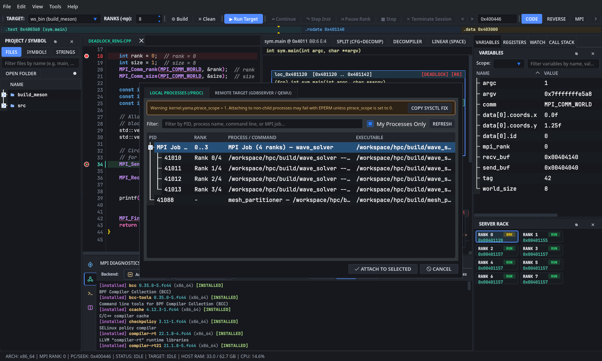
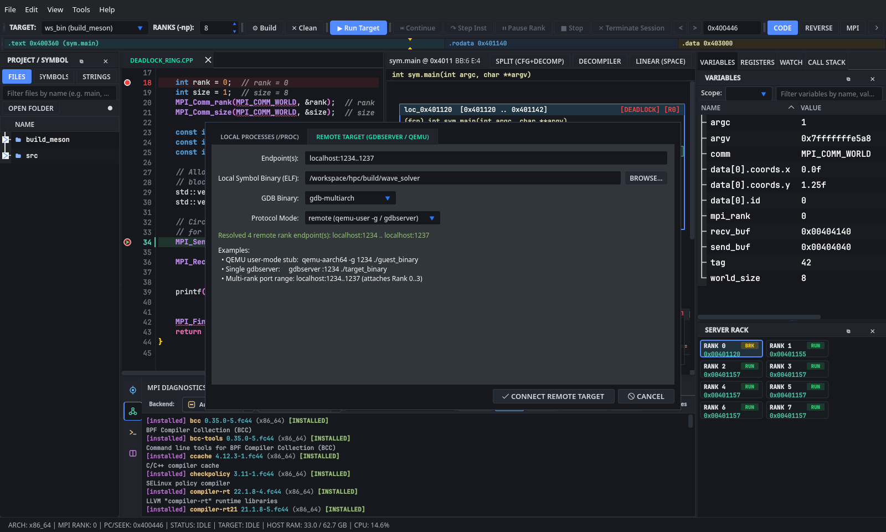
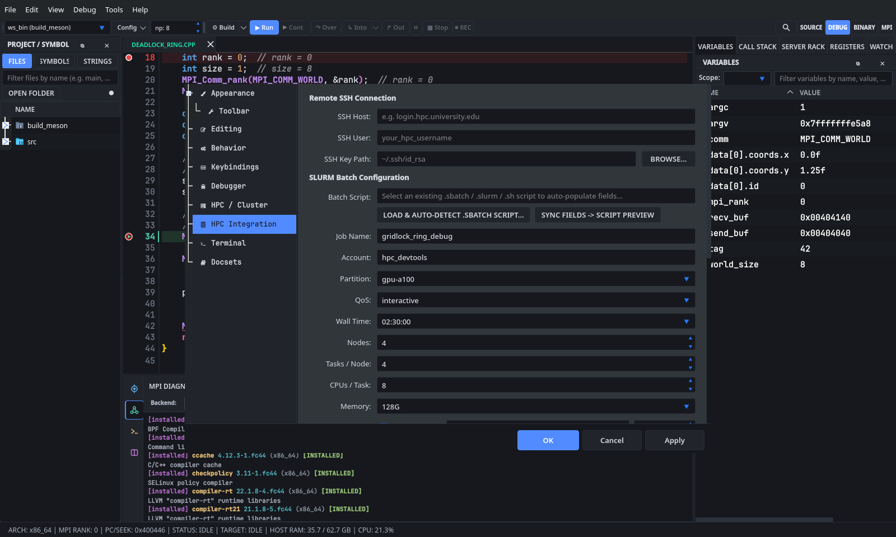

# Quickstart and Workflows

This guide covers the four main debugging workflows in GridLock (`v0.8.8`):
1. Launching a local multi-rank MPI program or standalone ELF64 binary.
2. Attaching to a running Linux process or live `mpirun` / SLURM MPI job (`Ctrl+Alt+P`).
3. Connecting to `qemu-user -g` cross-architecture stubs and `gdbserver` instances (`target remote` / `extended-remote`).
4. Importing `#SBATCH` cluster scripts and configuring MPI hostfiles and SSH settings.

---

## 1. Launching a Local MPI Program

### Quick Launch From the Main Toolbar

1. **Choose a Target (`#toolbarTargetSelector`)**:
   * Select one of the bundled MPI showcase programs (`inspection_demo` through `catchpoint_exceptions`), pick a discovered workspace target after `File -> Open Workspace...`, or choose `Open ELF / Binary...` to load any C/C++ source file or ELF64 executable.
2. **Configure Per-Target Launch Options (`Config` Popover)**:
   * Click **`Config`** next to the target dropdown to set CLI `--args` (persisted per target and per workspace so arguments never leak across unrelated binaries), custom working directory, and `Stop at main()`.
3. **Set the Rank Count (`np:`)**:
   * Set the spinbox (`1..256`, default `8`). When `np == 1`, multi-rank chrome collapses automatically; when `np >= 2`, `ServerRackView` displays `IDLE` rank cards immediately.
4. **Select a Debugger Engine (Optional)**:
   * Open `Edit -> Preferences` (`Ctrl+,`) -> `Debugger` -> `Debugger Engine` to pick `GNU GDB (gdb)` (default, uses `GdbRankCoordinator`), `LLVM LLDB-DAP (lldb-dap)` (uses `DapCoordinator`), `NVIDIA CUDA-GDB (cuda-gdb)`, or `AMD ROCm GDB (rocgdb)`.
5. **Set Breakpoints (Optional)**:
   * Left-click any line in the `SourceCodeView` gutter to toggle an all-ranks breakpoint, or right-click a line in the gutter to set a rank-filtered condition, hit ignore count, or non-suspending logpoint.
6. **Start Execution (`▶ Run` or `Alt+R`)**:
   * If a standalone `.cpp` or `.c` source file is selected and its binary is missing or older than the source, GridLock compiles it with `mpicxx -g -O0` (or `mpicc -g -O0`), enforces `+x` permissions, and blocks stale-binary launches if compilation fails.
   * `GdbRankCoordinator` creates per-rank POSIX named pipes (`/tmp/gridlock_mi_<pid>_<seq>/r<i>.in` and `r<i>.out`) and spawns a single MPMD `mpirun` job running one `gdb --interpreter=mi3` instance per rank. If `mpirun`/`mpiexec` is not installed on the host, it falls back to launching Rank 0 directly under `gdb`.
   * OpenMP thread counts are auto-tuned to `OMP_NUM_THREADS = max(1, idealThreadCount / rankCount)` with `OMP_WAIT_POLICY=PASSIVE` unless overridden in your environment or `MPI Args`.
7. **Step, Scope Ranks, Inspect, and Reverse**:
   * Click any card in **`SERVER RACK`** (`RANK 0 .. RANK N-1`) to focus that rank via `setFocusedRank()` across `Variables`, `Registers`, `Call Stack`, `SourceCodeView`, `DisassemblyView`, `Memory View`, `ArrayPlotDialog`, and `PointerGraphDialog`, and toggle execution scope between **`All Ranks`** and **`Rank k`**.
   * Use **`▶ Cont`** (`F5`), **`Over`** (`F10`), **`Into`** (`F11` split button with `Step Instruction`), **`Out`** (`Shift+F11`), **`⏸ Pause`** / **`Pause All Ranks`** (`F6`), and **`■ Stop`**.
   * To step backward in GDB sessions, toggle **`● REC`** on the toolbar (enables `record full` with `scheduler-locking on` and a 200,000-instruction ring buffer), then step or continue backward.

> [!TIP]
> Click any rank card in **`SERVER RACK`** (`RANK 0 .. RANK N-1`) to refocus all docks simultaneously, or toggle **`All Ranks`** vs. **`Rank k`** execution scope when stepping a single divergent process past a barrier.

### Creating or Configuring a Workspace Project

* **`File -> New Project...` (`ProjectWizard`)**: Two-page wizard that configures the workspace directory, target binary, program arguments, rank count (`-np`), and OpenMPI topology flags (`--bind-to core`, `--map-by node`, `--use-hwthread-cpus`, `--oversubscribe`, `--report-bindings`, `--display-map`, `--tag-output`, `--timestamp-output`), saves `.gridlock/settings.toml`, and launches the session.
* **`File -> Project Settings` (`ProjectSettingsDialog`)**: Edits `Target Binary`, per-target `Program Arguments`, `Working Directory`, `MPI Ranks (-np)` (`1..256`), and extra `MPI Args` for the current workspace.

---

## 2. Attaching to a Running Process or Live MPI Job (`Ctrl+Alt+P`)

Open **`File -> Attach to Process...`** (or press **`Ctrl+Alt+P`**) and stay on the first tab: **`Local Processes (/proc)`**.



### How `/proc` MPI Job Grouping Works (`ProcessScanner`)

`ProcessScanner::scanRunningProcesses` reads `/proc/<pid>/{comm,status,cmdline,exe,environ}` (filtering to your UID by default when **`My Processes Only`** is checked) and checks MPI/scheduler environment variables in priority order:

* **World Rank**: `OMPI_COMM_WORLD_RANK`, `PMI_RANK`, `PMIX_RANK`, `SLURM_PROCID`, `MV2_COMM_WORLD_RANK`.
* **World Size**: `OMPI_COMM_WORLD_SIZE`, `PMI_SIZE`, `SLURM_NTASKS`, `MV2_COMM_WORLD_SIZE`.
* **Job Grouping Tag**: `OMPI_MCA_ess_base_jobid`, `PMIX_NAMESPACE`, `PMI_JOBID`, `SLURM_STEP_ID`, `SLURM_JOB_ID`, or parent launcher `ppid_<PPID>`.

All sibling ranks belonging to the same job appear under an expandable **`MPI Job (N ranks)`** header sorted by world rank (`Rank 0/N .. Rank N-1/N`). Non-MPI processes appear below, sorted newest-PID-first.

### Step-by-Step Local Attach

1. Start your target in an external terminal (for example, `mpirun -np 4 ./wave_solver` or a hung MPI job).
2. Press **`Ctrl+Alt+P`** in GridLock.
3. Check the top of the dialog for the **`kernel.yama.ptrace_scope`** banner:
   * On many Linux distributions, `/proc/sys/kernel/yama/ptrace_scope` defaults to `1`, which blocks non-parent `ptrace` attaches with `EPERM`.
   * Click **`Copy sysctl Fix`** and run the copied command in a root-capable shell:
     ```bash
     echo 0 | sudo tee /proc/sys/kernel/yama/ptrace_scope
     ```
   * Alternatively, grant `CAP_SYS_PTRACE` directly to your local `gdb` binary (`sudo setcap cap_sys_ptrace=eip /usr/bin/gdb`) or set `kernel.yama.ptrace_scope = 0` in `/etc/sysctl.d/10-ptrace.conf`.

> [!WARNING]
> When `kernel.yama.ptrace_scope` is `1` (or `2`), GridLock's `process_vm_readv` direct memory reader and `gdb -p <pid>` attach calls fail with `EPERM` on external MPI jobs started from a separate terminal until one of the permissions above is granted.
4. Filter the list using the **`Filter:`** box (matches PID, rank label, binary name, command line, or MPI job tag) and click **`Refresh`** if you started the process after opening the dialog.
5. Select what to attach:
   * **Entire MPI Job**: Click the top-level **`MPI Job (N ranks)`** row. `AttachProcessDialog::selectedProcesses()` expands all child rank PIDs in world-rank order.
   * **Subset or Single Process**: `Ctrl+Click` / `Shift+Click` specific rank rows or select any standalone PID row.
6. Click **`Attach to Selected`** (or double-click the row):
   * `GdbRankCoordinator::attachToProcesses` resolves `/proc/<pid>/exe` into `ElfBinaryInspector`, spawns one `gdb --interpreter=mi3` process per selected rank, issues `-target-attach <pid>`, syncs active breakpoints, and populates `ServerRackView`.
   * When you later click **`■ Stop`** or **`✕ Terminate Session`**, attached GDB sessions issue `-target-detach` before `-gdb-exit` so the external process is not killed with `SIGKILL`.

---

## 3. Debugging `qemu-user` and `gdbserver` Targets (`target remote`)

Open **`File -> Attach to Process...`** (`Ctrl+Alt+P`) and switch to Tab 2: **`Remote Target (gdbserver / QEMU)`**.



### Endpoint Syntax (`ProcessScanner::expandRemoteEndpoints`)

The **`Endpoint(s):`** field accepts three forms (ports must satisfy `1 <= start <= end <= 65535`, up to `1025` ports per range):

* **Single Endpoint**: `localhost:1234`, `:1234` (normalizes to `localhost:1234`), or `192.168.122.50:2222` -> attaches as `Rank 0`.
* **Contiguous Port Range**: `localhost:1234..1237` or `localhost:1234-1237` -> expands into 4 endpoints assigned to `Rank 0 .. Rank 3`.
* **Comma-Separated Endpoints**: `node0:1234, node1:1234, node2:1234, node3:1234` -> assigns each `host:port` to `Rank 0 .. Rank N-1` in order.

### Step-by-Step Remote Connection

1. **Start the Remote Stub(s)**:
   * **QEMU User-Mode Cross-Architecture Stub (`AArch64` / `RISC-V`)**:
     ```bash
     qemu-aarch64 -g 1234 ./build-arm64/solver
     # or for RISC-V:
     qemu-riscv64 -g 1234 ./build-rv64/solver
     ```
   * **Single `gdbserver` (Local, Container, or QEMU System VM)**:
     ```bash
     gdbserver :1234 ./solver --mesh wing.msh
     ```
   * **Multi-Rank `mpirun` + Per-Rank `gdbserver` Port Range (`1234..1237`)**:
     ```bash
     mpirun -np 4 bash -c 'gdbserver :$((1234 + OMPI_COMM_WORLD_RANK)) ./wave_solver'
     ```
2. **Configure Tab 2 in `AttachProcessDialog`**:
   * **`Endpoint(s):`**: Enter `localhost:1234` (single target) or `localhost:1234..1237` (4-rank job). Verify the green validation line reads `Resolved N remote rank endpoint(s): ...`.
   * **`Local Symbol Binary (ELF):`**: Click **`Browse...`** and select the unstripped ELF binary on your workstation. `GdbRankCoordinator` loads DWARF symbols and disassembly locally via `ElfBinaryInspector` and sends `-file-exec-and-symbols "<path>"` to GDB before connecting.
   * **`GDB Binary:`**: Pick `gdb` (native x86_64), `gdb-multiarch` (recommended for cross-architecture QEMU targets), `aarch64-linux-gnu-gdb`, `riscv64-linux-gnu-gdb`, or type a custom path.
   * **`Protocol Mode:`**:
     * `remote (qemu-user -g / gdbserver)`: Sends `-target-select remote <host:port>`. Required for `qemu-user -g` stubs and standard single-process `gdbserver`.
     * `extended-remote (gdbserver --multi)`: Sends `-target-select extended-remote <host:port>` for persistent `gdbserver --multi` listeners.
3. Click **`Connect Remote Target`** to attach all resolved ranks and inspect disassembly, registers, stack frames, and memory.

---

## 4. Importing `#SBATCH` Scripts and Cluster Configuration (Experimental / Untested)

> [!WARNING]
> **Slurm Support is Experimental:** Slurm job-step attachment and batch launch integration have not yet been validated on production Slurm clusters and may break depending on site `srun` / `pmix` / `ptrace` configurations. Local `mpirun` / `mpiexec` and direct SSH rank launches are the primary tested workflows.

Open **`Edit -> Preferences`** (`Ctrl+,`) to configure MPI hostfiles, environment variables, SSH credentials, and SLURM batch scripts.



### `HPC / Cluster` Page (Local & Multi-Node `mpirun`)

* **`MPI Hosts File`**: Passed as `--hostfile <path>` by `GdbRankCoordinator` when launching `mpirun`.
* **`MPI Env Vars`**: One `KEY=VALUE` per line, injected into the spawned MPI process environment.
* **`Strict Node Affinity`**: Appends `--map-by node` to `mpirun`.

### `HPC Integration` Page (16-Directive `#SBATCH` Parser & SSH Fields)

1. Click **`Load & Auto-Detect .sbatch Script...`** (or paste an existing batch script into the **`Script Template`** editor).
2. `PreferencesDialog::parseSlurmBatchScript` extracts `module load` statements, the launcher (`srun`, `srun --mpi=pmix`, `mpirun`, `mpiexec`), and 16 SLURM flags (`--job-name`/`-J`, `--account`/`-A`, `--partition`/`-p`, `--qos`/`-q`, `--time`/`-t`, `--mem`/`--mem-per-cpu`, `--nodes`/`-N`, `--ntasks-per-node`/`--ntasks`/`-n`, `--cpus-per-task`, `--constraint`/`-C`, `--gres=gpu:...`/`--gpus`, `--output`/`-o`, `--mail-type`, `--mail-user`).
3. Edit any form field and click **`Sync Fields -> Script Preview`** to regenerate a clean `#SBATCH` script using `{FILE}` as the binary placeholder.

> [!NOTE]
> **Scope of `File -> Submit SLURM Job`**: Selecting `File -> Submit SLURM Job` substitutes `{FILE}` in your `Script Template` and dispatches a local preview log to `MockHpcBackend` inside `Package Manager` (`>_ Raw`). Live SSH batch submission to remote SLURM login nodes is out of scope; copy the generated `.sbatch` script to your cluster or tunnel remote `gdbserver` ports over SSH (`ssh -L 1234:compute01:1234 login.cluster.edu`) and attach via **`Remote Target (gdbserver / QEMU)`**.
