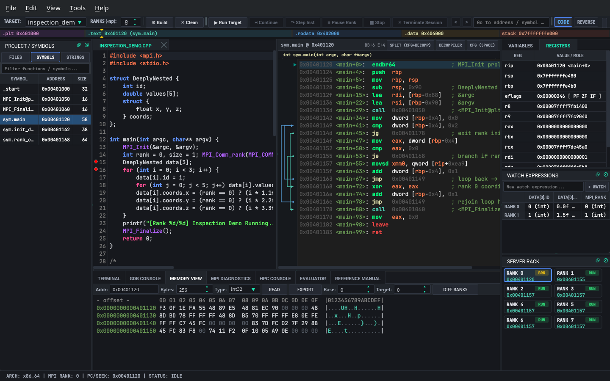
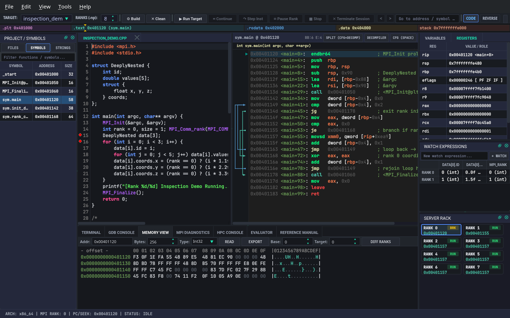
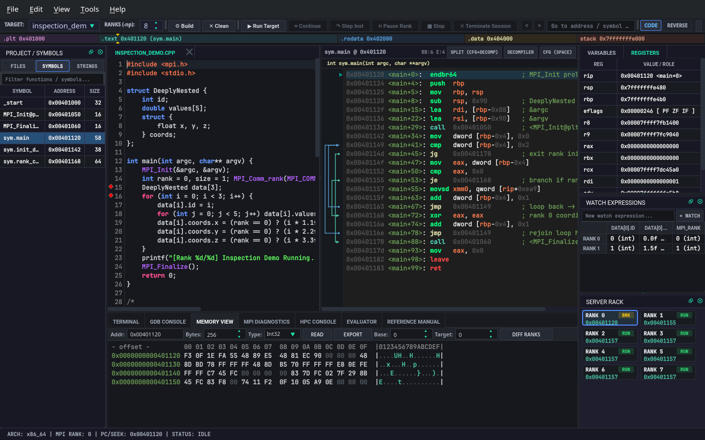
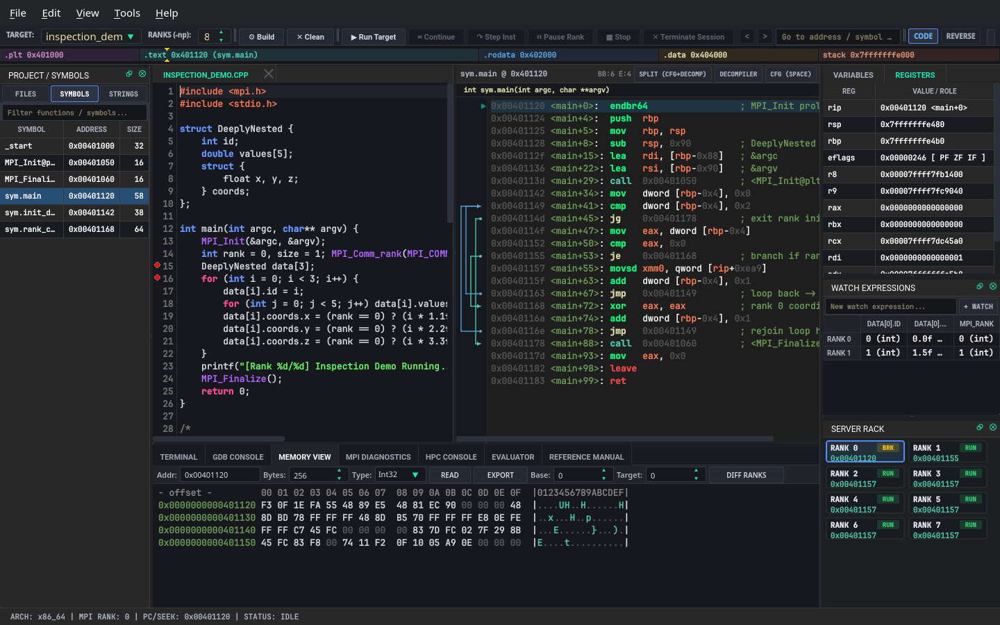
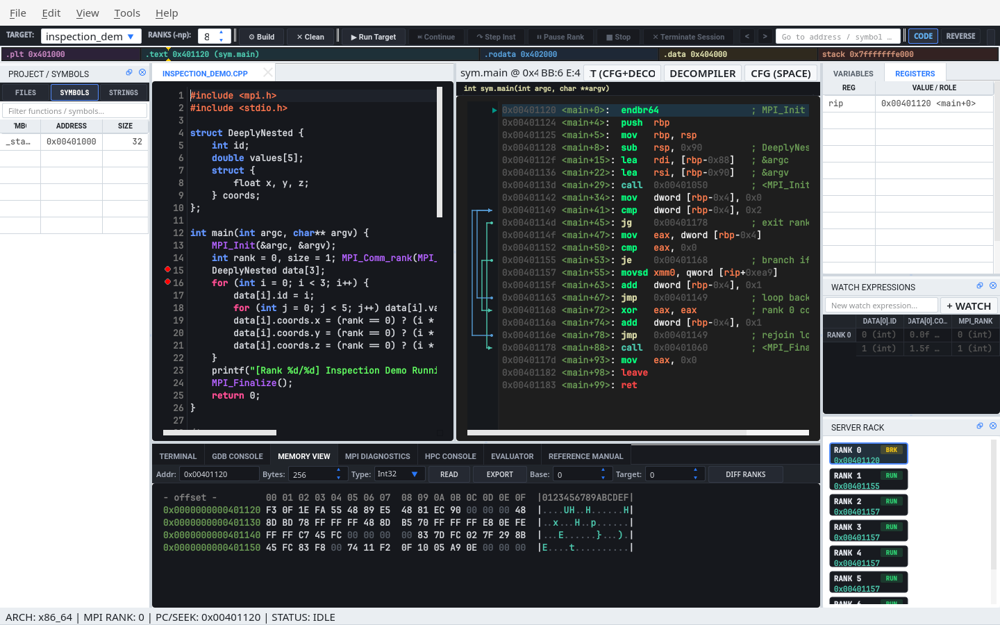

# GridLock Workstation Color Themes & Typography Gallery

GridLock provides **6 curated workstation color themes** engineered for zero-gutter multi-rank MPI debugging, x86_64/AArch64/RISC-V disassembly, Control Flow Graph (CFG) visualization, and multi-target decompilation.

All themes are selectable live in **`Edit -> Preferences (Ctrl+,) -> Appearance`** with zero raw underscore identifiers and an interactive 5-swatch palette preview strip (`Canvas`, `Header`, `Border`, `Accent`, `Text`).

---

## Curated Color Palette Matrix

| Theme Name | Internal ID | Canvas (`bg`) | Header (`hdr`) | Structural Border | Primary Accent | Primary Text | Polarity |
| :--- | :--- | :--- | :--- | :--- | :--- | :--- | :--- |
| **GridLock Slate** | `gridlock_slate` | `#16181d` | `#21252b` | `#2c313a` | `#00a2ff` | `#d4d4d4` | Dark (Default) |
| **Obsidian Teal** | `dark_teal` | `#111a1d` | `#172429` | `#22353c` | `#00bfa5` | `#d8e6e7` | Dark |
| **Tokyo Night** | `tokyo_night` | `#1a1b26` | `#24283b` | `#3b4261` | `#7aa2f7` | `#c0caf5` | Dark |
| **Catppuccin Mocha** | `catppuccin_mocha` | `#1e1e2e` | `#181825` | `#313244` | `#89b4fa` | `#cdd6f4` | Dark |
| **Gruvbox Industrial** | `gruvbox_dark` | `#1d2021` | `#282828` | `#3c3836` | `#fe8019` | `#ebdbb2` | Dark |
| **Daylight Paper (Light)** | `daylight_light` | `#f5f6f8` | `#e6e9ef` | `#ccd0da` | `#1e66f5` | `#4c4f69` | High-Contrast Light |

---

## Live Typography & Dynamic Control Scaling

In **`Edit -> Preferences -> Appearance`**, GridLock provides four independent live typography controls that take effect immediately upon clicking **Apply** or **OK** (no application restart required):

1. **UI Font Family (`appearance/ui_font_family`):** Scales menus, dock headers, tree/table views, buttons, and status strips (`Inter`, `Cantarell`, `Noto Sans`, `DejaVu Sans`, `Liberation Sans`, `System Default`).
2. **UI Font Size (`appearance/ui_font_size`, `8 pt – 24 pt`):** Dynamically interpolates `font-size: %1pt` and proportional control heights across `ThemeManager`'s QSS engine (`QLineEdit`, `QComboBox`, `QSpinBox`, `QPushButton`, `QMenuBar`, `QMenu`, `QTableView`, `QTreeView`, `QTabBar`).
3. **Code / Disassembly Font Family (`appearance/code_font_family`):** Sets the fixed-pitch font across `SourceCodeView`, `DisassemblyView` (Linear, CFG Graph, and Decompiler), and `MemView` (`JetBrains Mono`, `Cascadia Code`, `Fira Code`, `DejaVu Sans Mono`, `Source Code Pro`, `Monospace`).
4. **Code / Disassembly Font Size (`appearance/code_font_size`, `8 pt – 24 pt`):** Dynamically scales editor line numbers, assembly columns, CFG basic-block nodes, decompiler output, and hexadecimal memory views while keeping `TerminalDockWidget` strictly isolated on a fixed-pitch PTY grid.

---

## Workstation Theme Screenshots (`1440x900`)

### 1. GridLock Slate (`gridlock_slate`)
Default high-contrast dark slate palette (`#16181d` canvas, `#21252b` headers, `#00a2ff` azure accent).

---

### 2. Obsidian Teal (`dark_teal`)
Deep oceanic slate (`#111a1d` canvas, `#172429` headers, `#00bfa5` teal accent).

---

### 3. Tokyo Night (`tokyo_night`)
Indigo-slate developer workstation palette (`#1a1b26` canvas, `#24283b` headers, `#7aa2f7` periwinkle blue accent).

---

### 4. Catppuccin Mocha (`catppuccin_mocha`)
Warm pastel-on-charcoal palette (`#1e1e2e` canvas, `#181825` headers, `#89b4fa` sapphire accent).

---

### 5. Gruvbox Industrial (`gruvbox_dark`)
Warm retro-industrial hard contrast (`#1d2021` canvas, `#282828` headers, `#fe8019` amber-orange accent).

---

### 6. Daylight Paper (`daylight_light`)
High-contrast daylight paper theme (`#f5f6f8` canvas, `#e6e9ef` headers, `#1e66f5` cobalt accent) for bright environments and publication figures.

