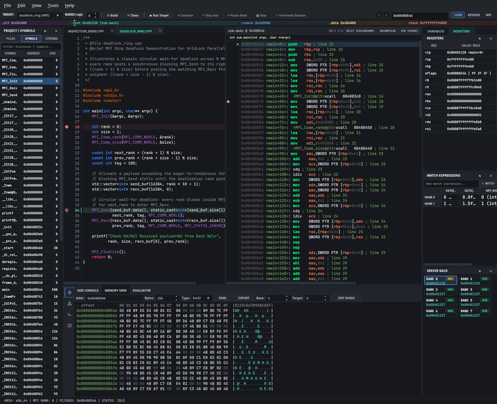
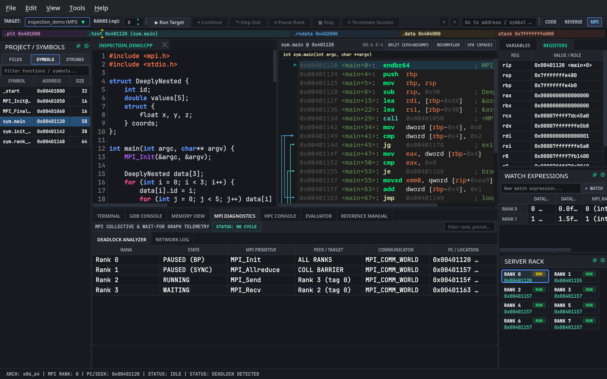
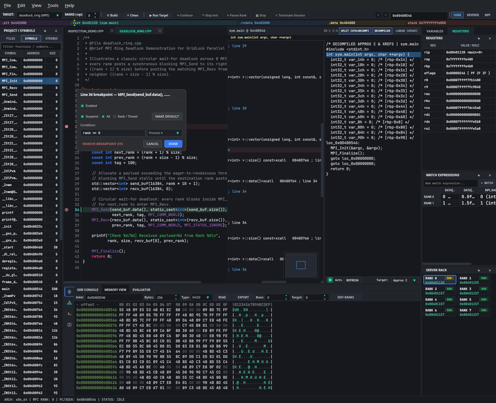
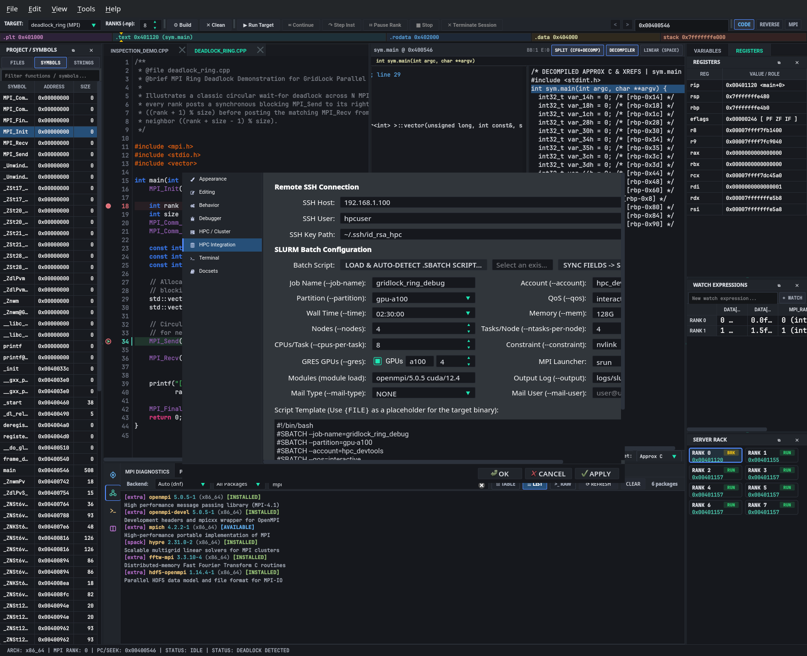

# GridLock Hands-On Tutorial

This tutorial walks through four common MPI debugging and binary inspection workflows using the two sample programs bundled in the `tutorial/` directory: `tutorial/deadlock_ring.cpp` and `tutorial/inspection_demo.cpp`.



---

## Prerequisites & Building the Sample Programs

Make sure an MPI compiler wrapper (`mpicxx`), `gdb` or `lldb-dap`, and `clangd` are installed on your machine.

You can compile both tutorial samples manually with debug symbols (`-g -O0`):

```bash
mpicxx -g -O0 tutorial/deadlock_ring.cpp -o tutorial/deadlock_ring
mpicxx -g -O0 tutorial/inspection_demo.cpp -o tutorial/inspection_demo
```

Alternatively, launch GridLock (`./builddir/gridlock`), pick **`deadlock_ring (MPI)`** or **`inspection_demo (MPI)`** from the **TARGET** dropdown on the main toolbar, and set **RANKS (-np)** to **`8`**. If the sample binary has not been compiled yet, GridLock compiles it automatically with `mpicxx -g -O0` when you start the session.

---

## Walkthrough 1: Diagnosing an 8-Rank Circular `MPI_Send` Deadlock (`tutorial/deadlock_ring.cpp`)

`tutorial/deadlock_ring.cpp` sets up a ring topology where every rank sends a 16,384-integer buffer (`send_buf`) to `next_rank = (rank + 1) % size` (lines 34–35) before posting the matching `MPI_Recv` from `prev_rank = (rank + size - 1) % size` (lines 36–37):

```cpp
// tutorial/deadlock_ring.cpp (lines 29-37)
std::vector<int> send_buf(16384, rank * 10 + 1);
std::vector<int> recv_buf(16384, 0);

MPI_Send(send_buf.data(), static_cast<int>(send_buf.size()), MPI_INT,
         next_rank, tag, MPI_COMM_WORLD);
MPI_Recv(recv_buf.data(), static_cast<int>(recv_buf.size()), MPI_INT,
         prev_rank, tag, MPI_COMM_WORLD, MPI_STATUS_IGNORE);
```

Because the 64 KB payload exceeds the typical MPI eager message threshold, `MPI_Send` blocks waiting for the destination rank to enter `MPI_Recv`, stalling all 8 processes.

### Step-by-Step Diagnosis
1. **Launch across 8 ranks:**
   * Select **`deadlock_ring (MPI)`** in the **TARGET** dropdown, set **RANKS (-np)** to **`8`**, and click **`▶ Run Target`**.
   * Step or continue past `MPI_Init` until execution reaches `MPI_Send` at line 34.
2. **Check the Server Rack (`ServerRackView`):**
   * Look at the **Server Rack** panel on the right. Every rank card (`R0` through `R7`) shows a blocked state inside `MPI_Send`.
3. **Inspect the Wait-For Cycle in MPI Diagnostics:**
   * Press **`Alt+3`** (or click **`MPI`** on the bottom tool rail) to open the **MPI Diagnostics** panel (`DeadlockAnalyzer`).
   * The **DEADLOCK ANALYZER** view lists the circular wait-for chain (`Rank 0 -> Rank 1 -> Rank 2 -> Rank 3 -> Rank 4 -> Rank 5 -> Rank 6 -> Rank 7 -> Rank 0`) and updates the status bar with a deadlock warning.
   * Switch to **`REVERSE`** (`Alt+2`) or toggle the **CFG** view (`Space` in `DisassemblyView`) to see the `[R0..R7]` rank badges stopped inside the basic block calling `MPI_Send`.



4. **Fix the Deadlock and Rebuild (`F7`):**
   * Switch back to **`CODE`** (`Alt+1`) and edit `tutorial/deadlock_ring.cpp` in `SourceCodeView`—either pair odd and even ranks (even ranks call `MPI_Send` then `MPI_Recv`, odd ranks call `MPI_Recv` then `MPI_Send`) or replace the pair with `MPI_Sendrecv`:
     ```cpp
     MPI_Sendrecv(send_buf.data(), static_cast<int>(send_buf.size()), MPI_INT, next_rank, tag,
                  recv_buf.data(), static_cast<int>(recv_buf.size()), MPI_INT, prev_rank, tag,
                  MPI_COMM_WORLD, MPI_STATUS_IGNORE);
     ```
   * Save the file (`Ctrl+S`) and press **`F7`** (`Build -> Build Target`) to recompile and re-run.

---

## Walkthrough 2: Rank-Filtered Conditional Breakpoints with `clangd` Completion (`tutorial/inspection_demo.cpp`)

`tutorial/inspection_demo.cpp` defines a nested struct `DeeplyNested` (lines 4–10) and populates `DeeplyNested data[3]` inside a loop (lines 16–22) with values that depend on `rank`:

```cpp
// tutorial/inspection_demo.cpp (lines 4-22)
struct DeeplyNested {
    int id;
    double values[5];
    struct {
        float x, y, z;
    } coords;
};
...
for (int i = 0; i < 3; i++) {
    data[i].id = i;
    for (int j = 0; j < 5; j++) data[i].values[j] = (rank + 1) * (i * j);
    data[i].coords.x = (rank == 0) ? (i * 1.1f) : (i * 1.5f);
    data[i].coords.y = (rank == 0) ? (i * 2.2f) : (i * 2.5f);
    data[i].coords.z = (rank == 0) ? (i * 3.3f) : (i * 3.5f);
}
```

### Setting a Rank-Filtered Conditional Breakpoint
1. **Open `tutorial/inspection_demo.cpp`:**
   * Select **`inspection_demo (MPI)`** in the **TARGET** dropdown (or open `tutorial/inspection_demo.cpp` from the **Project Explorer** `FILES` tree).
2. **Open the Breakpoint Popover:**
   * Move the mouse over the left gutter at **line 19** (`data[i].coords.x = ...`) or **line 20** (`data[i].coords.y = ...`) and **right-click** the gutter marker.
   * The **Conditional Breakpoint Popover** (`ConditionalBreakpointDialog`) opens directly below the line's gutter icon.



3. **Filter by Rank and Add a `clangd` Condition:**
   * In the **Suspend Scope** dropdown, select **Focused Rank Only** (or keep **All MPI Ranks** and filter in the expression).
   * In the **Condition** box, type `data[i].` — `ClangdLspClient` queries `clangd` at that line in `inspection_demo.cpp` and suggests `id`, `values`, and `coords`.
   * Continue typing `data[i].coords.` to complete `x`, `y`, or `z`, and enter:
     ```cpp
     rank == 3 && data[i].coords.x > 0.0f
     ```
   * Press **`Enter`** (or click **Done**). The gutter badge changes to a conditional breakpoint diamond.
4. **Run and Verify:**
   * Click **`▶ Run Target`** with **RANKS (-np)** set to **`8`**.
   * Step through the loop (`↷ Step Inst`): on iteration `i == 0`, `data[0].coords.x` is `0.0f`, so the condition is false; on iteration `i == 1`, Rank 3 computes `data[1].coords.x = 1.5f > 0.0f` and halts at the breakpoint.

---

## Walkthrough 3: Cross-Rank Variable Watch (`DifferentialGrid`) & Memory Diffing (`MemView`)

When debugging `tutorial/inspection_demo.cpp`, Rank 0 assigns `coords.x = i * 1.1f` while Ranks 1–7 assign `coords.x = i * 1.5f`, and `data[i].values[j]` scales by `(rank + 1)`.

### Comparing Expressions Across All Ranks (`DifferentialGrid`)
1. **Promote Variables to the Watch Table:**
   * Expand `data` in the **Variables** dock on the right to inspect `data[0]`, `data[1]`, and `data[2]`, or open the **Watch Expressions** (`DifferentialGrid`) panel.
   * Add the expressions `rank`, `data[1].id`, `data[1].coords.x`, and `data[1].values[2]`.
2. **Spot Rank Divergence:**
   * `DifferentialGrid` evaluates each expression across all 8 ranks (`R0` through `R7`).
   * `data[1].id` is `1` on every rank, whereas `data[1].coords.x` shows `1.1` on Rank 0 and `1.5` on Ranks 1–7, and `data[1].values[2]` increases across ranks (`2`, `4`, `6`, ..., `16`).

### Diffing Raw Process Memory Between Two Ranks (`MemView`)
1. **Open Memory View:**
   * Click **`Debug`** on the bottom tool rail and select the **Memory View** (`MemView`) tab, or right-click a variable/register and choose **Show in Memory View**.
2. **Compare Base and Target Ranks (`DIFF RANKS`):**
   * In the `MemView` toolbar, set **Base Rank** to **`0`** and **Target Rank** to **`1`** (or click **`DIFF RANKS`**).
   * `MemoryDiffer` reads the memory region from both rank processes via `process_vm_readv` and highlights every byte cell where Rank 1's buffer differs from Rank 0's buffer.
   * To test binary or in-memory patching, press **`Ctrl+E`** in `MemView` to modify hex bytes at the current address, or export a patched ELF binary via `File -> Export Patched Binary`.

---

## Walkthrough 4: Offline Documentation Lookup (`F1`) & SLURM `#SBATCH` Script Configuration

### Looking Up MPI & C/C++ Reference Pages (`F1`)
1. **Trigger Contextual Help (`F1`):**
   * Place the editor cursor on `MPI_Init`, `MPI_Comm_rank`, `MPI_Send`, or `MPI_Recv` in `SourceCodeView` (or select a call instruction in `DisassemblyView`) and press **`F1`**.
2. **Browse Offline Docsets & `man` Pages:**
   * GridLock switches the bottom dock to **`Docs`** (**Reference Manual** / `ReferenceManualWidget`) and looks up the symbol in your local Zeal `.docset` bundles (`~/.local/share/Zeal/Zeal/docsets`) or system `man` pages.
   * You can also type any MPI routine or C/POSIX function directly into the search bar at the top of the **Reference Manual** panel.

### Importing or Generating a SLURM `#SBATCH` Batch Script
1. **Open HPC / Cluster Preferences:**
   * Open **`Edit -> Preferences (Ctrl+,)`** and select **`HPC / Cluster`** (or **`HPC Integration`**) in the left sidebar.



2. **Import an Existing `.sbatch` Script:**
   * Click **Browse / Load Batch Script...** or paste a batch script into the **SLURM Batch Script Auto-Detector** text box:
     ```bash
     #!/bin/bash
     #SBATCH --job-name=gridlock_ring_debug
     #SBATCH --partition=gpu-debug
     #SBATCH --account=hpc_team
     #SBATCH --nodes=2
     #SBATCH --ntasks-per-node=4
     #SBATCH --cpus-per-task=2
     #SBATCH --gres=gpu:2
     #SBATCH --mem=32G
     #SBATCH --time=00:30:00
     #SBATCH --output=logs/ring_%j.out

     module load openmpi/5.0.5
     srun ./tutorial/deadlock_ring
     ```
   * GridLock parses the `#SBATCH` directives and `module load` commands and populates the partition, node count, tasks per node, GPU count, memory, walltime, and launcher fields automatically.
3. **Apply and Export:**
   * Adjust any parameters in the form and click **Apply** or **OK** to save the configuration to `.gridlock/workspace.toml` and `QSettings`.
