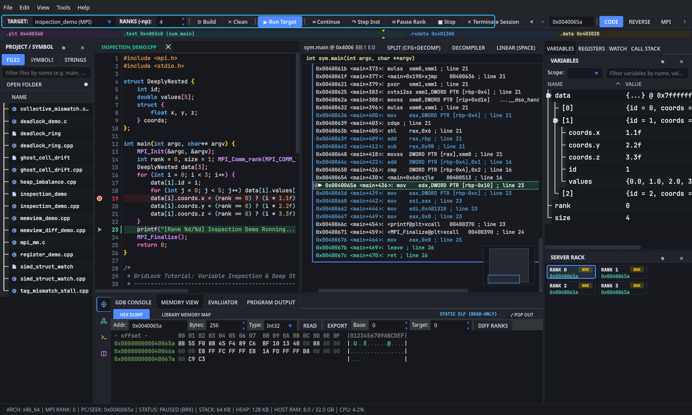
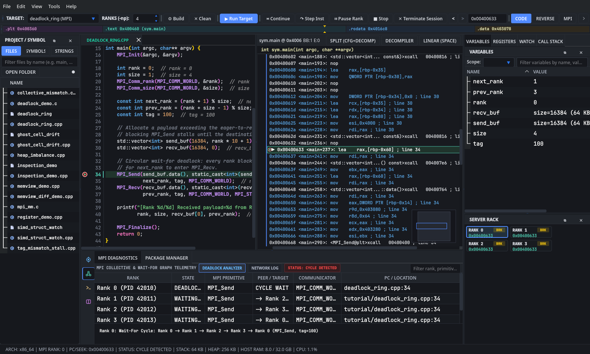
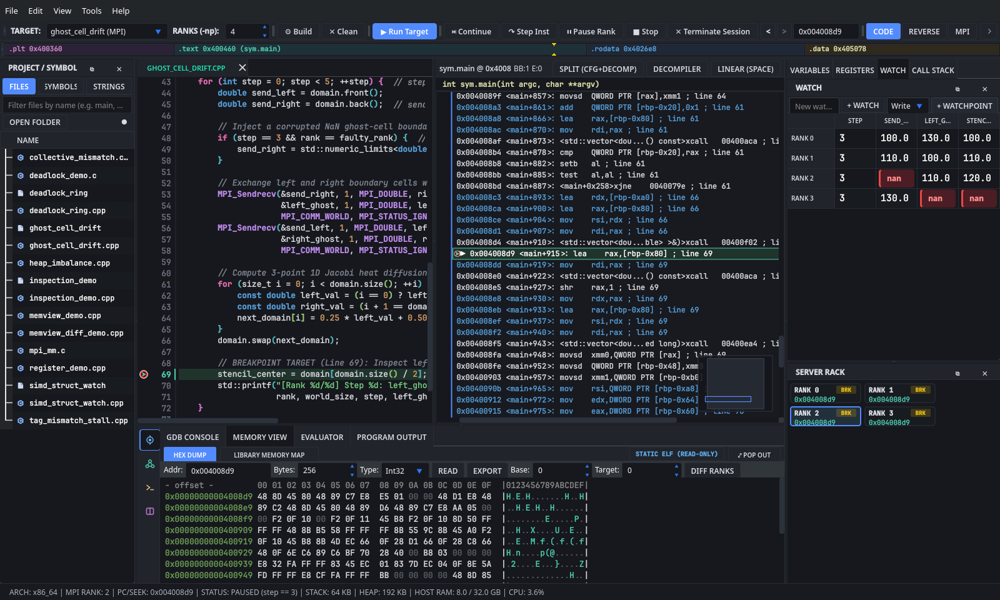
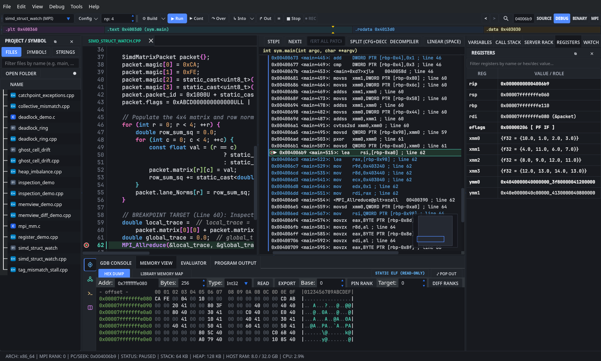

# Tutorials Walkthrough

This hands-on guide walks you through finding, inspecting, and fixing real parallel C++ and MPI bugs in GridLock. Every lab uses a runnable program from the `tutorial/` folder, shows the exact C++ code from disk, and tells you each button, tab, and line number to click.

---

## First 5 Minutes: How to Load, Break, and Step a Program in GridLock

If you have never used a multi-process debugger before, start here. Unlike a single-process program, an MPI job runs multiple copies of your binary at the same time, numbered **`Rank 0`**, **`Rank 1`**, **`Rank 2`**, and so on. GridLock lets you pause all of them (or just one rank), compare their variables side by side, and step line by line.



### Step 1: Select or Build a Target Binary
Look at the top-left of the main toolbar (outlined in cyan above):
1. Click the **`TARGET:`** dropdown. The bundled MPI showcase tutorials (`inspection_demo (MPI)` through `simd_struct_watch (MPI)`) are pre-listed, and `tutorial/catchpoint_exceptions.cpp` (Tutorial 8) can be opened via **`File -> Open Source File`** or **`Ctrl+P`**. Selecting a target opens its `.cpp` source file in the center editor.
   * To open your own file or binary instead, choose **`Open ELF / Binary...`** at the bottom of **`TARGET:`**, or use **`File -> Open Source File`**.
2. Click **`⚙ Build`** on the toolbar (or press **`Ctrl+B`**, or choose **`Tools -> Build Target`**) to compile the target with debug symbols (`mpicxx -g -O0`). Clicking **`▶ Run Target`** also compiles any unbuilt tutorial file automatically.

### Step 2: Set the MPI Rank Count (`-np`)
1. Next to **`TARGET:`**, find the **`RANKS (-np):`** spinbox.
2. Set it to **`4`** (you can choose anywhere from `1` to `256` processes).
3. Look at the **`SERVER RACK`** panel in the bottom-right corner: it immediately displays 4 cards labeled **`RANK 0`** through **`RANK 3`**.

### Step 3: Set a Breakpoint (or a Rank-Filtered Condition)
1. Look at the numbered gray gutter along the left edge of the source code editor (`SourceCodeView`).
2. **Left-click** next to any executable line number (for example, line **`23`** in `inspection_demo.cpp`). A red circle appears: every MPI rank will pause when it reaches this line. Left-click the red circle again to remove it.
3. **Right-click** a line number in the gutter (for example, line **`19`**) to open the **Conditional Breakpoint Popover**:
   * Type `rank == 2` into **`Condition:`** (or pick a preset from **`Presets ▾`**) and click **`Done`**.
   * Now only Rank 2 stops at line 19, while Ranks 0, 1, and 3 run past it without pausing.

### Step 4: Run, Read the Rank Cards, and Step
1. Click the blue **`▶ Run Target`** button on the top toolbar (or press **`Alt+R`**).
2. Read the status badges in **`SERVER RACK`** (bottom-right):
   * **`RUN`** (green): That rank is currently executing code.
   * **`BRK`** (amber): That rank is paused at a breakpoint, step, or manual pause, showing its current instruction address (`0x...`).
   * **`IDLE`** (gray): No session is running, or that rank has exited.
3. Click any card in **`SERVER RACK`** (for example **`RANK 2`**) to focus it. The **`VARIABLES`**, **`REGISTERS`**, and **`CALL STACK`** tabs in the top-right dock immediately update to show Rank 2's local state.
4. Use the stepping controls to move forward from a paused line:
   * **Step Over (`F10`)**: Runs the current C++ line and pauses on the next line in the same function.
   * **Step Into (`F11`)**: Enters inside a function call on the current line.
   * **Step Inst (`↷ Step Inst` on toolbar)**: Advances by a single CPU assembly instruction and updates both the editor and the **`Disassembly`** graph.
   * **Continue (`⏭ Continue` or `F5`)**: Resumes execution until the next breakpoint or program exit.
   * **Pause / Stop (`⏸ Pause Rank` / `■ Stop`)**: Interrupts a stuck rank or ends the debugging session.

---

## Tutorial 1: Multi-Rank Inspection (`tutorial/inspection_demo.cpp`)

### What This Program Does
`tutorial/inspection_demo.cpp` initializes an array of 3 nested C++ structs (`DeeplyNested data[3]`) on every MPI rank. Each struct holds an integer `id`, a 5-element `double values[5]` array scaled by `(rank + 1)`, and an inner `coords` struct whose `x, y, z` floats intentionally differ between `Rank 0` and worker ranks (`Rank 1..N-1`).

### Source Code (`tutorial/inspection_demo.cpp`, lines 4-26)
```cpp
struct DeeplyNested {
    int id;
    double values[5];
    struct {
        float x, y, z;
    } coords;
};

int main(int argc, char** argv) {
    MPI_Init(&argc, &argv);
    int rank = 0, size = 1; MPI_Comm_rank(MPI_COMM_WORLD, &rank); MPI_Comm_size(MPI_COMM_WORLD, &size);
    DeeplyNested data[3];
    for (int i = 0; i < 3; i++) {
        data[i].id = i;
        for (int j = 0; j < 5; j++) data[i].values[j] = (rank + 1) * (i * j);
        data[i].coords.x = (rank == 0) ? (i * 1.1f) : (i * 1.5f);
        data[i].coords.y = (rank == 0) ? (i * 2.2f) : (i * 2.5f);
        data[i].coords.z = (rank == 0) ? (i * 3.3f) : (i * 3.5f);
    }
    printf("[Rank %d/%d] Inspection Demo Running...\n", rank, size);
    MPI_Finalize();
    return 0;
}
```

### Click-by-Click Walkthrough
1. In **`TARGET:`** on the top toolbar, select **`inspection_demo (MPI)`**, and set **`RANKS (-np):`** to **`4`**.
2. **Left-click** the editor gutter at **line `23`** (`printf(...)`) so every rank pauses right after the `for` loop finishes filling `data`.
3. Click **`▶ Run Target`**. Wait a moment for **`RANK 0`** through **`RANK 3`** in **`SERVER RACK`** to turn amber (**`BRK`**).
4. In the top-right dock, click the **`VARIABLES`** tab:
   * Click the disclosure arrow next to **`data`** to expand `[0]`, `[1]`, and `[2]`.
   * Expand **`[1]`**, then expand **`coords`**. On **`RANK 0`**, you will see `x = 1.1`, `y = 2.2`, `z = 3.3`, and `values[4] = 4` (`(0 + 1) * (1 * 4)`).
5. Now click **`RANK 2`** in **`SERVER RACK`**:
   * Watch **`VARIABLES`** update to Rank 2's memory: `data[1].coords` is now `x = 1.5`, `y = 2.5`, `z = 3.5`, and `data[1].values[4] = 12` (`(2 + 1) * (1 * 4)`).
6. Compare all 4 ranks at once without clicking back and forth:
   * Click the **`WATCH`** tab (next to `VARIABLES` and `REGISTERS` in the top-right dock).
   * Type `data[1].coords.x` into the **`New watch expression...`** box and click **`+ Watch`** (or press `Enter`).
   * Add `data[2].values[4]` the same way.
   * Notice that `Rank 0`'s `data[1].coords.x` cell (`1.1`) turns light red because it differs from the `1.5` consensus shared by Ranks 1, 2, and 3.
7. Click **`■ Stop`** on the top toolbar to end the session.

---

## Tutorial 2: Circular Send/Recv Deadlock (`tutorial/deadlock_ring.cpp`)

### Why This Program Hangs
In `tutorial/deadlock_ring.cpp`, every rank tries to pass a 64 KB `std::vector<int>` (`16384 * 4` bytes) to its right neighbor (`next_rank`) using a synchronous-mode blocking `MPI_Send` **before** calling `MPI_Recv` from its left neighbor (`prev_rank`). Small MPI messages often fit inside an internal library buffer ("eager" protocol) and return immediately, hiding the bug. Once the payload exceeds that threshold (typically 4 KB to 32 KB), `MPI_Send` switches to the "rendezvous" protocol and blocks until the receiver posts `MPI_Recv`. Because every rank is stuck on line 34 waiting for the next rank in the ring, nobody ever reaches line 36.

### Source Code (`tutorial/deadlock_ring.cpp`, lines 23-40)
```cpp
    const int next_rank = (rank + 1) % size;
    const int prev_rank = (rank + size - 1) % size;
    const int tag = 100;

    // Allocate a payload exceeding the eager-to-rendezvous threshold so
    // blocking MPI_Send stalls until the destination rank posts MPI_Recv.
    std::vector<int> send_buf(16384, rank * 10 + 1);
    std::vector<int> recv_buf(16384, 0);

    // Circular wait-for deadlock: every rank blocks inside MPI_Send waiting
    // for next_rank to enter MPI_Recv.
    MPI_Send(send_buf.data(), static_cast<int>(send_buf.size()), MPI_INT,
             next_rank, tag, MPI_COMM_WORLD);
    MPI_Recv(recv_buf.data(), static_cast<int>(recv_buf.size()), MPI_INT,
             prev_rank, tag, MPI_COMM_WORLD, MPI_STATUS_IGNORE);

    printf("[Rank %d/%d] Received payload=%d from Rank %d\n",
           rank, size, recv_buf[0], prev_rank);
```

### Click-by-Click Walkthrough
1. Select **`deadlock_ring (MPI)`** in **`TARGET:`**, set **`RANKS (-np):`** to **`4`**, and clear any previous breakpoints.
2. Click **`▶ Run Target`**. Notice the program never prints `"Received payload=..."` and never exits: all 4 ranks stay stuck.
3. Click **`⏸ Pause Rank`** on the top toolbar to interrupt the hung processes and inspect where they are blocked.
4. Open the Deadlock Analyzer:
   * Click the **`MPI`** button on the far-right of the top toolbar (or press **`Alt+3`**, or click the second icon on the bottom-left vertical tool rail via **`Alt+5`** and select the **`MPI Diagnostics`** tab).
   * Make sure **`DEADLOCK ANALYZER`** is selected in the panel header.



5. Read what GridLock found:
   * The status pill turns red: **`STATUS: CYCLE DETECTED`**.
   * All 4 rows (`Rank 0` through `Rank 3`) show `MPI_Send` stalled at `deadlock_ring.cpp:34`, forming the closed wait ring `Rank 0 -> Rank 1 -> Rank 2 -> Rank 3 -> Rank 0`.
   * Double-click any row in the Deadlock Analyzer table to jump the editor and **`CALL STACK`** directly to that rank's `MPI_Send` call site.
6. **How to Fix the Bug**:
   * Click **`■ Stop`**. Replace the separate `MPI_Send` and `MPI_Recv` calls (lines `34-37`) with a single paired `MPI_Sendrecv` call (or post a non-blocking `MPI_Isend` + `MPI_Recv` + `MPI_Wait`):
     ```cpp
     MPI_Sendrecv(send_buf.data(), static_cast<int>(send_buf.size()), MPI_INT, next_rank, tag,
                  recv_buf.data(), static_cast<int>(recv_buf.size()), MPI_INT, prev_rank, tag,
                  MPI_COMM_WORLD, MPI_STATUS_IGNORE);
     ```
   * Press **`Ctrl+S`** to save, press **`Ctrl+B`** to rebuild, and click **`▶ Run Target`** to confirm all 4 ranks print their received payloads and exit cleanly. (Use `Ctrl+Z` + `Ctrl+S` afterward if you want to restore the original tutorial file.)

---

## Tutorial 3: Collective Mismatch (`tutorial/collective_mismatch.cpp`)

### Why This Program Hangs
MPI collective routines (`MPI_Bcast`, `MPI_Barrier`, `MPI_Reduce`, `MPI_Allreduce`) require **every rank** in `MPI_COMM_WORLD` to call the same collective routine in the same order. In `tutorial/collective_mismatch.cpp`, an `if (rank % 2 == 0)` branch sends even ranks (`0, 2`) into `MPI_Bcast` on line 50 while odd ranks (`1, 3`) enter `MPI_Barrier` on line 60. Neither collective can complete while half of the communicator is inside a different collective operation.

### Source Code (`tutorial/collective_mismatch.cpp`, lines 46-61)
```cpp
    // BREAKPOINT TARGET (Line 46): Rank parity causes divergent collective calls!
    if (rank % 2 == 0) {
        // Even ranks participate in MPI_Bcast expecting all ranks in MPI_COMM_WORLD.
        cfg.rank_branch_tag = 100 + rank;
        MPI_Bcast(&cfg.broadcast_seed, 1, MPI_INT, 0, MPI_COMM_WORLD);
        for (size_t i = 0; i < local_work.size(); ++i) {
            local_work[i] += static_cast<double>(cfg.broadcast_seed);
        }
    } else {
        // Odd ranks take a divergent branch and enter MPI_Barrier instead of MPI_Bcast.
        cfg.rank_branch_tag = 200 + rank;
        for (size_t i = 0; i < local_work.size(); ++i) {
            local_work[i] *= 0.5;
        }
        MPI_Barrier(MPI_COMM_WORLD);
    }
```

### Click-by-Click Walkthrough
1. Select **`collective_mismatch (MPI)`** in **`TARGET:`** and set **`RANKS (-np):`** to **`4`**.
2. Click **`▶ Run Target`**, wait one second for the mismatch stall to occur, and click **`⏸ Pause Rank`**.
3. Inspect the divergent call stacks across ranks:
   * Click **`CALL STACK`** in the top-right dock.
   * Click **`RANK 0`** in **`SERVER RACK`**: the backtrace shows `MPI_Bcast` called from `collective_mismatch.cpp:50`.
   * Click **`RANK 1`** in **`SERVER RACK`**: the backtrace shows `MPI_Barrier` called from `collective_mismatch.cpp:60`.
4. Open **`MPI Diagnostics`** (`Alt+3`):
   * In **`DEADLOCK ANALYZER`**, the status badge reads **`STATUS: COLL DIVERGENCE`** (`Collective Divergence: Rank 0 in MPI_Bcast vs Rank 1 in MPI_Barrier`).
   * Click **`NETWORK LOG`** in the `MPI Diagnostics` header bar and set the filter dropdown to **`Collectives`** to review the mismatched collective entries across even and odd ranks.
5. Visualize the branch split on the Control Flow Graph:
   * Click **`REVERSE`** on the top toolbar (`Alt+2`). Even rank badges (`[R0]`, `[R2]`) sit on the basic block calling `MPI_Bcast`, while odd rank badges (`[R1]`, `[R3]`) sit on the sibling block calling `MPI_Barrier`.
6. **How to Fix the Bug**: Move `MPI_Bcast(&cfg.broadcast_seed, 1, MPI_INT, 0, MPI_COMM_WORLD);` above `if (rank % 2 == 0)` so all ranks execute the broadcast unconditionally before doing rank-specific work on `local_work`.

---

## Tutorial 4: Ghost-Cell / Halo Drift (`tutorial/ghost_cell_drift.cpp`)

### What Breaks in This Program
Not all MPI bugs hang; silent numerical corruption is often harder to catch. `tutorial/ghost_cell_drift.cpp` runs 5 timesteps of a 1D 3-point Jacobi heat-diffusion stencil across a periodic ring of ranks. Each rank exchanges its leftmost and rightmost values (`send_left`, `send_right`) with its neighbors via `MPI_Sendrecv`. On `step == 3`, `faulty_rank` (`Rank 2` when running 4+ ranks) overwrites `send_right` with an IEEE-754 quiet `NaN`, poisoning `Rank 3`'s `left_ghost` and spreading `nan` into neighboring stencil cells on the next timestep.

### Source Code (`tutorial/ghost_cell_drift.cpp`, lines 43-72)
```cpp
    for (int step = 0; step < 5; ++step) {
        double send_left = domain.front();
        double send_right = domain.back();

        // Inject a corrupted NaN ghost-cell boundary value on iteration 3 on the faulty rank.
        if (step == 3 && rank == faulty_rank) {
            send_right = std::numeric_limits<double>::quiet_NaN();
        }

        // Exchange left and right boundary cells with periodic ring neighbors.
        MPI_Sendrecv(&send_right, 1, MPI_DOUBLE, right_neighbor, 10 + step,
                     &left_ghost, 1, MPI_DOUBLE, left_neighbor, 10 + step,
                     MPI_COMM_WORLD, MPI_STATUS_IGNORE);
        MPI_Sendrecv(&send_left, 1, MPI_DOUBLE, left_neighbor, 20 + step,
                     &right_ghost, 1, MPI_DOUBLE, right_neighbor, 20 + step,
                     MPI_COMM_WORLD, MPI_STATUS_IGNORE);

        // Compute 3-point 1D Jacobi heat diffusion update across interior cells.
        for (size_t i = 0; i < domain.size(); ++i) {
            const double left_val = (i == 0) ? left_ghost : domain[i - 1];
            const double right_val = (i + 1 == domain.size()) ? right_ghost : domain[i + 1];
            next_domain[i] = 0.25 * left_val + 0.50 * domain[i] + 0.25 * right_val;
        }
        domain.swap(next_domain);

        // BREAKPOINT TARGET (Line 69): Inspect left_ghost, right_ghost, and stencil_center across ranks.
        stencil_center = domain[domain.size() / 2];
        std::printf("[Rank %d/%d] Step %d: left_ghost=%.3f center=%.3f right_ghost=%.3f\n",
                    rank, world_size, step, left_ghost, stencil_center, right_ghost);
    }
```

### Click-by-Click Walkthrough
1. Select **`ghost_cell_drift (MPI)`** in **`TARGET:`** and set **`RANKS (-np):`** to **`4`** (press `Alt+1` first if you are still in the `REVERSE` view).
2. Skip the healthy iterations (`step = 0, 1, 2`) automatically using a conditional breakpoint:
   * **Right-click** the gutter next to **line `69`** (`stencil_center = domain[domain.size() / 2];`).
   * In **`Condition:`**, type `step == 3` (or leave `Condition:` empty and set **`Ignore:`** to `3` hits) and click **`Done`**.
3. Set up the cross-rank **`WATCH`** table (`DifferentialGrid`) in the top-right dock:
   * Click the **`WATCH`** tab.
   * Add `step`, `send_right`, `left_ghost`, and `stencil_center` one by one in **`New watch expression...`** (`+ Watch`).
4. Click **`▶ Run Target`**. All 4 ranks run steps 0, 1, and 2 at full speed and pause together at line 69 on `step == 3`.



5. Pinpoint the exact origin and spread of the `NaN`:
   * In **`WATCH`**, look at `Rank 2`: `send_right` is **`nan`**, while `left_ghost` on `Rank 2` is still a valid number (`110.0`).
   * Look one row down at `Rank 3` (Rank 2's right neighbor): `Rank 3`'s `left_ghost` has just turned **`nan`** because line 53 received `send_right` from Rank 2!
   * Click **`⏭ Continue`** (`F5`) once (if you used `Ignore: 3` rather than `step == 3`) to advance to `step == 4` and watch `nan` propagate inward across `domain`.
6. **How to Fix the Bug**: Delete the `if (step == 3 && rank == faulty_rank)` block on lines `48-50` (and in real stencil codes, verify boundary indices `0` and `domain.size() - 1` never read one element past the local buffer).

---

## Tutorial 5: Per-Rank Heap Memory Imbalance (`tutorial/heap_imbalance.cpp`)

### What Breaks in This Program
On HPC clusters, an Out-Of-Memory (`OOM`) kill on a single node often brings down an entire multi-node job because one rank allocated far more heap or stack memory than its peers. `tutorial/heap_imbalance.cpp` scales `heap_buffer` quadratically with `(rank + 1)^2` and recurses `2 + rank * 2` stack frames deep before hitting `MPI_Barrier`.

### Source Code (`tutorial/heap_imbalance.cpp`, lines 27-44 and 54-65)
```cpp
double recurseWithStackFrame(int rank, int current_depth, int target_depth,
                             const std::vector<double>& heap_buffer) {
    // Allocate a 256-byte stack frame buffer per recursion level to grow active stack usage.
    double stack_scratch[32];
    for (int i = 0; i < 32; ++i) {
        stack_scratch[i] = static_cast<double>(rank * 100 + current_depth * 10 + i);
    }

    if (current_depth < target_depth) {
        return stack_scratch[0] * 0.01 +
               recurseWithStackFrame(rank, current_depth + 1, target_depth, heap_buffer);
    }

    // BREAKPOINT TARGET (Line 41): Compare stack depth, RSP, and heap_buffer size across ranks!
    const double leaf_checksum =
        std::accumulate(heap_buffer.begin(), heap_buffer.begin() + 16, stack_scratch[31]);
    return leaf_checksum;
}
```
```cpp
    // Scale heap buffer size asymmetrically: Rank 0 allocates 4K doubles, higher ranks allocate much more.
    const size_t element_count = static_cast<size_t>(4096) * static_cast<size_t>((rank + 1) * (rank + 1));
    std::vector<double> heap_buffer(element_count, static_cast<double>(rank) + 0.5);
    for (size_t i = 0; i < 64 && i < heap_buffer.size(); ++i) {
        heap_buffer[i] = static_cast<double>(rank * 1000 + static_cast<int>(i));
    }

    // Recurse to a rank-dependent stack depth before synchronizing across the cluster.
    const int target_stack_depth = 2 + rank * 2;
    const double total = recurseWithStackFrame(rank, 0, target_stack_depth, heap_buffer);

    MPI_Barrier(MPI_COMM_WORLD);
```

### Click-by-Click Walkthrough
1. Select **`heap_imbalance (MPI)`** in **`TARGET:`** and set **`RANKS (-np):`** to **`8`** (so Rank 0 allocates `32 KB` while Rank 7 allocates `2,048 KB`, a 64x spread).
2. **Left-click** the gutter at **line `41`** (`const double leaf_checksum = ...`) and click **`▶ Run Target`**.
3. Compare stack depths and status-bar telemetry:
   * Click **`RANK 0`** in **`SERVER RACK`** and open **`CALL STACK`**: `recurseWithStackFrame` is only 3 frames deep (`depth 0..2`).
   * Click **`RANK 7`** in **`SERVER RACK`**: **`CALL STACK`** jumps to 17 `recurseWithStackFrame` frames (`depth 0..16`), and the bottom status bar ribbon shows a larger `STACK` and `HEAP` footprint.
4. Inspect the visual Memory Map Profiler (`MemoryProfilerWidget`):
   * In the bottom dock (`Alt+4` -> **`Memory View`**), click **`LIBRARY MEMORY MAP`** in the top header bar (or click **`⤢ POP OUT`** to open it in a large standalone window).
   * Ensure **`Track Heap Callers (LD_PRELOAD)`** is checked so dynamic allocations `>= 4 KB` are attributed to their C++ call site.
   * Use the **`Rank`** selector dropdown at the top-left of the profiler to switch between **`Rank 0`**, **`Rank 3`**, and **`Rank 7`**, watching the **`Heap / Call Site`** treemap tile and the **`Live / RSS (MB)`** / **`Private Dirty (MB)`** columns in the bottom breakdown table grow with `(rank + 1)^2`.

---

## Tutorial 6: Tag Mismatch Stall (`tutorial/tag_mismatch_stall.cpp`)

### Why This Program Stalls
Point-to-point `MPI_Recv` matches incoming messages on three envelope fields: **source rank**, **tag**, and **communicator**. In `tutorial/tag_mismatch_stall.cpp`, `Rank 0` sends a 56-byte `TelemetryPacket` to `Rank 1` with `send_tag = 100` (line 53), while `Rank 1` calls `MPI_Recv` from `Rank 0` demanding `expected_tag = 200` (line 61). Meanwhile, worker ranks (`Rank 2..N-1`) finish their local loop and block inside `MPI_Finalize` on line 73 waiting for Rank 1.

### Source Code (`tutorial/tag_mismatch_stall.cpp`, lines 46-69)
```cpp
    if (world_size >= 2) {
        if (rank == 0) {
            // Rank 0 transmits the packet to Rank 1 with tag 100.
            const int send_tag = 100;
            std::printf("[Rank 0] Sending TelemetryPacket (seq=%d) to Rank 1 with tag=%d\n",
                        pkt.sequence_id, send_tag);
            // BREAKPOINT TARGET (Line 53): Inspect send_tag (100) before transmission.
            MPI_Send(&pkt, sizeof(TelemetryPacket), MPI_BYTE, 1, send_tag, MPI_COMM_WORLD);
        } else if (rank == 1) {
            // BUG: Rank 1 listens for expected_tag = 200 instead of 100, stalling point-to-point progress!
            const int expected_tag = 200;
            MPI_Status status{};
            std::printf("[Rank 1] Waiting in MPI_Recv from Rank 0 with mismatched expected_tag=%d...\n",
                        expected_tag);
            // BREAKPOINT TARGET (Line 61): Inspect expected_tag (200) vs Rank 0's send_tag (100).
            MPI_Recv(&pkt, sizeof(TelemetryPacket), MPI_BYTE, 0, expected_tag, MPI_COMM_WORLD, &status);
            std::printf("[Rank 1] Received packet with status.MPI_TAG=%d\n", status.MPI_TAG);
        } else {
            // Ranks 2..N-1 perform independent local reduction and proceed to finalize.
            double sum = 0.0;
            for (double v : pkt.readings) sum += v;
            std::printf("[Rank %d/%d] Worker finished local pass (sum=%.2f)\n", rank, world_size, sum);
        }
    }
```

### Click-by-Click Walkthrough
1. Select **`tag_mismatch_stall (MPI)`** in **`TARGET:`** and set **`RANKS (-np):`** to **`4`**.
2. **Left-click** the gutter at **line `53`** (`MPI_Send`) and **line `61`** (`MPI_Recv`), then click **`▶ Run Target`**.
3. Inspect both sides of the mismatched envelope:
   * Click **`RANK 0`** in **`SERVER RACK`** (paused at line 53): in **`VARIABLES`**, `send_tag` is **`100`** and `pkt.payload_tag` is **`100`**.
   * Click **`RANK 1`** in **`SERVER RACK`** (paused at line 61): in **`VARIABLES`**, `expected_tag` is **`200`**.
4. Click **`⏭ Continue`** (`F5`) so the ranks enter the MPI calls, then click **`⏸ Pause Rank`** after a moment:
   * Open **`MPI Diagnostics`** (`Alt+3`): `Rank 1` remains stuck inside `MPI_Recv` at line 61 while `Ranks 0, 2, 3` have moved on to `MPI_Finalize` (line 73).
   * Click **`NETWORK LOG`** in the `MPI Diagnostics` header bar and set the traffic dropdown to **`Point-to-Point`** to compare the `TAG / COMM` column between Rank 0's send (`tag=100`) and Rank 1's unmatched receive (`tag=200`).
5. **How to Fix the Bug**: Change line `56` from `const int expected_tag = 200;` to `const int expected_tag = 100;` (or `MPI_ANY_TAG` if Rank 1 accepts any tag and checks `status.MPI_TAG` afterward), save (`Ctrl+S`), and rebuild (`Ctrl+B`).

---

## Tutorial 7: SIMD Vector & Struct Alignment Watch (`tutorial/simd_struct_watch.cpp`)

### What This Program Demonstrates
`tutorial/simd_struct_watch.cpp` defines a 16-byte-aligned binary packet (`struct alignas(16) SimdMatrixPacket`, 112 bytes total) with a 4-byte magic signature (`{0xCA, 0xFE, rank, world_size}`), a `uint32_t packet_id`, `uint64_t flags`, a `float matrix[4][4]`, and `double lane_Norms[4]`, then sums the matrix diagonal into `global_trace` via `MPI_Allreduce`. Use this lab to practice low-level register, struct-graph, and raw byte inspection.

### Source Code (`tutorial/simd_struct_watch.cpp`, lines 21-27 and 37-63)
```cpp
struct alignas(16) SimdMatrixPacket {
    uint8_t magic[4];       // Byte signature: {0xCA, 0xFE, rank, world_size}
    uint32_t packet_id;     // Little-endian packet sequence identifier
    uint64_t flags;         // Bitmask flags for SIMD lane activity
    float matrix[4][4];     // 4x4 row-major single-precision transformation matrix
    double lane_Norms[4];   // Per-row Euclidean norm accumulator
};
```
```cpp
    SimdMatrixPacket packet{};
    packet.magic[0] = 0xCA;
    packet.magic[1] = 0xFE;
    packet.magic[2] = static_cast<uint8_t>(rank & 0xFF);
    packet.magic[3] = static_cast<uint8_t>(world_size & 0xFF);
    packet.packet_id = 0x1000U + static_cast<uint32_t>(rank);
    packet.flags = 0xABCD000000000000ULL | static_cast<uint64_t>(rank);

    // Populate the 4x4 matrix and row norms with rank-distinct floating-point values.
    for (int r = 0; r < 4; ++r) {
        double row_sum_sq = 0.0;
        for (int c = 0; c < 4; ++c) {
            const float val = (r == c)
                                  ? static_cast<float>((rank + 1) * 10 + r)
                                  : static_cast<float>(rank) * 0.25f + static_cast<float>(r * 4 + c);
            packet.matrix[r][c] = val;
            row_sum_sq += static_cast<double>(val) * static_cast<double>(val);
        }
        packet.lane_Norms[r] = row_sum_sq;
    }

    // BREAKPOINT TARGET (Line 60): Inspect &packet in MemView, toggle DIFF RANKS, and test EXPORT!
    double local_trace =
        packet.matrix[0][0] + packet.matrix[1][1] + packet.matrix[2][2] + packet.matrix[3][3];
    double global_trace = 0.0;
    MPI_Allreduce(&local_trace, &global_trace, 1, MPI_DOUBLE, MPI_SUM, MPI_COMM_WORLD);
```

### Click-by-Click Walkthrough
1. Select **`simd_struct_watch (MPI)`** in **`TARGET:`**, set **`RANKS (-np):`** to **`4`**, and **left-click** the gutter at **line `62`** (`MPI_Allreduce(...)`) and **line `64`** (`std::printf(...)`).
2. Click **`▶ Run Target`** to pause at line `62` right after `packet` and `local_trace` are computed.



3. Inspect CPU & SIMD registers (`RegisterView`):
   * Click the **`REGISTERS`** tab in the top-right dock.
   * Verify `rsp` / `&packet` alignment (a `16`-byte aligned address ends in `0`, such as `0x...e080`).
   * Type `xmm` or `ymm` into **`Filter registers by name or hex/dec value...`** (or step single instructions inside the matrix loop with **`↷ Step Inst`**) to watch floating-point registers mutate in bold red as diagonal elements are accumulated.
4. Visualize the struct card (`PointerGraphDialog`):
   * Switch to **`VARIABLES`**, right-click **`packet`**, and select **`Visualize in Pointer / Struct Graph...`** (or choose **`Tools -> Pointer & Struct Graph Visualizer...`**, type `packet`, and click **`Graph Expression`**) to inspect all fields of `SimdMatrixPacket` on the 2D canvas.
5. Inspect raw byte offsets, diff ranks, and export (`MemView`):
   * Open **`Memory View`** in the bottom dock (`Alt+4` -> **`HEX DUMP`**).
   * Type `&packet` into **`Addr:`**, set **`Bytes:`** to **`112`**, and click **`Read`**.
   * Verify the byte layout:
     * Offset `+0x00..0x03`: `CA FE 00 04` (`magic[0..3]` on Rank 0 with 4 ranks).
     * Offset `+0x04..0x07`: `00 10 00 00` (`packet_id = 0x1000` in little-endian).
     * Offset `+0x08..0x0F`: `00 00 00 00 00 00 CD AB` (`flags = 0xABCD000000000000` in little-endian).
     * Offset `+0x10..0x4F`: 64 bytes of IEEE-754 `float matrix[4][4]`.
     * Offset `+0x50..0x6F`: 32 bytes of IEEE-754 `double lane_Norms[4]`.
   * Set **`Base:`** to `0` and **`Target:`** to `1`, then click **`Diff Ranks`**: rank-invariant bytes (`CA FE`, `04`, upper flag bytes) stay normal, while every rank-dependent byte (`magic[2]`, `packet_id`, `flags` low byte, `matrix`, `lane_Norms`) lights up in red.
   * Set **`Type:`** to `Float` and click **`Export`** to write the slice to `.csv` or `.bin`, then press **`F5`** to hit line 64 and verify `global_trace` matches across all 4 ranks.

---

## Tutorial 8: C++ Exceptions, Syscalls, and Signal Catchpoints (`tutorial/catchpoint_exceptions.cpp`)

### What This Program Demonstrates
`tutorial/catchpoint_exceptions.cpp` is a 4-rank MPI target designed to practice **`Debug -> Signals & Catchpoints...`** (`Ctrl+Alt+S`):
* **Rank 0** calls `open("/dev/null", O_RDONLY)` (`openat` syscall), allocates a 4096-byte anonymous `mmap` scratch page, and sends itself `SIGUSR1` (`std::raise(SIGUSR1)`).
* **Rank 1** throws and recovers locally from a benign `MeshBoundaryException` inside `validateHaloExchange()`.
* **Rank 2** throws a critical `SolverConvergenceException`, logs its residual norm inside `solveSubdomain()`, and rethrows it (`throw;`) to the outer driver.

### Source Code (`tutorial/catchpoint_exceptions.cpp`, lines 71-109)
```cpp
void validateHaloExchange(int rank) {
  if (rank == 1) {
    throw MeshBoundaryException("Rank 1 east ghost-layer index out of bounds (clamped to boundary)");
  }
}

void solveSubdomain(int rank) {
  try {
    if (rank == 2) {
      throw SolverConvergenceException("Rank 2 BiCGSTAB residual exceeded tolerance (1.42e+03)", 1420.0);
    }
  } catch (const SolverConvergenceException& ex) {
    std::printf("[Rank %d] Inner solver catch logged residual=%.2f; rethrowing to driver...\n",
                rank, ex.residualNorm());
    throw;  // Rethrow site targeted by GDB `-catch-rethrow`
  }
}

void performCoordinatorSyscallAndSignalProbe(int rank) {
  if (rank != 0) return;

  // Trigger `openat` syscall catchpoint on Rank 0.
  const int fd = ::open("/dev/null", O_RDONLY);
  if (fd >= 0) {
    ::close(fd);
  }

  // Trigger `mmap` syscall catchpoint on Rank 0.
  void* scratchPage = ::mmap(nullptr, 4096, PROT_READ | PROT_WRITE,
                             MAP_PRIVATE | MAP_ANONYMOUS, -1, 0);
  if (scratchPage != MAP_FAILED) {
    *static_cast<int*>(scratchPage) = 42;
    ::munmap(scratchPage, 4096);
  }

  // Trigger `SIGUSR1` disposition matrix handling on Rank 0.
  std::signal(SIGUSR1, handleSigUsr1Heartbeat);
  std::raise(SIGUSR1);
}
```

### Click-by-Click Walkthrough
1. Open **`tutorial/catchpoint_exceptions.cpp`** (`File -> Open Source File` or `Ctrl+P` -> `catchpoint_exceptions.cpp`), set **`RANKS (-np):`** to **`4`**, and press **`Ctrl+B`** (`Tools -> Build Target`) if not yet compiled.
2. Press **`Ctrl+Alt+S`** (or choose **`Debug -> Signals & Catchpoints...`**) to open `SignalCatchpointDialog`.
3. Configure **`SIGUSR1`** in the **`Signal Disposition Matrix`** tab:
   * Type `SIGUSR1` in the filter box and uncheck **`Stop`** while leaving **`Print`** and **`Pass`** checked (or click **`HPC Quiet Defaults`** to quiet `SIGUSR1`, `SIGUSR2`, and `SIGPIPE` in one click).
   * Rank 0's `raise(SIGUSR1)` telemetry heartbeat will now pass through to `handleSigUsr1Heartbeat` without stalling the parallel run.
4. Add exception and syscall rules in the **`Catchpoints`** tab:
   * Select **C++ `throw`**, type `SolverConvergenceException` into the regex filter box, and click **`Add C++ Catchpoint`** (`-catch-throw -r SolverConvergenceException`). Rank 1's benign `MeshBoundaryException` is skipped while Rank 2 pauses at line `80`.
   * Select **C++ `rethrow`** and click **`Add C++ Catchpoint`** (`-catch-rethrow`) so Rank 2 also pauses at line `85` (`throw;`) before unwinding out of `solveSubdomain()`.
   * Toggle the **`openat`** or **`mmap`** preset chip under **Linux Syscalls** and click **`Add Syscall Catchpoint`** (`catch syscall openat`) to intercept Rank 0 inside `performCoordinatorSyscallAndSignalProbe()`.
5. Click **`▶ Run Target`** (`Alt+R`) and step through the triggered catchpoints:
   * Inspect **`CALL STACK`** on Rank 2 at line `80` and line `85`, then click **`Remove`** next to each catchpoint rule in `SignalCatchpointDialog` and press **`F5`** (`⏭ Continue`) so all 4 ranks pass `MPI_Barrier` and print `SIGUSR1 heartbeats=1` in **`Program Output`**.

---

## Auxiliary Tutorial Demos (`tutorial/`)

Five smaller C and C++ micro-demos are also included in `tutorial/` (and in `./builddir/gridlock --tutorial-mode`):

| File | Compile Command | Run / Inspect |
| :--- | :--- | :--- |
| `tutorial/deadlock_demo.c` | `mpicc -g -O0 tutorial/deadlock_demo.c -o tutorial/deadlock_demo` | `-np 2`: 2-rank synchronous `MPI_Ssend` deadlock on lines `25` and `28`. |
| `tutorial/register_demo.cpp` | `mpicxx -g -O0 tutorial/register_demo.cpp -o tutorial/register_demo` | `-np 2`: Break at line `24`, click **`↷ Step Inst`**, and watch `%eax` / `rax` update in **`REGISTERS`**. |
| `tutorial/memview_demo.cpp` | `mpicxx -g -O0 tutorial/memview_demo.cpp -o tutorial/memview_demo` | `-np 2`: Break at line `25` and read `memory_block` (`256` bytes: `0xAA`, `0xBB`, and `"Hello, MemView!"` at `+16`) in **`Memory View`**. |
| `tutorial/memview_diff_demo.cpp` | `mpicxx -g -O0 tutorial/memview_diff_demo.cpp -o tutorial/memview_diff_demo` | `-np 2`: Break at line `30` and click **`Diff Ranks`** (`0` vs `1`) on `array` (`40` bytes) to spot `array[5] = 999` on Rank 1. |
| `tutorial/mpi_mm.c` | `mpicc -g -O0 tutorial/mpi_mm.c -o builddir/mpi_mm` *(built by Meson)* | `-np 4`: Master/worker `500x500` dense matrix multiply (`MPI_Send` / `MPI_Recv` at lines `84, 99, 114, 130`). |
