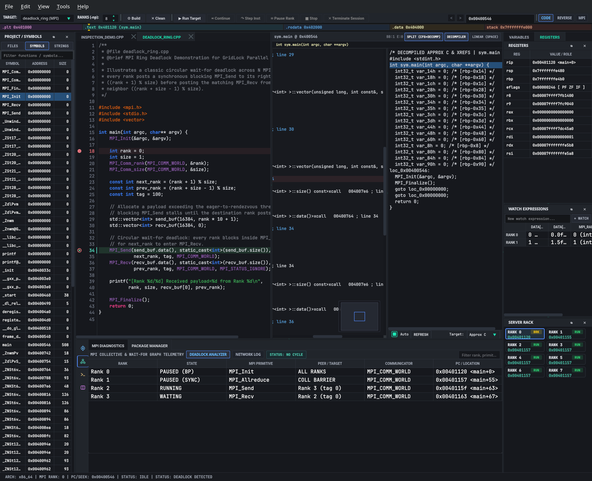
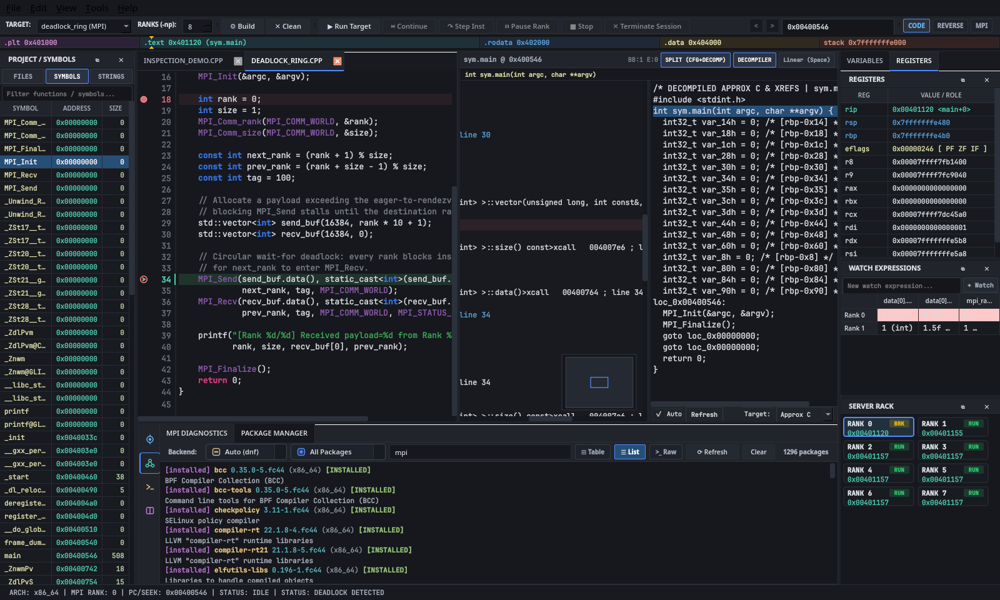

# GridLock v0.7.0 User Guide

## 1. Launching & Stepping an MPI Target

1. **Select a Target and Rank Count (`-np`):**
   * Pick one of the bundled MPI programs (`inspection_demo (MPI)`, `deadlock_ring (MPI)`) or choose `Open ELF / Binary...` in the **TARGET** dropdown on the main toolbar.
   * Set the number of MPI processes (`1..64`) in the **RANKS (-np)** spin box.
2. **Start the Session (`▶ Run Target`):**
   * While idle, only `▶ Run Target` is enabled; stepping and stop buttons remain disabled until a target is running.
   * Clicking `▶ Run Target` starts the MPI ranks in the **Server Rack** panel, pauses Rank 0 at `main`, marks the active source line in `SourceCodeView`, and enables the stepping controls.
3. **Step Instructions (`↷ Step Inst`):**
   * Clicking `↷ Step Inst` advances the active rank's instruction pointer (`rip`) and updates the disassembly view, CFG, decompiler, registers, rank status cards, memory view, and source editor together.
4. **Stop or Terminate (`■ Stop` / `✕ Terminate Session`):**
   * Ends the debugging session, clears the execution marker, and returns the toolbar to its idle state.

---

## 2. Editor Gutter & Conditional Breakpoint Popover

* **Two-Lane Gutter (`SourceCodeView`):** The source editor gutter keeps breakpoint markers (`●`), conditional breakpoint badges (`?`), and the current execution arrow (`▶`) in their own column next to the line numbers so they never overlap.
* **Hover Preview:** Moving the cursor over the gutter highlights the line and shows a faint preview dot where a click will toggle a breakpoint.
* **Conditional Breakpoint Popover (`ConditionalBreakpointDialog`):** Right-clicking a line in the gutter opens a compact popover right next to the cursor:
  * **Line Preview:** Shows the line number and the C/C++ statement at that line.
  * **Rank Filter:** Choose **All MPI Ranks** or **Focused Rank Only** to control which ranks stop at the breakpoint.
  * **`clangd` Autocomplete:** As you type a condition (such as `rank == 0` or `data[i].`), GridLock feeds the expression to `clangd` at that line in the file so you get completion suggestions for local variables and struct fields.
  * **Save or Remove:** Press `Enter` (`Done`) to apply the condition, or click **Remove Breakpoint** to delete it.

---

## 3. Bottom Tool Rail & Panel Groups

Instead of cramming all seven bottom panels into a single crowded tab bar, the bottom dock uses a vertical icon rail on the left to switch between four focused groups:

* **`Debug`:** Shows **GDB Console**, **Memory View**, and **Evaluator** for low-level process inspection.
* **`MPI`:** Shows **MPI Diagnostics** and **Package Manager**. Inside **MPI Diagnostics**, a single toolbar switches between the `DEADLOCK ANALYZER` and `NETWORK LOG` views, displays a quick rank summary, and lets you export a diagnostic report.
* **`Terminal`:** Opens the embedded PTY **Terminal** (`QTermWidget`).
* **`Docs`:** Opens the offline **Reference Manual** for browsing Zeal docsets and system `man` pages.

---

## 4. Searching HPC & System Packages (`"mpi"` Walkthrough)

The **Package Manager** tab (`HpcConsoleWidget`) lets you check which MPI libraries and development packages are installed on your workstation or cluster node without leaving the debugger:

1. **Supported Package Managers:** Checks for available backends automatically in order: **Spack** (`spack`), **Pacman** (`pacman`), **DNF** (`dnf`), **APT** (`apt` / `dpkg-query`), **Zypper** (`zypper`), **RPM** (`rpm`), and **EasyBuild** (`eb`).
2. **Searching for `"mpi"` Packages:**
   * Click `MPI` on the bottom tool rail and select the **Package Manager** tab.
   * Type `"mpi"` into the search box or click **Refresh**.
   * Filter by **All**, **Installed Only**, or **Available**, or pick a specific package manager from the **Backend** dropdown.
3. **Display Modes (`Table` | `List` | `Raw`):**
   * **Table:** Sortable columns (`Package Name`, `Version`, `Arch`, `Source / Repo`, `Status`, `Summary`) showing installed and available packages (such as `openmpi`, `mpich`, `hypre`, `fftw-mpi`, and `scalapack`).
   * **List:** Summary cards showing package name, version, repository, install status, and description.
   * **Raw:** Unformatted command-line output from the underlying package manager.

---

## 5. SLURM Batch Script Import & Project Build Runner

### Importing `#SBATCH` Job Scripts (`Edit -> Preferences -> HPC / Cluster`)
* Click **Browse / Load Batch Script...** or paste a SLURM batch script into the **SLURM Batch Script Auto-Detector** box in `PreferencesDialog`.
* GridLock reads common `#SBATCH` flags (`--job-name`, `--partition`, `--account`, `--qos`, `--nodes`, `--ntasks`, `--ntasks-per-node`, `--cpus-per-task`, `--gres`, `--mem`, `--time`, `--constraint`, `--reservation`, `--chdir`, `--output`, `--error`) along with `module load` lines and fills in the cluster launch settings automatically.

### Building Projects (`Build -> Build Target (F7)` / `Clean` / `Rebuild`)
* GridLock checks the project directory and runs the matching build tool:
  * **Meson (`meson.build`):** Runs `ninja -C builddir` (and `ninja -C builddir -t clean`).
  * **CMake (`CMakeLists.txt`):** Runs `cmake --build build --parallel` (and `cmake --build build --target clean`).
  * **GNU Make (`Makefile`):** Runs `make -j$(nproc)` (and `make clean`).
  * **Single MPI Source File:** Compiles standalone `.cpp` or `.c` files with `mpicxx -g -O0` (falling back to `g++ -g -O0`).

---

## 6. Switching Perspectives (`Alt+1` / `Alt+2` / `Alt+3`)

* **`CODE` (`Alt+1`):** Side-by-side C/C++ source editor and disassembly view for normal source and instruction stepping.
* **`REVERSE` (`Alt+2`):** Hides the source editor and gives the full center area to the split **CFG + Decompiler** view.
* **`MPI` (`Alt+3`):** Focuses the **MPI Diagnostics** panel (`Deadlock Analyzer` and `Network Log`) and expands the bottom dock.
* **Maximize Bottom Dock (`Ctrl+M`):** Toggles the bottom dock between its normal height and an expanded view when reading long logs or documentation.

---

## 7. Binary Navigation, Cross-References, Patching & Docs (`F1`)

* **Jump to Address or Symbol (`Ctrl+G`):** Type a hex address (`0x00401149`) or symbol name (`sym.main`) in the toolbar seek box to jump both `DisassemblyView` and `MemView` to that location.
* **Cross-References (`X`):** Press `X` on an instruction in `DisassemblyView` to open `XrefInspectorDialog` and see incoming callers/branches (`XREFS TO`) and outgoing calls/jumps (`XREFS FROM`).
* **Patching Instructions & Bytes (`Ctrl+Shift+P` / `Ctrl+E`):** Replace instructions in `DisassemblyView` or edit raw bytes in `MemView`, then write out a patched ELF binary via `MainWindow::exportPatchedBinary`.
* **Offline Documentation (`F1`):** Press `F1` on an MPI call (`MPI_Init`, `MPI_Send`, `MPI_Recv`, `MPI_Barrier`, `MPI_Allreduce`) or standard C/POSIX function to look up its page in the **Reference Manual** tab.
