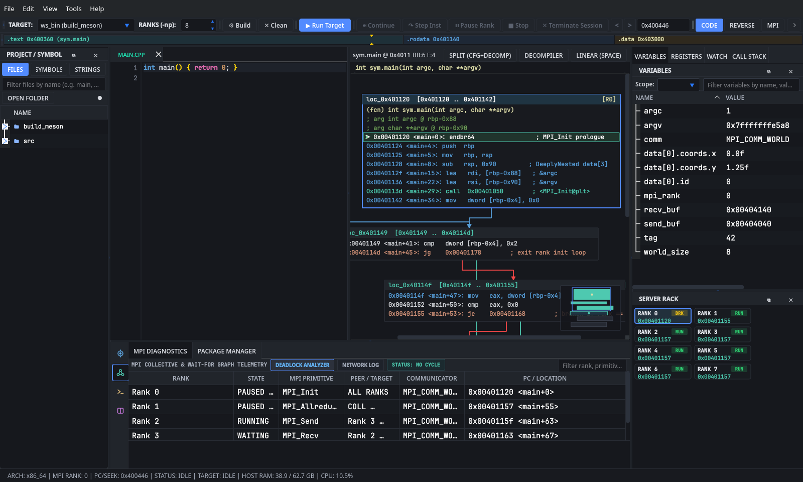
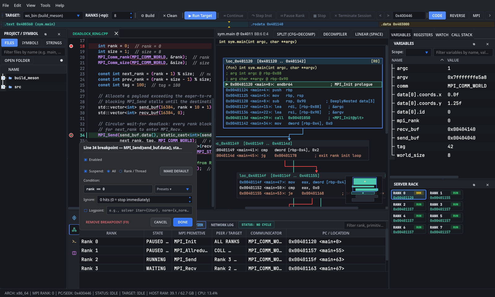
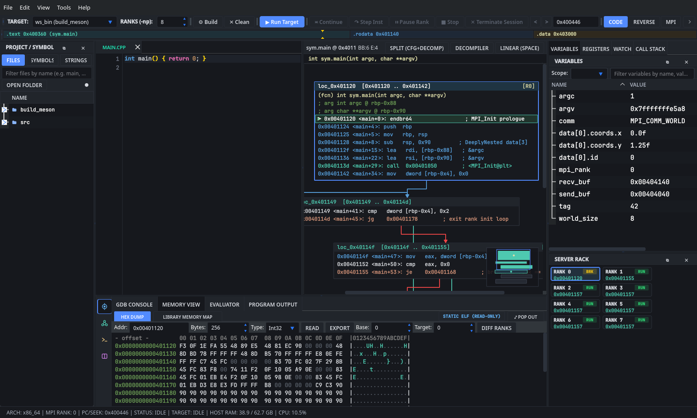

# User Manual: UI and Debugging Reference

This manual documents every workspace perspective, menu action, toolbar control, dock widget, breakpoint/logpoint/watchpoint option, and keyboard shortcut in GridLock (`v0.8.66`).

---

## 1. Workspace Perspectives (`Alt+1`, `Alt+2`, `Alt+3`)

Switch perspectives from the right side of the main toolbar (`CODE | REVERSE | MPI`) or via keyboard shortcuts:

* **`CODE` (`Alt+1`)**: Default side-by-side layout pairing the multi-tab source editor (`EditorTabManager` / `SourceCodeView`) on the left with `DisassemblyView` on the right, flanked by `Project / Symbols` on the far left and `Variables`, `Registers`, `WATCH`, `CALL STACK`, and `Server Rack` on the right.
* **`REVERSE` (`Alt+2`)**: Collapses the source editor and gives the central viewport to `DisassemblyView` in 50/50 **`SPLIT (CFG+DECOMP)`** mode (2D basic-block Control Flow Graph paired with the pseudo-C/C++ decompiler).
* **`MPI` (`Alt+3`)**: Activates the `MPI` group on the bottom tool rail, switches `BottomConsoleTabs` to **`MPI Diagnostics`**, and expands the bottom dock for cluster stall inspection.

Press **`Ctrl+M`** at any time to toggle maximizing and restoring the height of the bottom console dock.

---

## 2. Menu Bar Reference

### `File` Menu

| Menu Action | Shortcut | Behavior |
| :--- | :--- | :--- |
| `New Project...` | - | Opens the 2-page `ProjectWizard` to configure workspace root, binary, arguments, `-np` ranks, and OpenMPI binding/output flags, then starts a session. |
| `Open Workspace...` | - | Switches active workspace root (`switchWorkspaceDirectory`), re-roots `ProjectExplorerWidget`, scans for ELF binaries and sources, and cd's the embedded terminal. |
| `Open Source File` | - | Opens a `.cpp`, `.hpp`, `.h`, or `.c` file in `EditorTabManager`. |
| `Save Source File` | `Ctrl+S` | Saves the active modified buffer in `SourceCodeView`. |
| `Save All` | `Ctrl+Shift+S` | Saves all dirty tabs (`●` indicator) in `EditorTabManager`. |
| `Switch Header/Source` | `F10` | Toggles between matching `.cpp`/`.c` and `.hpp`/`.h`/`.hxx`/`.hh` files in the same directory. |
| `Save Session` | - | Writes watched variables, active breakpoints, and focused rank to `<workspace>/.gridlock/workspace.toml`. |
| `Save Session As...` | - | Exports the current session state to a chosen `.toml` file. |
| `Load Session...` | - | Restores watched variables, breakpoints, and rank selection from a `.toml` session file. |
| `Recent Sessions` | - | Lists up to 10 recent workspace/session paths (`debugger.conf`) plus `Clear Recent Sessions`. |
| `Project Settings` | - | Opens `ProjectSettingsDialog` (`Target Binary`, `Program Arguments`, `Working Directory`, `MPI Ranks (-np)`, `MPI Args`). |
| `Attach to Process...` | `Ctrl+Alt+P` | Opens the two-tab `AttachProcessDialog` (`Local Processes (/proc)` and `Remote Target (gdbserver / QEMU)`). |
| `Submit SLURM Job` | - | Substitutes `{FILE}` in the configured SLURM template and dispatches a preview submission to `MockHpcBackend`. |
| `Exit` | - | Closes GridLock (prompts on unsaved editor tabs and, if `Confirm Quit` is `Yes`, confirms exit). |

### `Edit` Menu

| Menu Action | Shortcut | Behavior |
| :--- | :--- | :--- |
| `Undo` / `Redo` | `Ctrl+Z` / `Ctrl+Shift+Z` | Undoes or redoes edits in the focused text editor. |
| `Cut` / `Copy` / `Paste` / `Select All` | `Ctrl+X` / `Ctrl+C` / `Ctrl+V` / `Ctrl+A` | Standard clipboard and selection operations on the focused editor. |
| `Find in View...` | `Ctrl+F` | Focuses and selects the toolbar address/symbol seek input (`#cutterSeekBar`). |
| `Go to Line...` | `Ctrl+L` | Jumps the active `SourceCodeView` cursor. |
| `Toggle Comment` | `Ctrl+/` | Prefixes or unprefixes selected lines in `SourceCodeView` with `// `. |
| `Go to Definition` | `F12` *(in editor)* | Resolves the symbol under the cursor via `ClangdLspClient` (`textDocument/definition`) and navigates to the target file and line. |
| `Preferences` | `Ctrl+,` | Opens the 8-page `PreferencesDialog`. |

### `View` Menu

| Menu Action | Shortcut | Behavior |
| :--- | :--- | :--- |
| `Toolbars -> Main Toolbar` | - | Shows or hides the top execution toolbar. |
| `Toolbars -> Address Space Navigation` | - | Shows or hides the ELF section navigation ribbon. |
| `Toolbars -> Reset Toolbars` | - | Re-shows all toolbars and snaps them back to the top toolbar area. |
| `Split Editor Right` | - | Splits `EditorTabManager` horizontally (`Qt::Horizontal`), opening the companion `.hpp`/`.cpp` file if found. |
| `Split Editor Down` | - | Splits `EditorTabManager` vertically (`Qt::Vertical`). |
| `Close Split` | - | Closes the secondary split editor pane. |
| `Redock All Floating Panels` | `Ctrl+Shift+R` | Docks all floating `QDockWidget` panels back into their home dock areas. |
| `Project / Symbols`, `Expression Evaluator`, `Variables`, `Registers`, `WATCH`, `Server Rack` | - | Checkable visibility toggles for each dock panel. |

### `Tools` and `Help` Menus

| Menu Action | Shortcut | Behavior |
| :--- | :--- | :--- |
| `Tools -> Build Target` | `Ctrl+B` | Auto-detects `Meson`, `CMake`, `Make`, or standalone `mpicxx`/`mpicc` and compiles the active target. |
| `Tools -> Clean Target` | - | Runs `ninja -t clean`, `cmake --target clean`, `make clean`, or removes the standalone compiled binary. |
| `Tools -> Rebuild Target` | - | Runs `Clean Target` followed by `Build Target`. |
| `Tools -> Run Tests` | - | Emits `runTargetRequested` (triggers `GridLockAutomationRunner` sequence in `--test-mode`). |
| `Tools -> Pointer & Struct Graph Visualizer...` | - | Opens the modeless `PointerGraphDialog` (`1100x720`) bound to the active coordinator and focused rank. |
| `Help -> About GridLock` | - | Displays build version metadata and open-source attributions. |

---

## 3. Main Toolbar & Address Space Navigation Ribbon

### Row 1: `Main Toolbar` (Left to Right)

1. **`TARGET:` (`#toolbarTargetSelector`)**: Lists the 7 bundled MPI showcase programs (or workspace ELF/source targets) plus `Open ELF / Binary...`.
2. **`RANKS (-np):` (`#toolbarRankSpin`)**: MPI world size (`1..256`, default `8`).
3. **`⚙ Build`** and **`✕ Clean`**: Compile or clean the selected target/workspace.
4. **`▶ Run Target`** (changes to **`● Running`** while active): Compiles on demand if needed and starts the debugging session.
5. **`⏭ Continue`**, **`↷ Step Inst`**, **`⏸ Pause Rank`**, **`■ Stop`**, **`✕ Terminate Session`**: Session execution controls (enabled only when a debug session is active).
6. **`<`** and **`>`**: Backward and forward address history navigation (`Alt+Left` / `Alt+Right`).
7. **Seek Bar (`Go to address / symbol (Ctrl+G)...`)**: Accepts hex addresses (`0x40113d`), symbol names (`main`, `MPI_Send`), or register expressions (`$rsp`).
8. **`CODE` | `REVERSE` | `MPI`**: Workspace perspective buttons (`Alt+1` / `Alt+2` / `Alt+3`).
9. **`⏺ Record`**, **`↶ Step Back`**, **`⏮ Rev Continue`**: Time-travel reverse debugging controls (`record full`, `-exec-next --reverse`, `-exec-continue --reverse` on GDB; `stepBack` / `reverseContinue` on DAP).

### Row 2: `Address Space Navigation` Ribbon (`22px`)

Displays proportional clickable segments for the loaded ELF64 binary: **`.plt`**, **`.text`** (annotated with `sym.main`), **`.rodata`**, **`.data`** (or **`.bss`**), plus a live **`stack 0x<rsp>`** segment while a debugging session is active. Clicking any segment seeks both `DisassemblyView` and `MemView` to that section's base virtual address.

---

## 4. Source Editor, `clangd` LSP, and Project Explorer

### `Project / Symbols` Dock (`ProjectExplorerWidget`)

Switch between three modes at the top of the left dock, all sharing a live wildcard/substring filter bar:
* **`FILES`**: Workspace file tree with `"Open Folder"` and Collapse-All buttons. Double-click a file to open it; press **`F2`** to rename; right-click for **`New Source File (.cpp)...`**, **`New Header File (.hpp)...`** (generates `#pragma once` stub), **`New Folder...`**, **`Rename...`**, and **`Delete...`** (with optional automatic source registration in `meson.build` or `CMakeLists.txt`).
* **`SYMBOLS`**: Sortable 3-column table (`SYMBOL`, `ADDRESS`, `SIZE`) of up to 800 `STT_FUNC` and `STT_OBJECT` symbols extracted by `ElfBinaryInspector`. Double-click any row to seek to that symbol.
* **`STRINGS`**: Sortable 3-column table (`ADDRESS`, `SECTION`, `STRING`) of up to 500 printable ASCII strings (`>= 4` chars) from `.rodata`, `.dynstr`, and `.interp`.

### `SourceCodeView` & `EditorTabManager`

* **Scope Breadcrumbs & Git Diff Gutter**: Displays `File > Class/Struct > Function` above the editor and marks `Added` (green), `Modified` (blue), and `Deleted` (red triangle) lines against `HEAD` on the right edge of the line-number gutter.
* **Multi-Language & Rainbow Bracket Highlighting (`EditorSyntaxHighlighter`)**: Highlights C/C++/CUDA (including bold purple `MPI_*` calls), `TOML`, `YAML`, `Markdown`, and `CSV`/`TSV` (6-color alternating column rotation), with 5-level cyclic rainbow brackets (`()`, `{}`, `[]`) and red underlines on unmatched closing brackets.
* **`clangd` LSP Integration (`ClangdLspClient`)**:
  * Automatically locates `compile_commands.json` across `.`, `builddir/`, `build/`, `build_meson/`, and `build_cmake/`.
  * Draws wavy error (`#f7768e`) and warning (`#e0af68`) underlines from `textDocument/publishDiagnostics`.
  * Triggers `LspCompletionPopup` on `.`, `->`, `::`, or **`Ctrl+Space`**.
  * Shows type/Doxygen hover cards (`HoverWidget`) after a `400 ms` hover, jumps to definitions on **`F12`**, and supports `findReferences` and AST-safe `renameSymbol`.
* **Inline Variable Ghost Values**: When paused at a breakpoint or stack frame, appends muted italic `// var = val` annotations (up to 4 variables per visible line, including `struct.member` chains) at the end of source lines. Toggle in `Preferences -> Editing`.
* **Quick Watch Pinning**: **`Ctrl+LeftClick`** or **`DoubleClick`** any identifier in `SourceCodeView` to pin it to the `WATCH` (`DifferentialGrid`) dock.

---

## 5. Breakpoints, Logpoints, and Hardware Watchpoints

### Gutter Interactions & `ConditionalBreakpointDialog`

* **Left-Click Gutter**: Toggles an unconditional All-Ranks breakpoint (`●` crimson circle with white ring).
* **Right-Click Gutter**: Opens the cursor-anchored **`ConditionalBreakpointDialog`** (`380px` callout popover):
  * **`Enabled`**: Unchecking and clicking `Done` deletes the breakpoint (or click **`Remove Breakpoint (F9)`**).
  * **`Suspend: All | Rank / Thread`**: Choose **`All`** (`rankFilter = -1`, stops every rank) or **`Rank / Thread`** (stops only the currently focused rank, rendered with a per-rank colored badge and rank number). Click **`Make Default`** to persist your preferred scope.
  * **`Condition:`**: Enter any C/C++ boolean expression (for example `rank == 0 && data[i].coords.x > 1.0`) with live `clangd` virtual-buffer autocomplete, or pick from **`Presets ▾`** (`rank == 0`, `rank > 0`, `rank == size - 1`, `i == 0`, `i == 2`).
  * **`Ignore:`**: Skip the first `N` hits (`0..10,000,000`) via GDB `-break-insert -i N` / `-break-after` or DAP `hitCondition`.
  * **`Logpoint:`**: Check **`Logpoint:`** (which automatically unchecks `Suspend:` so ranks do not stall MPI barriers) and enter a trace message containing `{identifier}` placeholders, such as `iter={step}, ghost={left_ghost}`. On hit, `GdbRankCoordinator` formats `[LOGPOINT Rank r] ...` into **`Program Output`** and immediately resumes execution (`-exec-continue`). Logpoints render as an amber diamond with a cyan border in the gutter.
* **Editor Body Right-Click Menu**: Also provides `Set Breakpoint (All Ranks)`, `Set Breakpoint for Active Rank (Rank N)`, and `Set Breakpoint for Rank...` (`0..4095`).

### Hardware Data Watchpoints (`Variables` Dock)

Right-click any scalar variable, struct member, or array element in the **`Variables`** dock and choose:
* **`Watch Memory Write (Hardware Watchpoint)`**: GDB `-break-watch <expr>` / DAP `write`.
* **`Watch Memory Read (Hardware Watchpoint)`**: GDB `-break-watch -r <expr>` / DAP `read`.
* **`Watch Memory Read/Write (Hardware Watchpoint)`**: GDB `-break-watch -a <expr>` / DAP `readWrite`.

When triggered, GridLock pauses the offending rank and reports the expression, old value, and new value.

---

## 6. Right-Side Inspection Docks & Bottom Tool Rail

### Right-Side Docks

* **`Variables` (`VariablesDockWidget`)**: Sortable 3-column tree (`Name`, `Value`, `Type`) with a `Scope:` rank selector and recursive filter box. Lazily expands C++ structs, base classes, and `std::vector` elements; highlights mutated scalars in coral (`#f38ba8`); left-clicking a `0x...` pointer reads 256 bytes in `Memory View`; right-clicking promotes to `WATCH`, opens `PointerGraphDialog`, or sets a hardware watchpoint.
* **`Registers` (`RegisterView`)**: Sortable 2-column table (`REG`, `VALUE / ROLE`) pinning `rip`, `rsp`, and `rbp` at the top, highlighting changed registers in bold red, filtering by register name or hex/unsigned-decimal value, and jumping to pointer targets on double-click.
* **`WATCH` (`DifferentialGrid`)**: Cross-rank expression matrix (`Rank 0 .. Rank N-1` rows by watched expression columns). Add expressions in the `New watch expression...` input (`+ Watch`). Cells that diverge from the column's majority consensus value are highlighted in light red (`rgb(255, 200, 200)`).
* **`CALL STACK` (`CallStackDockWidget`)**: Displays an OS/OpenMP **`Thread:`** selector (`-thread-info` / DAP `threads`) above a 4-column backtrace table (`#`, `Function`, `Location`, `Address`) up to 64 frames deep. Clicking any frame selects that thread and frame (`-thread-select`, `-stack-select-frame`), updating `Variables`, `Registers`, `SourceCodeView`, and `DisassemblyView`.
* **`Server Rack` (`ServerRackView`)**: Wrapping grid of rank cards showing `RANK N`, state pill (`RUN`, `BRK`, `IDLE`), and current PC (`0x...`). Clicking a card switches the focused rank across the entire IDE.

### Bottom Tool-Window Icon Rail (`Alt+4` .. `Alt+7`)

| Rail Button | Shortcut | Hosted Bottom Tabs |
| :--- | :--- | :--- |
| **`Debug`** | `Alt+4` | **`GDB Console`** (target rank selector `All Ranks` / `Rank N`, stream filter, `Raw MI` toggle, and `MiSanitizer`-validated `gdb>` prompt), **`Memory View`** (`HEX DUMP` and `LIBRARY MEMORY MAP`), **`Evaluator`** (`DWARF / C++ EVALUATOR` with `All Ranks` / `Rank N` selector and `+ Watch` promotion), and **`Program Output`** (launch command `COPY`, rank filter, stdout/stderr & `[LOGPOINT]` stream). |
| **`MPI`** | `Alt+5` | **`MPI Diagnostics`** (`DEADLOCK ANALYZER` and `NETWORK LOG`) and **`Package Manager`** (`HpcConsoleWidget`). |
| **`Terminal`** | `Alt+6` | **`Terminal`** (`QTermWidget` `xterm-256color` truecolor Linux PTY synchronized to the workspace directory). |
| **`Docs`** | `Alt+7` | **`Reference Manual`** (`DOCSETS` SQLite3 Zeal viewer + `MAN PAGES` `man -Thtml` viewer + built-in MPI/x86_64/GDB-MI cards). |

---

## 7. Complete Keyboard Shortcut Reference

| Shortcut | Action | Context / Scope |
| :--- | :--- | :--- |
| `Alt+1` / `Alt+2` / `Alt+3` | Switch to **`CODE`** / **`REVERSE`** / **`MPI`** workspace perspective | Global (`MainWindow`) |
| `Alt+4` / `Alt+5` / `Alt+6` / `Alt+7` | Switch bottom tool rail to **`Debug`** / **`MPI`** / **`Terminal`** / **`Docs`** | Global (`MainWindow`) |
| `Ctrl+M` | Maximize or restore bottom console dock height | Global (`MainWindow`) |
| `Ctrl+Shift+R` | Redock all floating dock panels | Global (`View` menu) |
| `Ctrl+Alt+P` | Open **Attach to Running Process / Remote GDB Target** dialog | Global (`File` menu) |
| `Alt+R` | Launch parallel debug session (`ShortcutManager`) | Global |
| `F5` | Continue execution on focused rank | Global (`ShortcutManager`) |
| `F10` | Step Over on focused rank (`ShortcutManager`) / Switch Header & Source (`File` menu) | Global / Editor |
| `F11` | Step Into on focused rank | Global (`ShortcutManager`) |
| `Alt+B` | Toggle breakpoint at current cursor line (`DapCoordinator`) | Global (`ShortcutManager`) |
| `Ctrl+B` | Build active target (`Tools -> Build Target`) | Global (`Tools` menu) |
| `Ctrl+S` / `Ctrl+Shift+S` | Save current file / Save all modified tabs | Source Editor |
| `Ctrl+/` | Toggle `// ` line comment | Source Editor |
| `Ctrl+L` | Go to line in active source editor | Source Editor |
| `Ctrl+Space` | Trigger `clangd` / structural code completion popup | Source Editor |
| `F12` | Go to symbol definition (`clangd` AST lookup) | Source Editor |
| `Ctrl+MouseWheel` | Zoom source editor font size (`6pt .. 72pt`) | Source Editor |
| `Ctrl+W, H` | Focus central source editor (`EditorTabManager`) | Global 2-key chord |
| `Ctrl+W, L` | Focus `Project / Symbols` explorer | Global 2-key chord |
| `F2` | Rename selected file or folder | `Project / Symbols` (`FILES`) |
| `F9` | Remove breakpoint | `ConditionalBreakpointDialog` |
| `Ctrl+G` / `Ctrl+F` | Focus toolbar address / symbol seek bar | Global (`MainWindow`) |
| `Ctrl+Shift+F` | Open Workspace Search dialog across symbols, strings, and disassembly | Global (`MainWindow`) |
| `Alt+Left` / `Alt+Right` | Navigate backward / forward in address history | Global (`MainWindow`) |
| `F1` | Look up symbol or mnemonic under cursor in `Reference Manual` | Global / Disassembly |
| `Space` | Toggle `DisassemblyView` between Linear Assembly and 2D CFG (`Space`+drag pans CFG) | `DisassemblyView` |
| `X` | Open `XrefInspectorDialog` (`XREFS TO` and `XREFS FROM`) for active address | `DisassemblyView` |
| `Ctrl+Shift+P` | Patch instruction at active address (`QInputDialog`, default `nop`) | `DisassemblyView` |
| `Left` / `Right` / `Home` | Pan CFG horizontally (`±48px`) / Snap CFG viewport back to active basic block | `DisassemblyView` (CFG) |
| `Ctrl+,` | Open `Preferences` dialog | Global (`Edit` menu) |
